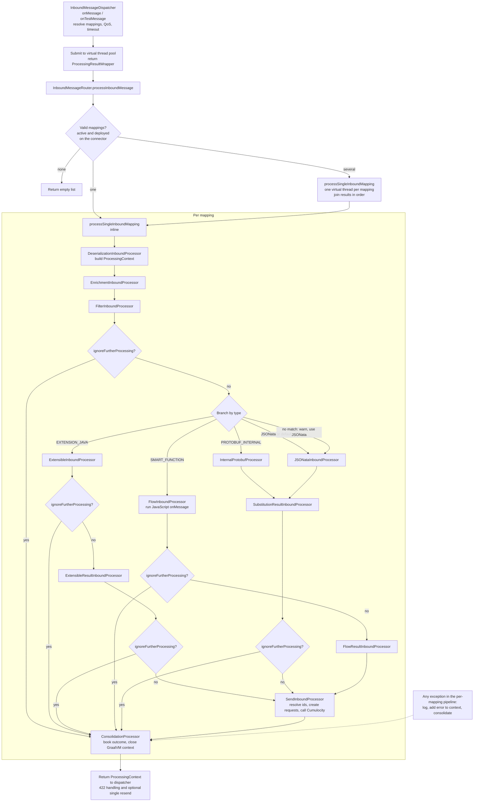

# Inbound processing chain — flow diagram

A single end-to-end view of the processor chain for inbound messages, from
`InboundMessageDispatcher` through `InboundMessageRouter`: mapping selection, deserialization,
enrichment, filtering, the transformation branch (internal Protobuf / Java extension / JSONata /
Smart Function) and consolidation.

This is a **supporting diagram**, not a feature page — it carries no requirements of its own.
The contract and the implementation detail live in
[mapping-processing-inbound.md](mapping-processing-inbound.md), whose mermaid diagrams cover
the dispatcher sequence and mapping-tree resolution in addition to the processor chain shown here.

Notes:

- `ConsolidationProcessor` is the single terminal step of every mapping, including filtered
  and failed ones.
- After `FlowResultInboundProcessor` there is no further ignore check; the context goes straight
  to `SendInboundProcessor`.
