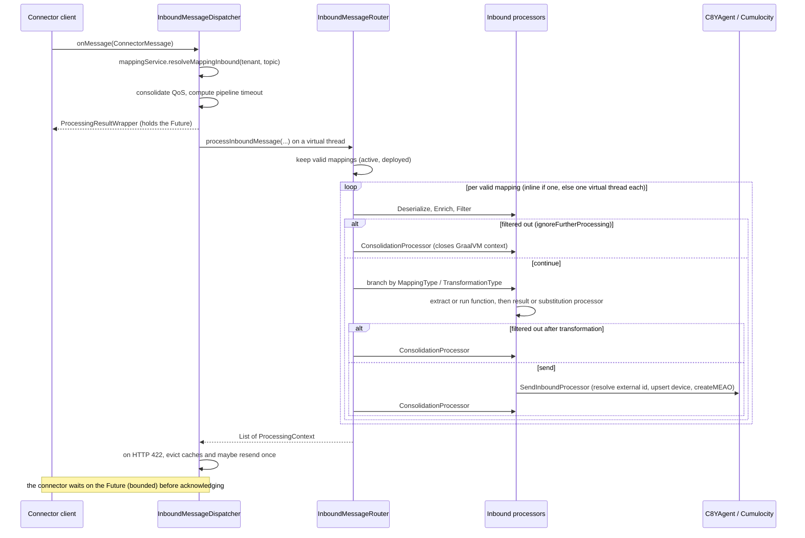
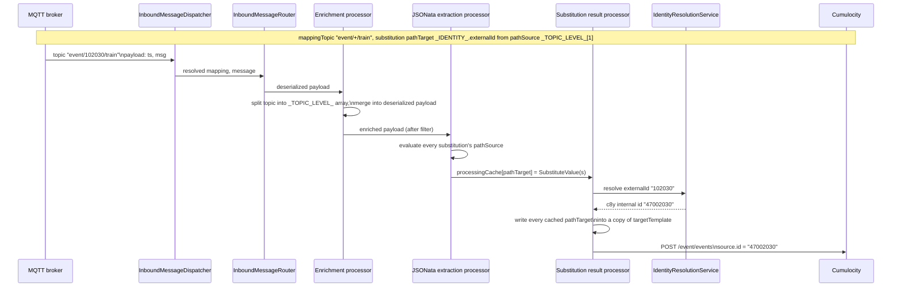
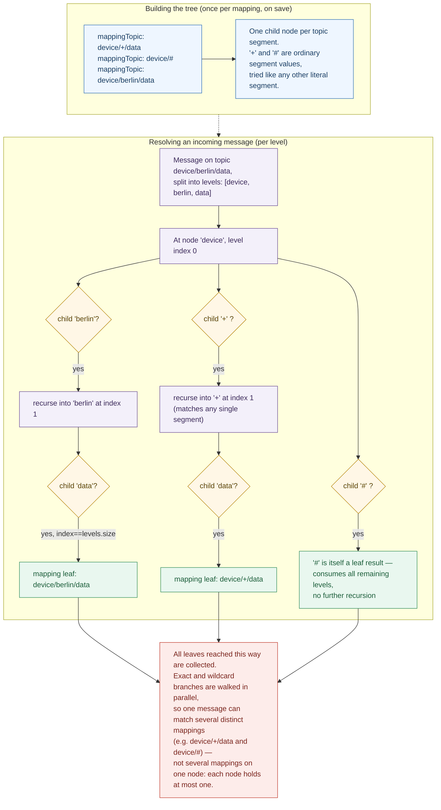

# Inbound Message Processing

Inbound processing turns a broker message (MQTT, Kafka, HTTP, AMQP, Pulsar) into one or
more Cumulocity IoT requests (measurement, event, alarm, inventory update, operation
update). It is an in-process pipeline: each connector hands the raw bytes to a single
dispatcher, which resolves the matching `Mapping`(s) and passes them to a router that runs a
fixed sequence of processing stages per mapping — deserialize, enrich, filter, transform,
substitute, send — each mapping on a virtual thread when several match. This page describes that pipeline's shape and sequencing; the transformation
mechanisms themselves (JSONata, Smart Functions, Java extensions) are documented
separately.

---

## Requirements

**What it is for.** Turning a message that arrived on a broker into Cumulocity data, according to
the mappings the tenant configured.

- **A message is offered to every mapping whose topic matches it.** One message can produce
  several Cumulocity objects through several mappings; a message matching none is counted and
  otherwise ignored.
- **Mappings only run on connectors they are deployed to.** Matching a topic is not enough.
- **The pipeline is: deserialize → enrich with identity → transform → send.** A failure at any
  stage stops that mapping's processing of that message, records the failure, and must not affect
  other mappings processing the same message.
- **A mapping may reject a message deliberately** via its filter expression. That is not a
  failure and must not be counted as one.
- **Payload formats supported inbound**: JSON, flat file, hexadecimal, Protobuf, Sparkplug B, and
  arbitrary payloads handled by an extension.
- **An array in the payload may produce one object per element**, when the mapping says so.
- **Processing must be bounded**: no message may occupy a worker indefinitely, and a runaway
  transformation must be stoppable — see [reliability.md](reliability.md).
- **Test runs must never change a mapping's runtime status** — no counters, no statistics, no failure streaks (so no auto-deactivation), whether the test is a Dry Run or a Live Test. See [`mapping-testing-isolation.md`](mapping-testing-isolation.md).

---

## Implementation

> For a single end-to-end picture of the processor chain described below, see
> [inbound-flow-diagram.md](inbound-flow-diagram.md).

### Where it runs

| Stage | Class | Role |
|---|---|---|
| Entry point | [`InboundMessageDispatcher`](../../dynamic-mapper-service/src/main/java/dynamic/mapper/processor/inbound/InboundMessageDispatcher.java) | Implements `GenericMessageCallback`; every connector calls `onMessage()` (live) or `onTestMessage()` (Dry Run / Live Test) with a `ConnectorMessage`. |
| Router | [`InboundMessageRouter`](../../dynamic-mapper-service/src/main/java/dynamic/mapper/processor/inbound/InboundMessageRouter.java) | Keeps only the valid mappings (active and deployed on the originating connector), then calls the processor beans below, in order, for each of them — inline for one mapping, one virtual thread per mapping for several. |
| Deserialize | [`DeserializationInboundProcessor`](../../dynamic-mapper-service/src/main/java/dynamic/mapper/processor/inbound/processor/DeserializationInboundProcessor.java) | Picks a `PayloadDeserializer` by `MappingType` and builds the `ProcessingContext` (carrying an error instead of throwing when deserialization fails). |
| Enrich | [`EnrichmentInboundProcessor`](../../dynamic-mapper-service/src/main/java/dynamic/mapper/processor/inbound/processor/EnrichmentInboundProcessor.java) (extends [`AbstractEnrichmentProcessor`](../../dynamic-mapper-service/src/main/java/dynamic/mapper/processor/AbstractEnrichmentProcessor.java)) | Injects `_TOPIC_LEVEL_`/`_CONTEXT_DATA_` into the payload (non-code mappings) or builds the GraalVM Smart Function config (code mappings); borrows a pooled GraalVM context when the mapping has `code`. |
| Filter | [`FilterInboundProcessor`](../../dynamic-mapper-service/src/main/java/dynamic/mapper/processor/inbound/processor/FilterInboundProcessor.java) | Evaluates `mapping.getFilterMapping()` (a JSONata boolean expression) against the deserialized payload; inbound-only, no equivalent on the outbound route. |
| Transform (dispatch) | `InboundMessageRouter.processSingleInboundMapping()` if/else chain (predicates in [`MessageRoutingSupport`](../../dynamic-mapper-service/src/main/java/dynamic/mapper/processor/util/MessageRoutingSupport.java)) | Calls one of `processInternalProtobuf` / `processExtension` / `processJSONataExtraction` / `processFlowFunction` based on `mapping.getMappingType()`/`getTransformationType()`; unmatched types log a warning and fall back to JSONata. |
| Substitute | [`SubstitutionResultInboundProcessor`](../../dynamic-mapper-service/src/main/java/dynamic/mapper/processor/inbound/processor/SubstitutionResultInboundProcessor.java) | Applies cached `SubstituteValue`s to `targetTemplate`, resolves `_IDENTITY_.*`, builds one `DynamicMapperRequest` per device (cardinality), evaluates `filterInventory`. |
| Send | [`SendInboundProcessor`](../../dynamic-mapper-service/src/main/java/dynamic/mapper/processor/inbound/processor/SendInboundProcessor.java) | Resolves external IDs to C8Y source IDs, upserts devices, calls `C8YAgent.createMEAO`, merges multiple MEASUREMENT requests into one bulk request, creates processing alarms, handles SparkPlug B birth/active-state bookkeeping. |
| Cleanup | [`ConsolidationProcessor`](../../dynamic-mapper-service/src/main/java/dynamic/mapper/processor/util/ConsolidationProcessor.java) | Called before every terminal return of a single mapping's pipeline: clears the mapping's consecutive-failure streak on a clean run, books the outcome (processed / filtered / failed) on the mapping status, and closes the context's GraalVM resources (idempotent — the one point every mapping passes through, including early exits). Status updates are skipped for test runs (`affectsMappingStatus()`). The name is historical. |

### End-to-end flow

### Worked example

A concrete run through the diagram above, for a mapping with `mappingTopic: "event/+/train"`
and a substitution `_TOPIC_LEVEL_[1]` → `_IDENTITY_.externalId`:

How the mapping in that example was found in the first place — the topic-matching tree
(`MappingTreeNode`) that resolves `event/102030/train` to `event/+/train` — one node per topic
segment, `+`/`#` wildcards are ordinary segment values in that tree, walked one level at a time
with exact-match and wildcard branches followed in parallel so a single message can match more
than one mapping:

The levels of the Mapping Topic are split and added to the source payload as `_TOPIC_LEVEL_`, e.g.
`["device", "express", "berlin_01"]` for topic `device/express/berlin_01` — see
[`MappingTreeNode.resolveTopicPath`](../../dynamic-mapper-service/src/main/java/dynamic/mapper/model/MappingTreeNode.java)
and [mapping-validation.md](mapping-validation.md).

### Dispatch and resolution (`InboundMessageDispatcher`)

`onMessage()`/`onTestMessage()` both funnel into `processMessage()` of
[`InboundMessageDispatcher`](../../dynamic-mapper-service/src/main/java/dynamic/mapper/processor/inbound/InboundMessageDispatcher.java):

1. System topics (`$SYS*`), a null topic and null payloads are dropped immediately. For live
   traffic (not test runs) the inbound message counter and timer metrics are updated.
2. Mappings are resolved for the topic via `mappingService.resolveMappingInbound(tenant, topic)`
   — or, for a test call, the single `testMapping` passed in is used directly. If none match, the
   message is counted on the catch-all `Mapping.UNSPECIFIED_MAPPING` status (live traffic only);
   a resolution failure increments that status's error counter. Their QoS is consolidated via
   `connectorClient.determineMaxQosInbound()` into the wrapper's `consolidatedQos`, which decides
   when the connector acknowledges the message — see [`reliability.md`](reliability.md).
3. `testing` is computed as `testMapping != null && !sendPayload` — a Dry Run uses mocked
   identity/inventory lookups, but for a Live Test (`sendPayload=true`) the mapping runs against
   real Cumulocity services, against a test device the test controller has ensured beforehand
   (registered under `d11r_liveTest_` + the external ID). Whether the message counts for the mapping's
   status is a separate question, answered by `ProcessingContext.affectsMappingStatus()`. See
   [`mapping-testing.md`](mapping-testing.md).
4. A pipeline timeout is computed: 0 for template-based mappings, or
   `serviceConfiguration.getEffectivePipelineTimeoutMS()` when any resolved mapping has
   `isTransformationAsCode()` (Smart Functions). That value is the configured
   `pipelineTimeoutMS` (default 8000 ms), raised to `maxCPUTimeMS` + 3000 ms if the configuration
   does not exceed the CPU budget. It covers the GraalVM CPU-time bound (context interruption)
   plus the Cumulocity REST calls that follow. It is stored on the wrapper
   (`setPipelineTimeoutMS`) and enforced by the connector callbacks, which — when it is 0 — wait at
   most `ServiceConfiguration.PROCESSING_HARD_CEILING_MS` (120 s) so no message occupies a worker
   indefinitely (see `CHANGES.md`, "Processing timeouts are bounded and consistent").
5. The whole per-message pipeline is submitted to a virtual-thread pool
   (`virtualThreadPool.submit`); the returned `Future` is stored in the
   `ProcessingResultWrapper` that `onMessage()` returns, so the connector can wait on, or cancel,
   processing. If cancellation was already requested before the worker reaches the router, it
   returns without processing.
6. After the router returns, any resulting request that failed with HTTP 422 causes the resolved
   external-ID cache entries to be evicted (both the inbound external-ID cache reached through
   the cache manager and the separate cache in `TenantRegistry` used by
   `IdentityResolutionService`) and, if the mapping has `createNonExistingDevice` set, the whole
   message is resent once through the router. A failure of the retry is logged only. See
   [`identity-resolution.md`](identity-resolution.md) for why there are two caches.

### Router structure (`InboundMessageRouter`)

[`InboundMessageRouter`](../../dynamic-mapper-service/src/main/java/dynamic/mapper/processor/inbound/InboundMessageRouter.java)
is a Spring `@Component` extending `MessageRoutingSupport` (shared predicates and error logging
used by the inbound and outbound routers). Its method chain is:

- `processInboundMessage()` — the entry point called by the dispatcher.
  - Returns an empty list when no mappings were passed.
  - Filters candidates with `isValidMapping`: a mapping must be active and deployed on the
    originating connector (`isMappingDeployed`, which falls back to "deployed" if the check itself
    throws). The test connector processes every mapping unfiltered.
  - With exactly **one** valid mapping, `processSingleInboundMapping()` runs inline on the
    calling virtual thread.
  - With **several**, each runs on its own virtual thread (`virtualThreadPool.submit`), so
    **each matching mapping for a topic is processed as an independent parallel unit**. Each
    `Future` is registered on the `ProcessingResultWrapper` (`registerWorkerFuture`) so
    cancellation can interrupt it directly. The router then joins the futures in order and
    returns the list of `ProcessingContext`s.
- `processSingleInboundMapping()` — the common prefix for every mapping: Deserialization →
  Enrichment → Filter. If `shouldIgnoreFurtherProcessing` is set after that, it calls
  `ConsolidationProcessor` and returns. Otherwise it branches on the first matching predicate:
  1. `processInternalProtobuf` (`MappingType.PROTOBUF_INTERNAL`)
  2. `processExtension` (`TransformationType.EXTENSION_JAVA` and an extension configured)
  3. `processJSONataExtraction` (JSONata, default, or no transformation type)
  4. `processFlowFunction` (`TransformationType.SMART_FUNCTION`)
  5. anything else logs a warning and falls back to `processJSONataExtraction`.
- The four branch methods each end with `ConsolidationProcessor`, and check
  `shouldIgnoreFurtherProcessing` between steps (consolidating and returning early when set):
  - `processInternalProtobuf`: `InternalProtobufProcessor` → `SubstitutionResultInboundProcessor` →
    `SendInboundProcessor`
  - `processExtension`: `ExtensibleInboundProcessor` → `ExtensibleResultInboundProcessor` →
    `SendInboundProcessor`
  - `processJSONataExtraction`: `JSONataInboundProcessor` → `SubstitutionResultInboundProcessor` →
    `SendInboundProcessor`
  - `processFlowFunction`: `FlowInboundProcessor` → (ignore check) → `FlowResultInboundProcessor` →
    `SendInboundProcessor`
- Error handling: any exception in `processSingleInboundMapping()` is logged by
  `handleRouteException`, added to the context as a `ProcessingException`, and the context is
  consolidated (so GraalVM resources are still released). The failed context is returned as that
  mapping's result and does not affect the other mappings. Failures inside
  `SendInboundProcessor` are isolated per request and recorded on the request.
- The `ProcessingContext` is passed as a plain object from processor to processor.

> **History:** the router's Javadoc notes that it mirrors the former Apache Camel
> `direct:processInboundMessage` → `direct:processSingleInboundMapping` routes, which were
> removed together with the Camel dependency.

### `ProcessingContext` and its focused sub-contexts

`ProcessingContext<O>` ([`ProcessingContext.java`](../../dynamic-mapper-service/src/main/java/dynamic/mapper/processor/runtime/ProcessingContext.java))
is the per-message (per-mapping) state object passed as an argument from processor to
processor. It is `AutoCloseable`: `close()` releases GraalVM resources — either returning a pooled `Context` to the pool via
`engineReleaseAction`, or closing a non-pooled `Context` directly — and is called by
`ConsolidationProcessor` on every terminal path of the router so a filtered-out mapping still releases its
JS context.

Several fields on `ProcessingContext` (`requests`, `errors`, `warnings`, `logs`,
`processingCache`) already use thread-safe collections (`CopyOnWriteArrayList`,
`ConcurrentSkipListMap`) because a context can be touched from more than one virtual thread (for example the worker
and a cancelling connector callback). On top of that, `ProcessingContext` exposes
two **read-only projections** used to narrow method signatures:

| Context class | Getter on `ProcessingContext` | Fields | Notes |
|---|---|---|---|
| [`RoutingContext`](../../dynamic-mapper-service/src/main/java/dynamic/mapper/processor/runtime/RoutingContext.java) | `getRoutingContext()` | `topic`, `clientId`, `api`, `qos`, `resolvedPublishTopic`, `tenant` | `@Value` (Lombok immutable); `with*` methods return a new copy. |
| [`DeviceContext`](../../dynamic-mapper-service/src/main/java/dynamic/mapper/processor/runtime/DeviceContext.java) | `getDeviceContext()` | `sourceId`, `externalId`, `deviceName`, `deviceType`, `deviceFragments`, `deviceGroups`, `alarms` | Immutable, copy-on-write via `with*`. **Read-only projection — there is no `syncFromDeviceContext()`**, deliberately: `ProcessingContext` stays the single mutable owner. |

Both are snapshots with no sync-back, so they cannot be used to mutate state. To change state,
mutate `ProcessingContext` directly — its fields are already concurrent.

[`OutputCollector`](../../dynamic-mapper-service/src/main/java/dynamic/mapper/processor/runtime/OutputCollector.java)
is a **standalone accumulator**, not a `ProcessingContext` view. Construct it with
`new OutputCollector()`, pass it down, and merge results up.

> **History:** earlier revisions also exposed `getPayloadContext()`, `getProcessingState()` /
> `syncFromState()` and `getOutputCollector()` / `syncFromOutputCollector()`. These were
> copy-out/copy-back adapters: sync-back *replaced* collections wholesale, which would have
> reintroduced lost updates on the parallel route that the concurrent fields above already make
> safe. They have been removed, along with the `PayloadContext` and `ProcessingState` classes.

**GraalVM lifecycle:** there is no separate `ExecutionContext` class. The pooled `Context`,
`Engine` reference and release callback live directly on `ProcessingContext`
(`graalContext`, `pooledGraalContext`, `engineReleaseAction`), which implements
`AutoCloseable` for that purpose. Use `try (ProcessingContext<?> ctx = ...) { ... }` (or rely
on `ConsolidationProcessor`, which does this on every pipeline exit).

### Filtering (`FilterInboundProcessor`)

Runs once, right after enrichment, only for inbound. It evaluates `mapping.getFilterMapping()`
(a JSONata boolean expression) against the deserialized payload
([`FilterInboundProcessor`](../../dynamic-mapper-service/src/main/java/dynamic/mapper/processor/inbound/processor/FilterInboundProcessor.java)).
Mappings with a raw `byte[]` payload (`ANY_PAYLOAD`, `PROTOBUF_INTERNAL`) skip this filter, since
JSONata cannot evaluate raw bytes; an extension can still set `ignoreFurtherProcessing` itself.
A falsy result, or an expression that fails to evaluate, both set
`context.setIgnoreFurtherProcessing(true)` (with a warning on the context) — filter evaluation errors fail closed (the
message is dropped, not silently passed through), matching the outbound resolver's
`evaluateMessageFilter`/`evaluateInventoryFilter` behavior. There is a second,
post-substitution filter — `filterInventory` — applied later in
`SubstitutionResultInboundProcessor`, once the target device's C8Y source ID is known; see
[`mapping-validation.md`](mapping-validation.md) for the full validation rule set around both
filters.

### Transformation dispatch

The four transformation paths are documented individually — this page only covers how the
router selects and sequences them:

- [`transformation-jsonata.md`](transformation-jsonata.md) — JSONata substitutions (default).
- [`transformation-smart-functions.md`](transformation-smart-functions.md) — GraalVM-sandboxed JavaScript (`TransformationType.SMART_FUNCTION`).
- [`transformation-java-extensions.md`](transformation-java-extensions.md) — Java `ProcessorExtensionInbound<O>` plugins (`TransformationType.EXTENSION_JAVA`).

`MappingType.PROTOBUF_INTERNAL` is handled by `InternalProtobufProcessor` (using
`BytePayloadDeserializer`) directly in the router (`processInternalProtobuf`) and is not one of the three
pluggable transformation types above. `MappingType.SPARKPLUGB` is a separate mapping
type with its own dedicated codec (`SparkPlugBDeserializer`/`SparkPlugBSerializer`,
forced `SMART_FUNCTION` transformation per [mapping-validation.md](mapping-validation.md)
rule 4) — despite Sparkplug B also being protobuf-encoded on the wire, it is not routed
through `InternalProtobufProcessor`/`PROTOBUF_INTERNAL` and the two should not be
conflated.

### Substitution and identity resolution

`SubstitutionResultInboundProcessor` walks every `pathTarget` in
`context.getProcessingCache()` and writes the corresponding value into a copy of
`targetTemplate` for each device. The cardinality is the number of cached values for the
device-identifier `pathTarget`, after `BaseProcessor.validateProcessingCache()` has padded
that list up to the largest fan-out across all cached substitutions by repeating its first
entry. A `pathTarget` holding exactly one value is broadcast to every request; one holding
fewer values than the cardinality without being broadcastable falls back to its declared
`repairStrategy` (and to the `NOT_DEFINED` marker for `DEFAULT`/`CREATE_IF_MISSING`). Two
`pathTarget` values are handled specially before the generic JSONPath write, because they
drive Cumulocity identity:

- `_IDENTITY_.externalId` — resolves (or, if `mapping.getCreateNonExistingDevice()`, creates)
  the Cumulocity device for that external ID.
- `_IDENTITY_.c8ySourceId` — passes the value straight through as the device's C8Y internal
  ID; the device is assumed to already exist.

Full identity-resolution mechanics (caches, locking, implicit device creation) are in
[`identity-resolution.md`](identity-resolution.md).

Once requests are built, `SendInboundProcessor` processes them **sequentially**, in the order
they were produced; a failing request is recorded on that request and does not skip the rest.

### Sending (`SendInboundProcessor`)

Beyond resolving external IDs and creating/updating devices via `C8YAgent.upsertDevice()`
and `C8YAgent.createMEAO()`, this processor also:

- Merges multiple `MEASUREMENT` requests produced by one message (e.g. a Smart Function
  emitting several data points) into a single bulk `{"measurements": [...]}` request
  (`bulkMeasurementRequestsIfNeeded`).
- Creates a `WARNING` alarm (`Utils.MAPPER_PROCESSING_ALARM`) on the resolved source device
  for any entries in `context.getAlarms()` accumulated during processing.
- For `MappingType.SPARKPLUGB`: persists the NBIRTH/DBIRTH alias→metric map as a managed
  object fragment (`sparkPlugB_NBIRTH` / `sparkPlugB_DBIRTH_<deviceId>`) so later
  NDATA/DDATA messages can resolve metric aliases, and maintains
  `sparkPlugB_isActive[_<deviceId>]` flags from BIRTH/DATA/DEATH message types.

### Cancellation

Both `InboundMessageDispatcher` and the outbound dispatcher submit processing to a virtual
thread and store the `Future` on a `ProcessingResultWrapper`. A caller (e.g. a connector
detecting a processing timeout) can call `cancelProcessing()` on that wrapper, which sets a
`cancellationRequested` flag, interrupts the future, and runs any registered GraalVM
cancel-actions to abort CPU-bound JS execution. When the router fans out to several mappings,
each per-mapping worker future is registered on the wrapper too, so cancelling interrupts them
all, including workers blocked in Cumulocity HTTP calls. `cancelAndDrain()` additionally waits
briefly for the worker to leave and logs an error if it did not. `SendInboundProcessor` checks this flag
before doing any work so a cancelled pipeline doesn't still publish to Cumulocity.
