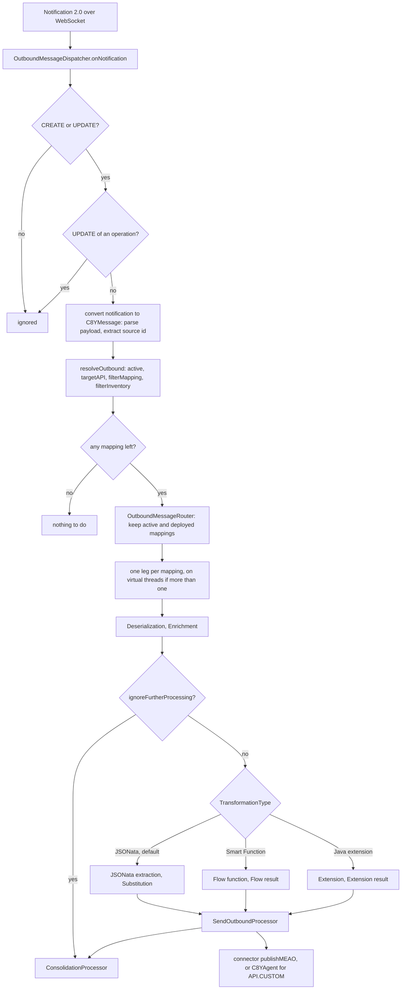
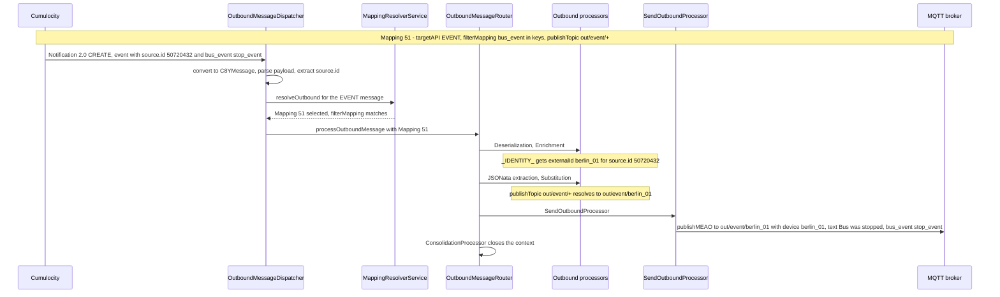

# Outbound Message Processing

Outbound processing turns a Cumulocity IoT change — a new measurement, event, alarm,
inventory update, or operation — into a message published to a broker (MQTT, Kafka, HTTP,
AMQP, Pulsar). Cumulocity delivers these changes as Notification 2.0 WebSocket
notifications; the mapper resolves which outbound `Mapping`(s) apply, transforms the
notification payload into the broker-side shape, and publishes it through the owning
connector. This page describes the pipeline shape; transformation internals are documented
separately (see the links below).

---

## Requirements

**What it is for.** Turning a change in Cumulocity — a measurement, event, alarm, operation or
inventory update — into a message published to a broker.

- **The tenant subscribes to what it wants forwarded.** Outbound processing only sees objects for
  devices that are subscribed; how a device becomes subscribed is a separate concern.
- **Outbound mapping can be switched off tenant-wide**, and then nothing is subscribed or
  published at all.
- **Every outbound mapping has a filter expression** deciding whether a given object is forwarded.
  It defaults to "forward everything" so the field is never implicitly empty.
- **The publish topic may be derived from the device**, so one mapping can serve many devices by
  resolving the device's external ID into the topic.
- **Internal metadata never reaches the broker.** Fields the mapper adds for its own use are
  stripped from the published payload.
- **The QoS a mapping asks for governs the publish**, clamped to what the connector supports —
  see [reliability.md](reliability.md).
- **Operations are forwarded on creation only.** Updates and deletions of an operation are
  deliberately ignored, since the device acts on the original.

---

## Implementation

### Where it runs

All outbound classes live in
[`processor/outbound/`](../../dynamic-mapper-service/src/main/java/dynamic/mapper/processor/outbound/).
The `ProcessingContext` of one mapping leg is passed from processor to processor as a plain
object; there is no message/exchange wrapper around it.

| Stage | Class | Role |
|---|---|---|
| Entry point | [`OutboundMessageDispatcher`](../../dynamic-mapper-service/src/main/java/dynamic/mapper/processor/outbound/OutboundMessageDispatcher.java) | One instance per connector; implements `NotificationCallback`. `onNotification()` (live WebSocket) and `onTestNotification()` (Dry Run / Live Test) both end up in `processNotification()` -> `convertNotificationToC8YMessage()` -> `processMessage()`. |
| Mapping resolution + filtering | [`MappingResolverService.resolveOutbound()`](../../dynamic-mapper-service/src/main/java/dynamic/mapper/mapping/resolver/MappingResolverService.java) (called via `MappingService.resolveMappingOutbound()`) | Selects active outbound mappings by `targetAPI`, then applies `filterMapping` and `filterInventory`, before any mapping enters the pipeline. |
| Router | [`OutboundMessageRouter`](../../dynamic-mapper-service/src/main/java/dynamic/mapper/processor/outbound/OutboundMessageRouter.java) (shared predicates in [`MessageRoutingSupport`](../../dynamic-mapper-service/src/main/java/dynamic/mapper/processor/util/MessageRoutingSupport.java)) | Keeps only active mappings that are deployed on the connector, then runs the processor chain below once per mapping. |
| Deserialize | [`DeserializationOutboundProcessor`](../../dynamic-mapper-service/src/main/java/dynamic/mapper/processor/outbound/processor/DeserializationOutboundProcessor.java) | Builds the `ProcessingContext` from the already-parsed `C8YMessage`. |
| Enrich | [`EnrichmentOutboundProcessor`](../../dynamic-mapper-service/src/main/java/dynamic/mapper/processor/outbound/processor/EnrichmentOutboundProcessor.java) (extends [`AbstractEnrichmentProcessor`](../../dynamic-mapper-service/src/main/java/dynamic/mapper/processor/AbstractEnrichmentProcessor.java)) | Extracts the source device ID, resolves the external ID, prepares the identity data for the transformation. |
| Transform | JSONata: [`JSONataOutboundProcessor`](../../dynamic-mapper-service/src/main/java/dynamic/mapper/processor/outbound/processor/JSONataOutboundProcessor.java) + [`SubstitutionResultOutboundProcessor`](../../dynamic-mapper-service/src/main/java/dynamic/mapper/processor/outbound/processor/SubstitutionResultOutboundProcessor.java); Smart Function: [`FlowOutboundProcessor`](../../dynamic-mapper-service/src/main/java/dynamic/mapper/processor/outbound/processor/FlowOutboundProcessor.java) + [`FlowResultOutboundProcessor`](../../dynamic-mapper-service/src/main/java/dynamic/mapper/processor/outbound/processor/FlowResultOutboundProcessor.java); Java extension: [`ExtensibleOutboundProcessor`](../../dynamic-mapper-service/src/main/java/dynamic/mapper/processor/outbound/processor/ExtensibleOutboundProcessor.java) + [`ExtensibleResultOutboundProcessor`](../../dynamic-mapper-service/src/main/java/dynamic/mapper/processor/outbound/processor/ExtensibleResultOutboundProcessor.java) | Chosen per mapping by `TransformationType` (see below). Each variant ends with the target request(s) in the context. |
| Send | [`SendOutboundProcessor`](../../dynamic-mapper-service/src/main/java/dynamic/mapper/processor/outbound/processor/SendOutboundProcessor.java) | Acknowledges operations, routes `API.CUSTOM` requests to `C8YAgent`, publishes the rest through the connector's `publishMEAO()`. |
| Terminal step | [`ConsolidationProcessor`](../../dynamic-mapper-service/src/main/java/dynamic/mapper/processor/util/ConsolidationProcessor.java) | Last step of every leg: clears the mapping's failure streak on a clean leg, books the outcome (processed / filtered / failed) on the mapping status, closes the context and its GraalVM resources. The name is historical. |

### End-to-end flow

### Notification arrival and message conversion

`onNotification()` receives a parsed `Notification` from the Notification 2.0 WebSocket
(device and device-group subscriptions are managed separately — see
[`NotificationSubscriptionService`](../../dynamic-mapper-service/src/main/java/dynamic/mapper/notification/NotificationSubscriptionService.java),
which subscribes/unsubscribes devices and device groups as mappings are deployed).

- Before anything else, `onNotification()` forwards `CREATE`/`UPDATE` notifications (except
  `UPDATE` of an operation) to the outbound Message Explorer listeners.
- A dispatcher that belongs to the `TEST` connector ignores live notifications; it only serves
  `onTestNotification()`.
- `processNotification()` drops the notification if a live connector is not connected, if the
  operation is not `CREATE`/`UPDATE`, or — outside of testing — if it is an `UPDATE` of an
  `API.OPERATION`.
- `convertNotificationToC8YMessage()` parses the body as JSON (`Json.parseJson`) into
  `parsedPayload`, takes `id` as message ID, and extracts `source.id` with a JSONata expression
  keyed by API (`notification.getApi().identifier`).

**This parsed payload is the raw Notification 2.0 message body as delivered by Cumulocity —
it is not necessarily the full managed object/measurement/event/alarm representation.** For
an `UPDATE` notification, Cumulocity sends only the changed fragments (a partial delta), not
a full re-fetch of the object.

### Filtering happens during mapping resolution, before the router

Unlike inbound (where `FilterInboundProcessor` is a pipeline stage), outbound filtering is
resolved entirely in
[`MappingResolverService.resolveOutbound()`](../../dynamic-mapper-service/src/main/java/dynamic/mapper/mapping/resolver/MappingResolverService.java)
(private `shouldProcessMapping()`), which `OutboundMessageDispatcher.processMessage()` calls
before the router sees any mapping. A mapping is selected only if, in order:

1. `mapping.getActive()` is true.
2. `mapping.getTargetAPI()` equals the notification's `API`.
3. If `filterMapping` is set (not blank and not the `"true"` default): `evaluateMessageFilter()`
   evaluates the JSONata expression **against `message.getParsedPayload()`** — i.e. the raw,
   possibly-partial notification body described above — and any evaluation error is treated
   as "no match" (fails closed).
4. If `filterInventory` is set: `evaluateInventoryFilter()` evaluates a separate JSONata
   expression against the **source device's full inventory representation** (looked up by
   `sourceId` via
   [`InventoryFilterEvaluator`](../../dynamic-mapper-service/src/main/java/dynamic/mapper/mapping/resolver/InventoryFilterEvaluator.java)),
   independent of whatever fields happen to be present in the notification delta. A missing
   `sourceId` fails the filter.

A test run (`onTestNotification()` with a mapping) skips resolution entirely: the mapping under
test is used as the only candidate, so neither filter is applied.

`filterMapping` runs against the partial Notification 2.0 payload (also described in the
[user guide](../../dynamic-mapper-ui/public/docs/define-subscription-for-outbound.md#outbound-filters)),
so a condition that depends on a fragment not included in a given `UPDATE` delta will not see
that fragment and will evaluate as if it were absent — even if the fragment does exist on the
object in Cumulocity. `filterInventory`, by contrast, always sees the complete current inventory
representation because it queries it separately. A filter that must be robust to partial
updates should use `filterInventory` rather than `filterMapping`.

There is deliberately **no** outbound equivalent of `FilterInboundProcessor` in the router:
mapping/inventory filtering for outbound is a resolution-time concern, not a post-enrichment
pipeline stage.

### Dispatcher: QoS, timeout, threading

After resolution, `processMessage()`:

- counts the message and times it (`dynmapper_outbound_message_total`,
  `dynmapper_outbound_processing_time`) — both skipped for test runs;
- determines the consolidated QoS of the resolved mappings via
  `connectorClient.determineMaxQosOutbound()` (default `AT_LEAST_ONCE` if resolution fails;
  the notification's ack handling uses it, see [reliability.md](reliability.md));
- sets the pipeline timeout on the result: `ServiceConfiguration.getEffectivePipelineTimeoutMS()`
  if at least one resolved mapping is a Smart Function (`isTransformationAsCode()`), otherwise
  `0`;
- submits the router call to the shared virtual-thread pool and returns a
  `ProcessingResultWrapper` holding that future. It does **not** wait for the result itself.

Waiting, acknowledging and cancelling are done by the caller of `onNotification()`,
`CustomWebSocketClient`:

- QoS 0: the notification is acknowledged immediately, without waiting for the pipeline.
- QoS > 0: it waits for the future with the pipeline timeout, multiplied by the retransmission
  attempt (`attempt + 1`, capped at 3x). With timeout `0` it waits up to
  `ServiceConfiguration.PROCESSING_HARD_CEILING_MS`.
- Success, or errors whose HTTP status is below 500: the notification is acknowledged. Server
  errors (500 and above), timeouts, or a cancellation requested by the JS CPU limit: no ack; a
  failure counter per message decides between WebSocket reconnect/retransmission and giving up.
- On timeout `ProcessingResultWrapper.cancelProcessing()` interrupts the pipeline futures and
  closes active GraalVM contexts; `SendOutboundProcessor` checks the cancellation flag first and
  skips sending if it is set.

### Router and per-mapping chain (`OutboundMessageRouter`)

`processOutboundMessage()`:

- keeps only mappings for which `isValidMapping()` holds: non-null, active, and deployed on the
  connector (`isMappingOutboundDeployed`). For the `TEST` connector every mapping is valid. If
  nothing is left, no processing occurs.
- a single valid mapping (the common case) runs inline on the current virtual thread; several
  mappings each run on their own virtual thread (`virtualThreadPool.submit`), the futures are
  registered with the `ProcessingResultWrapper` so cancellation can interrupt them, and the
  router joins all of them. The result is one `ProcessingContext` per mapping.

`processSingleOutboundMapping()` runs one leg:

1. `DeserializationOutboundProcessor`, then `EnrichmentOutboundProcessor`.
2. If enrichment set `ignoreFurtherProcessing` (e.g. no external ID of the mapping's
   `externalIdType` for this device, or an enrichment error): the leg goes straight to
   `ConsolidationProcessor`. `SendOutboundProcessor` does **not** run on this path, so no
   operation auto-ack happens.
3. Otherwise the chain depends on `TransformationType`:
   - `EXTENSION_JAVA` (and the mapping carries an extension): `ExtensibleOutboundProcessor`,
     `ExtensibleResultOutboundProcessor`.
   - `SMART_FUNCTION`: `FlowOutboundProcessor`, `FlowResultOutboundProcessor`.
   - JSONata, `DEFAULT` or no type: `JSONataOutboundProcessor`,
     `SubstitutionResultOutboundProcessor`.
   - anything else (including `EXTENSION_JAVA` without an extension object) logs a warning and
     falls back to the JSONata chain.
4. `SendOutboundProcessor`, then `ConsolidationProcessor`.

Unlike inbound, a leg that was filtered out or skipped *during* transformation still goes through
`SendOutboundProcessor` before consolidation (source comments: so it "can auto-ack the operation
as FAILED" when the extension, JS or substitution caused the skip). Whether the final status is
FAILED or SUCCESSFUL is decided by `context.hasError()`, see below.

**Error handling.** An exception escaping a processor is caught in
`processSingleOutboundMapping()`: it is logged via `handleRouteException()`, added to the
context as a `ProcessingException`, and the context is consolidated. The leg then returns its
context normally, so one failing mapping does not stop the other mappings; `SendOutboundProcessor`
is not called on that path. Several processors additionally catch their own errors, add them to
the context and increment the mapping's error counters
(`MappingService.increaseAndHandleFailureCount()`, skipped for test runs). An exception escaping
the router as a whole is logged by the dispatcher and rethrown, which fails the future.

### Identity enrichment (`EnrichmentOutboundProcessor`)

`enrichPayload()` extracts the source device ID from the payload using a JSONata expression
keyed by `context.getApi().identifier` (e.g. `source.id` for MEASUREMENT/EVENT/ALARM, `id` for
INVENTORY, `deviceId` for OPERATION). If no source ID can be extracted, a live run fails with a
`ProcessingException`; a test run falls back to a mock ID.

- **JSONata mappings:** an `_IDENTITY_` fragment (`{c8ySourceId, externalIdType[, externalId]}`)
  and `_TOPIC_LEVEL_` are injected into the payload so substitutions can reference
  `_IDENTITY_.c8ySourceId` / `_IDENTITY_.externalId` as `pathSource`.
- **Smart Function / Java extension mappings:** the payload is not expanded. Identity is given to
  the function or extension through its context instead (read-only config for Smart Functions,
  `JavaExtensionContext.setExternalId` for extensions).
- If `mapping.getUseExternalId()` is set, the external ID of the configured `externalIdType` is
  resolved via `C8YAgent.resolveGlobalId2ExternalId()`. If the device has none, a live run
  skips the mapping for this device (`ignoreFurtherProcessing = true`, logged at info, not
  counted as an error) — a missing enrollment is a device-configuration gap, not a mapping bug.
  A test run uses a fallback ID (prefixed with `d11r_liveTest_` for a Live Test) instead.
- For Smart Function mappings of mapping type SparkPlug B, the alias map and the per-device
  active flags are loaded from the managed object (`loadSparkPlugBContext()`) so NCMD/DCMD
  functions can address metrics by the original device-side alias.

### Substitution and topic resolution (`SubstitutionResultOutboundProcessor`)

Used by the JSONata chain only. It applies the cached substitutions to `targetTemplate` the same
way as inbound, but the target here is a broker message rather than a Cumulocity object, so
this processor additionally:

- Seeds the target with `_TOPIC_LEVEL_` and a `_CONTEXT_DATA_` block, merges the resulting topic
  levels into the topic to produce `context.resolvedPublishTopic` (falling back to
  `mapping.getPublishTopic()` when no topic levels are given).
- Reads back `_CONTEXT_DATA_.method`, `.publishTopic`, `.retain`, and the message key from the
  patched target document — letting substitutions override the HTTP method, publish topic,
  retain flag, or broker message key at runtime. The key placeholder is ignored if it was not
  overwritten. All `_CONTEXT_DATA_` and `_TOPIC_LEVEL_` fields are removed before the payload is
  stored, so they never reach the broker.
- Builds one `DynamicMapperRequest` (unlike inbound's per-device fan-out, the JSONata chain
  creates exactly one target message per notification).

The Smart Function and Java extension result processors build their requests from the returned
`DeviceMessage`s instead and apply topic, key and retain from those messages; the Smart Function
variant can also create `API.CUSTOM` requests.

### Sending (`SendOutboundProcessor`)

- If cancellation was requested (timeout), nothing is sent.
- `autoAckOperation()` updates the source `OperationRepresentation`'s status when the API is
  `API.OPERATION` and `mapping.getAutoAckOperation()` is set — skipped entirely in test mode.
  EXECUTING is set before sending; afterwards SUCCESSFUL, or FAILED if `context.hasError()`
  (also FAILED if the send step itself throws).
- No requests in the context: nothing to send. `sendPayload` false (a Dry Run): requests are
  built but not sent.
- `API.CUSTOM` requests (a `pathCumulocity` REST call rather than a broker publish) are
  routed to `C8YAgent.createMEAO()`; a failure is recorded on the request and on the context.
- The remaining requests go through `connectorClient.publishMEAO(context)` — the connector
  implementation resolves `resolvedPublishTopic`, `retain`, QoS, and any broker-specific key;
  it skips `API.CUSTOM` (see `supportsRequestAPI()`). Nothing is published if the connector is
  not connected.
- In outbound test mode with `send=true`, the payload is instead published through **every**
  connected non-`TEST` connector that has the mapping deployed
  (`publishToRealConnectors()`), since a test invocation has no single "originating"
  connector the way a live notification does.
- Processing alarms are raised for context alarms, except for test runs.

### Transformation dispatch

As with inbound, the individual transformation mechanisms are documented separately:

- [`transformation-jsonata.md`](transformation-jsonata.md) — shared with inbound via `AbstractJSONataExtractionProcessor`.
- [`transformation-smart-functions.md`](transformation-smart-functions.md) — `SmartFunctionContext` carries `aliasMap`/`isActive`/`deviceActiveMap` for SparkPlug B on the outbound side.
- [`transformation-java-extensions.md`](transformation-java-extensions.md) — `ProcessorExtensionOutbound<O>`.

### Worked example

A concrete run through the diagram above, for an outbound mapping "Mapping 51" with
`targetAPI: EVENT`, `filterMapping: "bus_event" in $keys($)`, `publishTopic: "out/event/+"`
(the `+` resolved from the device's external ID) and a JSONata transformation:

### Testing

Outbound tests reuse the same dispatcher: `onTestNotification()` builds a synthetic
`Notification` from a user-provided payload (see `TestController.createTestNotification()`)
and calls `processNotification()` with `testing=true` unconditionally — unlike inbound, where
`testing` depends on `sendPayload`. This is because the outbound source payload is always a
synthetic template, never a real Cumulocity object, so there is nothing to resolve against
real inventory even when "Live Test" is used. A Live Test does publish to the real brokers, so the
external ID the mock hands out is prefixed with `d11r_liveTest_` and the topic can never address a real
device. See
[`mapping-testing.md`](mapping-testing.md) for the full testing flow.
