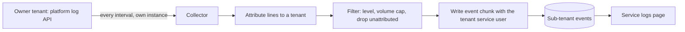

# Service logs in a multi-tenant deployment

> **Status: partly implemented.** Done: the *Monitoring → Service logs* page (reads the platform log endpoint
> directly, so it works only in the owner tenant) and the per-line tenant field the collector depends on
> (see *Traps*). Not done: the collector, the events, retention and the events-backed page.

How a subscriber tenant sees the logs of `dynamic-mapper-service` when the service is deployed in
an enterprise (owner) tenant and subscribed by sub-tenants.

---

## Requirements

**What it is for.** Letting a sub-tenant administrator diagnose *their own* mappings and connectors
without access to the owner tenant.

**The problem.** The platform serves microservice logs (`/application/applications/{id}/logs/{instance}`)
only through the tenant that owns the application. A sub-tenant that merely subscribes gets
`403 Forbidden`, so the logs page is empty exactly for the tenants that cannot ask the operator.

- **A sub-tenant sees its own log lines, and only its own.** Log lines can carry device ids,
  payload fragments and connector hosts. A line attributable to tenant A must never be visible to
  tenant B, and a line that cannot be attributed to any tenant is visible to **no** sub-tenant. This is
  the central rule; everything else is subordinate to it.
- **Lines that are not tenant-specific** (JVM start-up, framework banner, shared infrastructure) stay
  in the owner tenant's native log and are not copied anywhere.
- **The owner tenant keeps using the native logs.** Nothing changes for it, and it needs no copy.
- **Collection is bounded.** Only lines at or above a configured minimum level are copied (default
  `WARN`; the service itself runs at `TRACE`, which must never be mirrored wholesale), each tenant's
  copy is limited in volume per interval, and old copies are deleted after a retention period
  (default 24 h). Hitting a limit is visible in the log view ("lines omitted"), not silent.
- **The copy is near-real-time, not exact.** Lines appear within one collection interval (default
  30 s). Lines from an instance that dies between two collections can be lost. Guaranteed delivery
  is a non-goal.
- **Collection can be switched off** by the operator for the whole service, and by a tenant for
  itself. A disabled tenant sees an explanation, not an empty editor.
- **The log page works the same way in both cases.** Same layout, instance select, time window,
  paging, auto refresh, download. The page picks its source itself; the user does not choose.
  It says which source it is showing, and shows distinct messages for *not enabled*, *no logs yet*
  and *not permitted*.
- **Logging must not feed on itself.** The act of collecting and storing logs must not produce
  enough log output of its own to be collected in turn.
- **Per-tenant isolation** applies to every piece of state — cursor, counters, switches, errors —
  as for the rest of the service.

**Non-goals.** Searching or analysing logs (the view is a window, not a log platform); logs of
other microservices; live streaming below the polling interval; redacting arbitrary secrets from
free text (the minimum level is the protection — see *Traps*).

---

## Implementation

### Flow

1. **Collector** (one scheduled component, owner-tenant context). Each service instance reads **only
   its own** instance's log with the owner tenant's credentials. No leader election, no duplicate
   copies, and replicas never coordinate. Cost: a dying instance loses its last interval.
2. **Cursor.** The collector reads `dateFrom = <dateTo of the newest copied chunk of this instance>`.
   The cursor is **derived from the events already written** (newest chunk per tenant and instance),
   not stored separately, so a restart resumes where the data ends and there is no extra state to
   clean on unsubscribe. With no chunk yet, start at *now − one interval*; never replay history.
   Follow `truncated` the same way as the Administration UI (repeat from the returned `dateTo`).
3. **Attribution** (see *Traps*). Each line is assigned the tenant in its `[tenant]` field, or dropped if
   the field is `-`. The collector parses that one field and nothing else.
4. **Filter and cap.** Drop below the minimum level; keep multi-line records (stack traces) glued to
   their first line; apply a per-tenant per-interval cap and record how many lines were omitted.
5. **Write.** One event **per tenant per chunk**, created with that tenant's service user (the same
   mechanism the existing service events use). Never one event per line: at `INFO` the rate would
   overwhelm the tenant's event API.

### Event shape

| Field | Value |
|---|---|
| `type` | `d11r_serviceLog` |
| `source` | the tenant's existing service agent managed object (the one the *Service events* page uses) |
| `time` | `dateTo` of the chunk |
| `text` | short summary, e.g. `37 lines (2 WARN, 1 ERROR)` — what a generic events list shows |
| `d11r_serviceLog.instance` | instance name |
| `d11r_serviceLog.dateFrom` / `dateTo` | window covered; the paging key for the UI |
| `d11r_serviceLog.logs` | the lines, newline-joined; chunk is capped well below the event size limit (start with 64 KB) |
| `d11r_serviceLog.omitted` | lines dropped by cap, if any |

Chunks of one instance are contiguous (`dateFrom` of N+1 = `dateTo` of N, in the platform's own
terms), so the UI reassembles a window by concatenating chunks ordered by `d11r_serviceLog.dateFrom`.

### Retention

The collector deletes a tenant's `d11r_serviceLog` events older than the retention period when it
writes (one delete call per tenant per interval at most), so retention does not depend on the tenant
having a retention rule configured. Retention and level are service properties with a per-tenant
override in the service configuration, validated like the other service-configuration fields.

### Configuration

| Where | Setting | Default |
|---|---|---|
| Service (environment) | collection enabled | `false` until the credential question below is settled |
| Service (environment) | interval, minimum level, per-tenant cap, chunk size, retention | 30 s, `WARN`, 500 lines, 64 KB, 24 h |
| Tenant (service configuration) | opt out | off |

### UI

[`ServiceLogsComponent`](../../dynamic-mapper-ui/src/monitoring/logs/service-logs.component.ts)
gets a second source behind the same layout:

- **Source choice:** try the native endpoint first; on `403` switch to events for the rest of the
  session (the 403 handling already exists). Show a small badge *Native* / *Collected*.
- **Instances:** distinct `d11r_serviceLog.instance` values from the newest events.
- **Window and paging:** First / Previous / Next / Last and the *From … UTC* field become
  `EventService.list` queries on `d11r_serviceLog.dateFrom`, `pageSize` bounded, then concatenated
  into the editor. Same time-window semantics as the native source, so the buttons keep their meaning.
- **Auto refresh:** poll the newest chunk (the interval is no shorter than the collector interval).
- **Download:** page through all chunks of the instance and save as `<instance>.log`.
- **Empty states:** *collection not enabled for this tenant* (service switch or tenant opt-out),
  *no logs yet*, and *not permitted* (403 on the events API).

### Traps

- **Attribution comes from one field, never from message text.** The service prefixes many messages
  with the tenant by hand (`"{} - ..."`), but not all, so text matching would mislabel or miss lines.
  Attribution uses the tenant in the logging context (MDC), printed as its own field:
  `... --- [   main] [t2050305588] d.m.core.CacheManager : Initialize inventoryCache` (`-` when absent).
  **Implemented:**
  - **Two keys, on purpose.** The Cumulocity SDK sets `tenant` inside its `ContextService` scopes, but
    its `leaveContext()` removes that key unconditionally and restores it only from an *enclosing SDK
    scope*. A worker of ours that calls `callForTenant(...)` therefore lost the tenant for every line
    after the call (seen as `[-]` on `virtThread-*` in a real log). So
    [`TenantLogContext`](../../dynamic-mapper-service/src/main/java/dynamic/mapper/util/TenantLogContext.java)
    uses its own key (`mapperTenant`), which the SDK never touches.
  - [`TenantLogConverter`](../../dynamic-mapper-service/src/main/java/dynamic/mapper/util/TenantLogConverter.java)
    (`%tenantId`) prints the SDK key when set (innermost scope),
    else ours, else `-`. `logging.pattern.correlation=[%-11tenantId] ` puts it between thread and logger, padded so the
    logger column stays aligned (the collector must trim the field).
  - **No duplicate tenant.** [`TenantMessageConverter`](../../dynamic-mapper-service/src/main/java/dynamic/mapper/util/TenantMessageConverter.java)
    re-registers `%m` and drops a leading `"<tenant> - "` / `"Tenant <tenant> - "` **only if it equals the
    line's tenant**. The ~1,900 call sites were not edited: on a thread without a scope the prefix is
    still the only place the tenant appears, and removing it there would lose information. The side
    effect is a diagnostic — *a line that shows `[-]` and still starts with a tenant is a missing
    scope*. Once none remain on a real tenant, the prefixes can be deleted from the source.
  - **Where the scope is opened** (the tenant is a method argument on these threads, not an SDK
    context): the whole entry method of every callback that runs on a client library's thread — MQTT
    `accept`, Pulsar `received` (both callbacks), AMQP `handleDelivery` / `onMessage` — and
    `InboundMessageDispatcher.onMessage`, which every connector calls synchronously. Wrapping only the
    worker that runs *after* the hand-off is not enough: the callback's own "INITIAL" line and the
    dispatcher's "PROCESSING" / "Resolved n mapping(s)" lines are written on the library thread first
    (this was a real miss, seen in a deployed log). Also: the dispatcher workers; the shared
    virtual-thread pool ([`MdcPropagatingExecutorService`](../../dynamic-mapper-service/src/main/java/dynamic/mapper/util/MdcPropagatingExecutorService.java))
    carries the submitter's tenant to its workers; the MQTT 3/5 connected/disconnected listeners and
    subscribe/unsubscribe completions; the four `CustomWebSocketClient` callbacks (which also covers the
    management and cache-inventory clients it calls back into). REST controllers need nothing: the
    SDK's request scope sets the tenant (`mcat-handler-*` lines are attributed).
  - **Library-internal lines stay unattributed**, e.g. the Pulsar client's `ConsumerStatsRecorderImpl`
    statistics on a `pulsar-timer-*` thread. The topic in the text names the tenant
    (`persistent://t2050305588/...`), but we do not attribute from text by design; these lines remain
    in the owner tenant's native log. Quiet them with the logger level if they are noise.
  - **Known gaps, safe by design:** Kafka, HTTP-polling and Google Pub/Sub consumer loops (their dispatcher
    lines are covered, their own are not), HTTP connector requests, scheduled jobs and the token/housekeeping executors do not open a
    scope yet. Their lines are *unattributed* and so are dropped by the collector — missing coverage,
    never a leak. Find them with the diagnostic above and close each with `TenantLogContext.open`.
  - **Registration is programmatic, not in `logback-spring.xml`.**
    [`TenantLogging.register()`](../../dynamic-mapper-service/src/main/java/dynamic/mapper/util/TenantLogging.java)
    (first line of `App.main`) puts `%tenantId` and the tenant-aware `%m` into logback's static
    converter registries. A first version used `<conversionRule>` in `logback-spring.xml` and, deployed,
    printed `[%PARSER_ERROR[tenantId]]` on every line: the platform's `/etc/<service>-logging.xml`
    also takes part in configuring logging, and a pattern parsed by a configuration that never saw the
    rule cannot resolve the word. The static registries apply to every `PatternLayout` in the JVM.
    A test that only used `logback-spring.xml` could not catch this — keep `TenantLogPatternTest`
    free of XML rules.
  - **Tests.** `TenantLogContextTest` (nesting, restore on exception, SDK key wins inside its scope and
    ours survives its exit, workers under interleaved tenants). `TenantLogPatternTest` boots Spring's
    real logging with `logback-spring.xml` and asserts the rendered lines: field, SDK/our key, prefix
    dropped only when it matches. **Still missing:** a test that two tenants' rendered lines are
    disjoint end to end (needs the collector).
- **Credentials of the owner tenant.** *Testable inside the service:* as an admin of the owner tenant, `POST /service/dynamic-mapper-service/operation` with `{"operation":"PROBE_SERVICE_LOGS"}` (operation `PROBE_SERVICE_LOGS`, `ServiceLogsProbe`) makes the logs call as that service user and returns `CAN_READ_LOGS`, `FORBIDDEN` (with the roles it holds), `OWNER_NOT_SUBSCRIBED` or `INCONCLUSIVE`. Refused to every other tenant. Reading the native log needs an owner-tenant identity with
  application read access. The service user of the owner tenant exists only if the owner subscribes
  to its own microservice, and its permissions are those of the manifest's `requiredRoles`. Verify
  that the roles needed for the log endpoint can be requested there; if not, the collection has to be
  moved out of the service (a small separate job in the owner tenant). This decides the default
  of *collection enabled*.
- **Feedback loop.** Writing an event can itself log (HTTP client, Spring, our own `DEBUG`). The
  collector's own package and the HTTP client are excluded from collection, and the collector logs
  at most once per interval.
- **Secrets in lines.** At `DEBUG`/`TRACE` the service logs payloads and topics. The minimum level
  is the protection, so it must not be lowered to `TRACE` by a tenant; only the operator may set
  below `INFO`.
- **Cost.** Each tenant gets one event write per interval plus one delete. With many tenants the
  interval must scale (batch tenants per tick); measure before lowering the 30 s default.
- **Tenant lifecycle.** Unsubscribe stops collection for that tenant immediately (nothing is
  cached, because the cursor is derived); the tenant's already written events stay under that
  tenant's own retention.

### Alternatives considered

- **In-process capture instead of reading the platform API.** A logback appender that already
  knows the tenant (MDC) could buffer per tenant and write events directly, with no owner-tenant
  credentials, no cursor and no attribution step by text. It is the better design if the credential
  question above has a bad answer, and it removes the round trip through the platform. It was not
  chosen as the starting point because the request was to reuse the native log as the source of truth.
- **Read the native log from the sub-tenant by granting access.** Not possible: the endpoint is
  tied to application ownership, not to a role the sub-tenant can hold.
- **One event per line.** Rejected: volume and event-API cost; also loses multi-line records.

### Open decisions

1. **Who may read the collected events?** The events page follows the event permissions of the
   tenant, which are broader than an administrator. The Service logs page is currently visible
   to all roles; decide whether the copy should be restricted to a role, since logs describe the
   tenant's devices and connectors.
2. **Owner-tenant credentials** (see *Traps*) — decides where the collector runs.
3. **Default `WARN` vs `INFO`.** `WARN` keeps volume low but hides the normal story ("Connector
   connected"); a per-tenant raise to `INFO` within the operator's ceiling may be needed.
