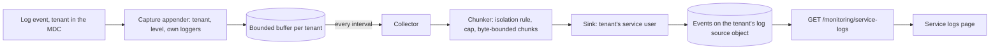

# Service logs in a multi-tenant deployment

> **Status: built, off by default, not yet run on a deployed tenant.** Done: the per-line tenant field, the
> in-process **capture** and **collector** (`dynamic.mapper.logs`, `service.logs.collector.enabled=false`), the **service
> endpoint** `GET /monitoring/service-logs` (admin only) and the *Monitoring → Service logs* page. Not done: a per-tenant
> opt-out and a per-tenant minimum level.

How a tenant that merely **subscribes** to `dynamic-mapper-service` sees the log lines of its own mappings and connectors,
when the service is deployed in an enterprise (owner) tenant and shared by many sub-tenants.

---

## Requirements

**What it is for.** Letting a sub-tenant administrator diagnose *their own* mappings and connectors without access to the
owner tenant and without asking the operator.

**The problem.** The platform shows a microservice's log only through the tenant that owns it, and only to a user with an
application-management role. A sub-tenant has no access at all, so exactly the tenants that cannot ask the operator see nothing.

- **A tenant sees its own log lines, and only its own.** Lines can carry device ids, payload fragments and connector hosts.
  A line attributable to tenant A must never be visible to tenant B, and a line that cannot be attributed to any tenant is
  visible to **no** tenant. This is the central rule; everything else is subordinate to it.
- **Lines that are not tenant-specific** (JVM start-up, framework banner, shared infrastructure) are copied nowhere.
- **Collection is bounded.** Only lines at or above a configured minimum level are stored (default `WARN`: `INFO` lines can
  carry device payloads); each tenant's volume is capped per run and its in-memory backlog is bounded; stored lines are
  deleted after a retention period (default 24 h). Hitting a limit is visible in the log view ("lines omitted"), not silent.
- **Near-real-time, not exact.** Lines appear within one interval (default 30 s). Lines still in memory when the process
  dies are lost. Guaranteed delivery is a non-goal.
- **Reading is restricted to `ROLE_DYNAMIC_MAPPER_ADMIN`**, enforced by the service, and the navigation entry is hidden for
  everyone else. Limit: the stored lines are ordinary platform events, so a user holding the platform's event-read
  permission can still list them with the platform's own API; a platform permission cannot be tied to an application role.
- **One page for everyone.** Same layout, instance select, time window, paging, auto refresh and download. The page shows
  the platform's own log where the user may read it and the stored log otherwise, says which it shows, and has distinct
  messages for *not enabled / nothing yet* and *not permitted*.
- **Logging must not feed on itself.** Collecting and storing must not produce enough log output to be collected in turn.
- **Per-tenant isolation** applies to every piece of state: buffers, counters, errors, caches.

**Non-goals.** Searching or analysing logs; logs of other microservices; redacting secrets from free text (the minimum level
is the protection); copying lines that belong to no tenant.

---

## Implementation

### Flow

The lines are **captured inside the process**, not read back from the platform. The logging framework already knows each
line's tenant, so there is nothing to parse, no cursor, no credentials and no platform permission involved — see *Why not the
platform's log* for what was measured.

| Class (`dynamic.mapper.logs`) | Role |
|---|---|
| `ServiceLogCaptureAppender` | attached to the root logger; per event: tenant from the MDC (SDK key, else ours), ignores events without a tenant, below the minimum level, or from `dynamic.mapper.logs.*`; formats the line like the console (`2026-10-15T12:00:00.000Z  WARN [thread] logger : message`, UTC, stack trace included) and offers it to the buffer. Never logs (would recurse) |
| `BoundedServiceLogBuffer` | in-memory, **bounded per tenant**: a flooding tenant drops its own oldest lines and can neither exhaust memory nor push out another tenant; drops are counted; `restore` puts records back in order |
| `ServiceLogCapture` | the Spring bean that attaches/detaches the appender and exposes the buffer |
| `ServiceLogPolicy`, `ServiceLogChunker` | minimum level, excluded loggers, per-tenant line cap with an `omitted` count, byte-bounded chunks; **a record reaches a tenant only if its own tenant field names that tenant and the tenant is subscribed** |
| `ServiceLogCollector` | one run: drain → per-tenant chunks → store. A failed store puts that tenant's *unstored* records back (time watermark of the last stored chunk) and does not hold up other tenants; never throws; a repeated identical failure is logged once, then every 20th run; purge at most hourly; records of tenants that are not subscribed are dropped |
| `EventServiceLogSink`, `ServiceLogSourceLocator` | one `d11r_serviceLog` event per chunk, written with that tenant's service user, on a dedicated source object (below) |
| `ServiceLogReader`, `ServiceLogsController` | the read side (below) |
| `ServiceLogCollectorConfiguration`, `ServiceLogCollectorJob` | the shared policy and the `@Scheduled` trigger; every bean exists only when `service.logs.collector.enabled=true` |

Settings (`application.properties`): `interval-ms` 30000, `min-level` WARN, `max-lines-per-tenant` 500, `max-chunk-bytes`
65536, `retention-hours` 24, `max-buffered-records-per-tenant` 2000.

Known limits: a record's time is the event's millisecond, so two records of the same millisecond across a retry watermark can
be skipped or repeated; a line count of a multi-line record counts every line; lines logged while the buffer is full are lost
(counted and reported once per run).

### Event shape

| Field | Value |
|---|---|
| `type` | `d11r_serviceLog` |
| `source` | the tenant's **log source object** (`d11r_serviceLogSource`, external id `c8y_Serial`/`d11r_serviceLogSource`, a child addition of the agent), created on first use. **Not the agent:** the *Service events* page lists the agent's newest 1000 events with no type filter, so log events of up to 64 KB would push the real service events off it |
| `time` | time of the chunk's last record |
| `text` | summary, e.g. `37 line(s) (2 WARN, 1 ERROR), 4 omitted` |
| `d11r_serviceLog.instance` | instance name (`HOSTNAME`) |
| `d11r_serviceLog.dateFrom` / `dateTo` | first and last record; the paging key |
| `d11r_serviceLog.lines` / `levels` / `omitted` | counts |
| `d11r_serviceLog.logs` | the lines, newline-joined, at most 64 KB per event |

One event per chunk, never per line: at `INFO` the per-line rate would overwhelm a tenant's event API. Events written by a
previous design onto the agent itself (if any exist) are invisible to the page and never purged; delete them.

### Read side and page

[`ServiceLogsController`](../../dynamic-mapper-service/src/main/java/dynamic/mapper/controller/ServiceLogsController.java) /
[`ServiceLogReader`](../../dynamic-mapper-service/src/main/java/dynamic/mapper/logs/ServiceLogReader.java): reads the calling
tenant's events **as that tenant's service user** (the caller's own event permission is irrelevant), up to 10 chunks per page,
ascending, never mixing instances (default: the newest chunk's), and reports `more`, `empty` and `omitted`. Neither bound =
latest; `dateFrom` only = after (oldest first); `dateTo` only = before. Bounds are exclusive and refer to a chunk's end time.

[`ServiceLogsComponent`](../../dynamic-mapper-ui/src/monitoring/logs/service-logs.component.ts) tries the platform's own log
first ([`NativeServiceLogsService`](../../dynamic-mapper-ui/src/monitoring/logs/native-service-logs.service.ts)) and falls back
to the stored log
([`CollectedServiceLogsService`](../../dynamic-mapper-ui/src/monitoring/logs/collected-service-logs.service.ts)) when that is
refused or the tenant sees no instance. Both sit behind one interface with the **same window semantics**, so First /
Previous / Next / Latest, the *From* field, auto refresh and Download behave identically. A badge and a note in the action
bar say which source is shown; omitted lines and the empty state are explained.

### Tenant attribution — the foundation

Everything above relies on every log line carrying the tenant it belongs to. Attribution is **never** done by reading message
text: the service writes `"<tenant> - ..."` into many messages by hand, but not all, and a wrong match would leak a line.

- **A field, from the logging context (MDC):** `... --- [   main] [t2050305588] d.m.core.CacheManager : ...` (`-` when absent).
  `logging.pattern.correlation=[%-11tenantId] ` puts it between thread and logger, padded so the logger column aligns.
- **Two keys, on purpose.** The Cumulocity SDK sets `tenant` inside its `ContextService` scopes, but its `leaveContext()`
  removes that key unconditionally and restores it only from an enclosing SDK scope — so any `callForTenant(...)` on one of
  our own threads blanked the tenant for every later line (seen as `[-]` on `virtThread-*`). Our scopes therefore use their
  own key (`mapperTenant`, [`TenantLogContext`](../../dynamic-mapper-service/src/main/java/dynamic/mapper/util/TenantLogContext.java));
  [`TenantLogContext.tenantOf`](../../dynamic-mapper-service/src/main/java/dynamic/mapper/util/TenantLogContext.java) /
  `%tenantId` ([`TenantLogConverter`](../../dynamic-mapper-service/src/main/java/dynamic/mapper/util/TenantLogConverter.java))
  prefer the SDK key (innermost scope), else ours.
- **No duplicate tenant.** [`TenantMessageConverter`](../../dynamic-mapper-service/src/main/java/dynamic/mapper/util/TenantMessageConverter.java)
  re-registers `%m` and drops a leading `"<tenant> - "` **only when it equals the line's tenant**. The ~1,900 call sites were
  not edited: on a thread without a scope the prefix is the only place the tenant appears. The side effect is a diagnostic —
  *a `[-]` line that still starts with a tenant is a missing scope*.
- **Registration is programmatic.** [`TenantLogging.register()`](../../dynamic-mapper-service/src/main/java/dynamic/mapper/util/TenantLogging.java)
  (first line of `App.main`) puts the converters into logback's static registries. A first version used `<conversionRule>`
  in `logback-spring.xml` and printed `[%PARSER_ERROR[tenantId]]` on every line when deployed: the platform's own
  `/etc/<service>-logging.xml` also configures logging and never saw the rule.
- **Where a scope is opened** (the tenant is a method argument on these threads, not an SDK context): the whole entry
  method of every callback that runs on a client library's thread (MQTT `accept`, Pulsar `received`, AMQP, the four websocket
  callbacks, MQTT 3/5 listeners and completions), `InboundMessageDispatcher.onMessage`, the dispatcher workers, the Kafka
  consumer loop, the Pub/Sub receiver, the HTTP-polling hand-off, and every connector's housekeeping thread
  ([`TenantScheduledThreadPoolExecutor`](../../dynamic-mapper-service/src/main/java/dynamic/mapper/util/TenantScheduledThreadPoolExecutor.java):
  a timer cannot inherit a scope from whoever scheduled the task). The shared virtual-thread pool
  ([`MdcPropagatingExecutorService`](../../dynamic-mapper-service/src/main/java/dynamic/mapper/util/MdcPropagatingExecutorService.java))
  carries the submitter's tenant. Wrapping only the worker after a hand-off is not enough: the callback's own first lines are
  written on the library's thread. REST controllers need nothing (the SDK's request scope sets the tenant). The token-refresh
  and websocket-reconnect timers are cross-tenant and use `runForEachTenant`.
- **Still unscoped, safe by design:** library-internal lines (e.g. the Pulsar client's statistics on a `pulsar-timer-*`
  thread), the websocket ping timer, the explorer sessions' consumer threads, and any call site not yet found. Their lines
  are unattributed and so are never stored — missing coverage, never a leak. Find them: a `[-]` line that still starts with a
  tenant needs a `TenantLogContext.open`.

---

## Why not the platform's log

The first design read the platform's own log (`GET /application/applications/{id}/logs/{instance}`) and copied it. It was
built, deployed and **measured not to work**; the code is preserved at the tag `service-logs-native-collector`.

- The endpoint is **not in the public OpenAPI spec** (`c8y-oas.yml`), so its required role is unpublished. The neighbouring
  application reads need `ROLE_APPLICATION_MANAGEMENT_READ`; `GET /application/currentApplication` and `.../subscriptions`
  need the **bootstrap user**.
- **No credential the service holds can read it.** From inside the service: the owner tenant's service user (25 manifest
  roles, no application-management role) and the bootstrap user both got `403 Access Denied` on the internal address, and the
  bootstrap user also on the tenant's public host. With plain `curl` and the bootstrap credentials: `403` with Basic
  authentication (a bearer-token attempt also returned 403 but is inconclusive: the token may not have been issued).
- **A retraction:** an earlier note claimed "the bootstrap user can read the logs", based on a `c8y` CLI call that returned 200.
  That call most likely ran under the operator's own logged-in session (an admin with application-management rights).
  Lesson: use `curl` with explicit credentials to test what a specific user may do.
- The only remaining way to read it would be `ROLE_APPLICATION_MANAGEMENT_READ` in `requiredRoles` (untested), which is granted
  to the service user in **every** subscribing tenant and has to be accepted by each of them.

In-process capture needs none of that, and it removed the log parsing, the cursor, the owner-tenant special case and the
credential handling.

---

## Traps and decisions

- **Feedback loop.** Writing an event can itself log. The appender ignores `dynamic.mapper.logs.*` and the policy excludes the
  collection classes by name; the collector logs only on start, on stored chunks and on failures.
- **Secrets in lines.** At `INFO` the service logs full device payloads. The minimum level is the protection (`WARN` default).
  A tenant-specific level, editable only by `ROLE_DYNAMIC_MAPPER_ADMIN` and bounded below by an operator floor, would be a
  per-tenant setting in the service configuration — **not built**.
- **Cost.** One event write per tenant per interval when it has something, plus an hourly delete per tenant. Measure before
  lowering the 30 s default with many tenants.
- **Tenant lifecycle.** Unsubscribed tenants' lines are dropped at the next run; the log source object is looked up per
  tenant and its cache is dropped on unsubscribe. Stored events stay under the tenant's own retention.
- **Owner tenant.** Treated like any other tenant: its lines are stored too, so an owner user without application-management
  rights sees them. They duplicate what the platform's own log holds; that is accepted for one rule instead of a special case.
- **Open:** a per-tenant opt-out; the per-tenant minimum level above; the uncovered scope gaps listed under *Tenant attribution*.
