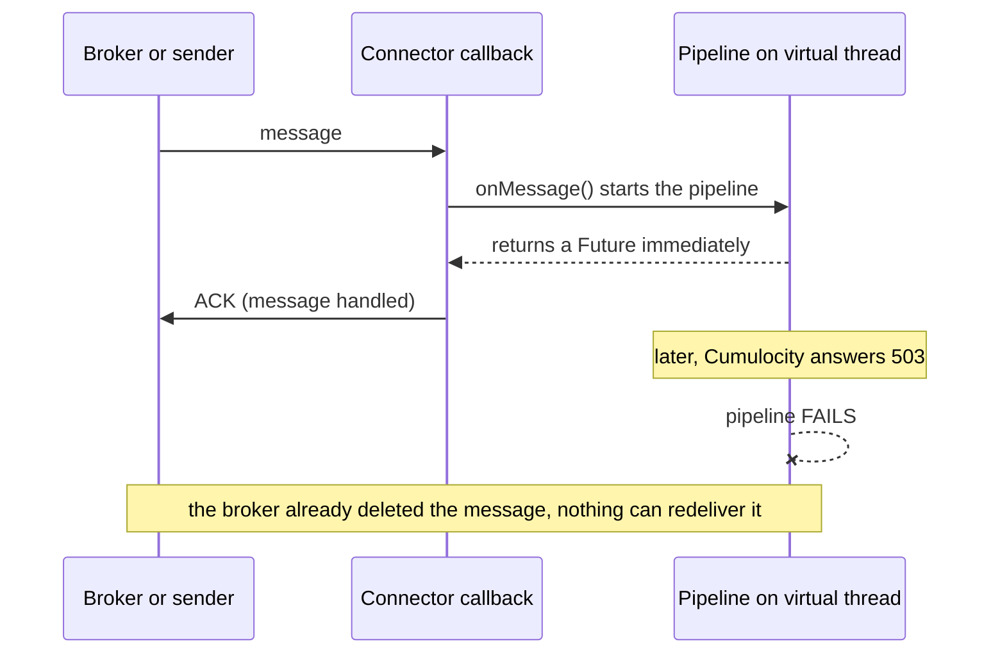
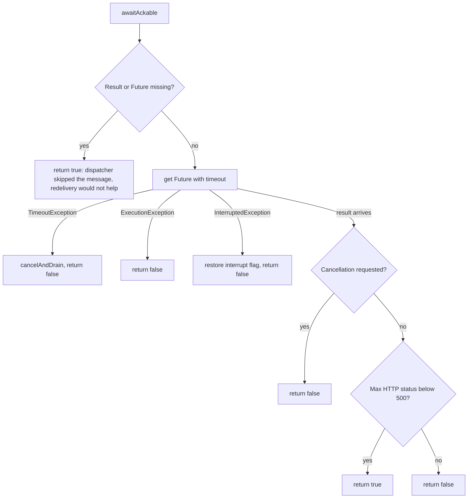
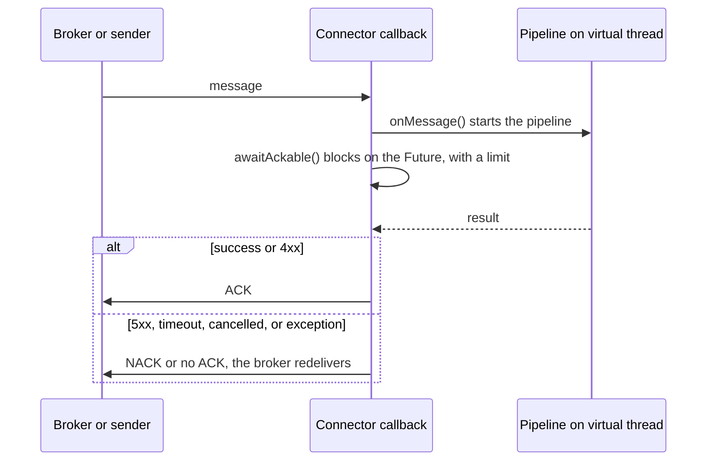

# Acknowledge only after the pipeline result

Status: fixed in commit `9d52771d1` (2026-10-31). Affects the AMQP (0-9-1 and 1.0), HTTP, and Kafka connectors.

## Summary

Three connectors told the sender or broker "message handled" before the mapping pipeline had finished.
A pipeline failure afterwards could not cause redelivery, so the message was lost. AMQP 0-9-1 was worse:
its callback never sent an acknowledgement for at-least-once subscriptions at all.

The fix is one shared helper, `ProcessingResultHelper.awaitAckable`. It waits for the pipeline result, with
a limit, and returns whether the message is safe to acknowledge. Each affected connector now calls it and
acknowledges, or refuses to, based on the answer. MQTT, Pulsar, and Pub/Sub already behaved this way with
their own code and were not changed.

## The bug

`onMessage()` on the dispatcher returns a `ProcessingResultWrapper` that holds a `Future`. The pipeline
runs on a virtual thread. The callbacks in AMQP, HTTP, and Kafka did not wait on that `Future`.



Per connector, before the fix:

| Connector | Behavior before | Effect |
|---|---|---|
| AMQP 0-9-1 | Callback built with a `null` channel, so `basicAck` was never sent for `AT_LEAST_ONCE`. It also skipped the ack when `envelope.isRedeliver()` was true. | Messages stayed unacknowledged and were redelivered on every consumer restart, and the pipeline result was never consulted. |
| AMQP 1.0 | `message.acknowledge()` right after `onMessage()` returned. | A failed mapping was never redelivered. |
| HTTP connector | Returned 200 once the message was handed over. | The sender never learned about a failed mapping and could not retry. |
| Kafka | QoS above 0 waited on a separate virtual thread and queued a commit per record. | A later success committed an offset past an earlier failed record, so that record was lost. |

## The fix

### The helper

`awaitAckable(processedResults, tenant, topic, log)` is in
[ProcessingResultHelper.java](../../dynamic-mapper-service/src/main/java/dynamic/mapper/processor/util/ProcessingResultHelper.java).
The wait is `getProcessingResult().get(effectiveTimeout, MILLISECONDS)`. The limit is the Smart Function
budget (`getPipelineTimeoutMS()`, typically 30 s) when it is above 0, otherwise the hard ceiling
(`ServiceConfiguration.PROCESSING_HARD_CEILING_MS`, 120 s). The call never blocks without a limit.



A client error (4xx) counts as handled, as in the MQTT and Pulsar callbacks: redelivering a message that
Cumulocity rejected as invalid would only repeat the rejection.

### Correct flow after the fix



### Per connector

| Connector | Change |
|---|---|
| AMQP 0-9-1 | `AMQPCallback` now receives the channel and the `autoAck` flag. For `AT_LEAST_ONCE` it calls `basicAck` on success and `basicNack(tag, false, true)` (requeue) otherwise. For `autoAck=true` it sends neither. The redelivery condition is gone. |
| AMQP 1.0 | `message.acknowledge()` runs only when `awaitAckable` returns true. A failed message stays unacknowledged. `session.recover()` is not called, so redelivery happens on the next session or consumer restart. |
| HTTP connector | `HttpConnectorController` waits, then answers 200 on success or 4xx, and 500 on a pipeline failure or timeout so the sender can retry. Errors while handing the message over still return 400. The request blocks while the pipeline runs. |
| Kafka | See below. |

### Kafka

Kafka commits an offset number, not single records. Committing record 11 commits everything up to 11.

```text
Before (queued commits):                 After (in order, per partition):
 offset 10 -> pipeline FAILS              offset 10 -> pipeline FAILS
 offset 11 -> pipeline OK, commit 12      seek(partition, 10), skip 11 and 12
 offset 12 -> ...                         wait 5 s, next poll() redelivers 10, 11, 12
 committed 12: record 10 lost             nothing committed past 10
```

For QoS above 0 the poll-loop thread now processes each partition's records in order and waits for each
result. On a failure it calls `consumer.seek(partition, failedOffset)`, skips the rest of that partition's
batch, and pauses for `CONSUMER_RESTART_DELAY_MS` (5 s) to avoid a hot redelivery loop while the cause
persists. Other partitions of the same batch continue. QoS 0 still commits without waiting.

## Trade-offs and risks

The wait blocks a thread that used to return at once:

| Connector | Thread that blocks | Consequence |
|---|---|---|
| AMQP | Consumer thread of the channel | Messages on one channel are settled in order, one at a time. |
| HTTP | The request thread | The caller waits for the pipeline, up to the Smart Function budget or 120 s. Callers with shorter client timeouts will see timeouts and may retry, so mappings must tolerate duplicates. |
| Kafka | The poll-loop thread | A slow batch delays the next `poll()`. If the time between polls exceeds `max.poll.interval.ms` (default 5 minutes), the broker rebalances the consumer group. |

Further points:

- **Duplicates are possible.** At-least-once delivery means a timed-out message can be redelivered after its
  pipeline partly ran. Mappings that create data should use stable external IDs or upsert semantics.
- **Poison messages.** AMQP requeues without a limit, and Kafka seeks back without a limit. A message that
  always fails loops until fixed. Pulsar and the MQTT callbacks have a poison-pill cutoff. This is not
  solved here (see follow-ups).
- **A cancelled Smart Function leg** now also counts as a failure toward `maxFailureCount`, which can
  deactivate a mapping that times out repeatedly. This was fixed in the same commit and is documented in
  [reliability.md](../feature/reliability.md).

## Tests

- [ProcessingResultHelperAwaitAckableTest](../../dynamic-mapper-service/src/test/java/dynamic/mapper/processor/util/ProcessingResultHelperAwaitAckableTest.java)
  covers: success, a skipped message, a failed pipeline, a timeout (and that it cancels), and a cancelled
  pipeline.
- The full backend suite passed after the change (1,420 tests, 0 failures, 7 skipped).
- Not covered: the AMQP callbacks, `HttpConnectorController`, and the Kafka seek-back have no tests. The
  repository has no AMQP 1.0, HTTP client, or Kafka consumer-loop tests to extend. Adding them is a
  follow-up.

## Follow-ups

1. **Shared contract test** for all connectors: a failing pipeline must never lead to an ack.
2. **Poison-pill cutoff** for AMQP and Kafka, as Pulsar has, with a dead-letter target. See
   [concept-review.md](../concept-review.md), concept-level gaps.
3. **Pub/Sub:** several inbound topics share one subscription, a failed publisher is never evicted, and no
   retry settings are set. It already waits for the result, so it was out of scope here.
4. **Remaining callback gaps:** `AbstractMqttCallback` neither acknowledges nor reconnects on
   `ExecutionException`, and `CustomWebSocketClient` (outbound) does not use `cancelAndDrain`.
5. **Kafka under load:** measure poll-loop wait times against `max.poll.interval.ms` with a slow pipeline,
   and consider pausing partitions while waiting.

## Where documented

- [connector-amqp.md](../feature/connector-amqp.md), [connector-http.md](../feature/connector-http.md),
  [connector-kafka.md](../feature/connector-kafka.md)
- [reliability.md](../feature/reliability.md)
