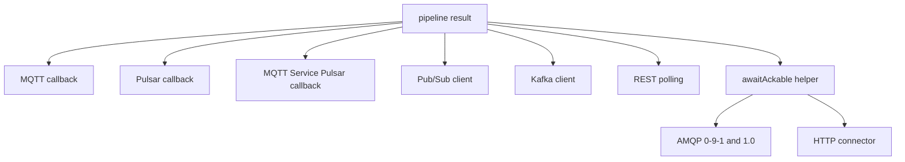

# Harmonizing acknowledgement handling across connectors

Status: analysis done 2026-11-01. Implementation started; see [Status](#status).

Follows [ack-after-pipeline-result.md](ack-after-pipeline-result.md), which fixed AMQP, the HTTP connector, and
Kafka acknowledging before the pipeline finished. That fix added one helper, but the connectors that already worked
kept their own copies. The result is not harmonized.

## Summary

After a message passes through the pipeline, every connector must decide: acknowledge (the message is done),
retry (the broker redelivers it), or drop. The decision depends on the pipeline result. Today that decision is
written out separately in seven places and the copies disagree.

## Current state

| Connector | Logic | Waiting thread |
|---|---|---|
| MQTT (`AbstractMqttCallback`) | own copy | virtual thread |
| Pulsar (`PulsarCallback`) | own copy | virtual thread |
| Cumulocity MQTT Service (`MQTTServicePulsarCallback`) | own copy | virtual thread |
| Google Pub/Sub (`GooglePubSubClient`) | own copy | subscriber thread |
| Kafka (`KafkaClientV2`) | own copy | poll thread |
| REST polling (`HttpPollingConnector`) | own copy, decides whether the cursor advances | polling thread |
| AMQP 0-9-1 and 1.0 | `awaitAckable` | consumer thread |
| HTTP connector | `awaitAckable` | request thread |

### Where the copies disagree

| Aspect | MQTT | Pulsar | Pub/Sub | Kafka | AMQP | HTTP |
|---|---|---|---|---|---|---|
| Client error (4xx) | ack | ack | nack | ack | ack | 200 |
| Error without HTTP status | ack | ack | nack | ack | ack | 200 |
| Server error (5xx) | no ack, reconnect | nack | nack | seek back | nack, requeue | 500 |
| Checks the cancelled flag | yes | yes | no | no | yes | yes |
| Timeout grows with each retry | yes | no | no | no | no | no |
| Limit on repeated failures | 5 reconnects, only if `reconnectOnProcessingError` is on | 5, then drop | none | consumer restart after 10 errors | none | caller decides |

## Findings

| # | Priority | Finding |
|---|---|---|
| 1 | P1 | **Kafka and Pub/Sub ignore a cancelled pipeline.** A Smart Function stopped by the CPU limit completes the future early with the cancellation flag set. The other connectors refuse to acknowledge it. Kafka reads the cancelled leg as an error without an HTTP status and commits it. Pub/Sub nacks it only because it nacks every error. |
| 2 | P1 | **Pub/Sub nacks every error, including client errors.** A message Cumulocity rejects as invalid is redelivered until Pub/Sub's own dead-letter policy, if one is configured, removes it. The other connectors treat 4xx and errors without an HTTP status as handled. An existing test (`testProcessPubSubMessage_atLeastOnce_nacksOnProcessingError`) pins the Pub/Sub behavior, so it looks deliberate. This needs a decision, see below. |
| 3 | P2 | **No consistent poison-message rule.** Pulsar drops a message after 5 failures. MQTT reconnects up to 5 times if configured. AMQP requeues forever. Pub/Sub depends on external configuration. Kafka seeks back and, after the fix in the previous report, a permanently failing record loops until the consumer restart after 10 errors. |
| 4 | P2 | **Seven copies of the same logic.** A fix must be applied seven times, and the first fix (previous report) missed three connectors because they had no copy. |
| 5 | P3 | **No connector-level tests** for the AMQP callbacks, the HTTP connector acknowledgement, or Kafka's per-record decision. |
| 6 | P3 | **Different retry tuning.** Only MQTT lengthens the timeout on a retry. This is a design choice that nobody wrote down. |

## Decision needed: what is an error worth retrying?

MQTT, Pulsar, Kafka, AMQP, and HTTP all use one rule: retry only on a server-side (5xx) failure, a timeout, or a
cancellation. A mapping error without an HTTP status, such as a JavaScript exception, is acknowledged, because
redelivering a deterministic failure repeats it. Pub/Sub deviates and retries every error.

| Option | Effect |
|---|---|
| A. Pub/Sub follows the common rule | Consistent. A mapping bug no longer loops. A failing message is dropped after one attempt and recorded as an error in the mapping status. |
| B. Keep Pub/Sub as is and document it | Messages are retried until Pub/Sub's dead-letter policy stops them. Needs a dead-letter policy on the subscription, and a mapping bug can loop. |
| C. Change the common rule to retry every error, with a failure limit | Treats mapping bugs as retryable, which only helps with transient causes. Needs the shared poison-message rule first. |

Recommendation: A, together with the shared poison-message rule (step 3 below), then revisit C. Until you decide,
Pub/Sub keeps its current error rule and gains only the cancelled check.

## Proposed work

1. **Fix the clear bugs now.** Kafka uses the shared helper (same rule, plus the cancelled check). Pub/Sub gets the
   cancelled check. Add tests for both, and for the AMQP callbacks.
2. **Migrate the remaining copies to one policy method** that returns `ACK` or `RETRY` from the pipeline result,
   including the cancelled check and the 4xx rule. Each connector only translates the decision into its broker call
   and keeps its own extras (MQTT timeout growth, Pulsar poison-pill, REST polling cursor).
3. **One poison-message rule:** a per-message failure counter with a shared limit and a dead-letter target.
4. **Contract test:** one parameterized test that every connector must pass: a failed pipeline never leads to an
   acknowledgement, and neither does a cancelled one.
5. **Decide the Pub/Sub error rule** (options above).

## Status

| Step | State |
|---|---|
| 1. Kafka on the helper, Pub/Sub cancelled check, tests | Done 2026-11-01, see below |
| 2. One policy method | open |
| 3. One poison-message rule | open |
| 4. Contract test | partly: per-connector tests added for AMQP, Kafka, and Pub/Sub; no shared parameterized test yet |
| 5. Pub/Sub error rule | open, needs a decision |

### Done in step 1

- **Kafka** (`KafkaClientV2.processMessageWithQos`) now calls `ProcessingResultHelper.awaitAckable` instead of its own
  copy. The rule is the same (4xx counts as success, 5xx and timeout do not) and adds the cancelled check, so finding 1
  is fixed for Kafka. A record whose pipeline was cancelled is no longer committed. The method is package-private
  for tests, and the unused `handleProcessingTimeout` and imports were removed.
- **Pub/Sub** (`GooglePubSubClient.processPubSubMessage`) nacks a cancelled pipeline. Its error rule is unchanged,
  pending the decision above.
- **Tests added:**
  - `KafkaClientV2AcknowledgementTest`: success requests the commit for offset + 1; a failed, cancelled, or timed-out
    pipeline requests no commit and returns `false`, which makes the poll loop seek back.
  - `AMQPCallbacksAcknowledgementTest`: AMQP 0-9-1 acks on success, nacks with requeue on failure, sends neither for
    an auto-ack consumer; AMQP 1.0 acknowledges on success, not on failure, and before dispatch for at-most-once.
  - `GooglePubSubClientTest`: a cancelled pipeline is nacked.
- The full backend suite passes (1,467 tests, 0 failures, 7 skipped).
- Still untested: the HTTP connector response (`HttpConnectorController`), and MQTT, Pulsar, and REST polling
  against a shared contract.
