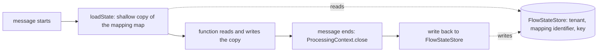
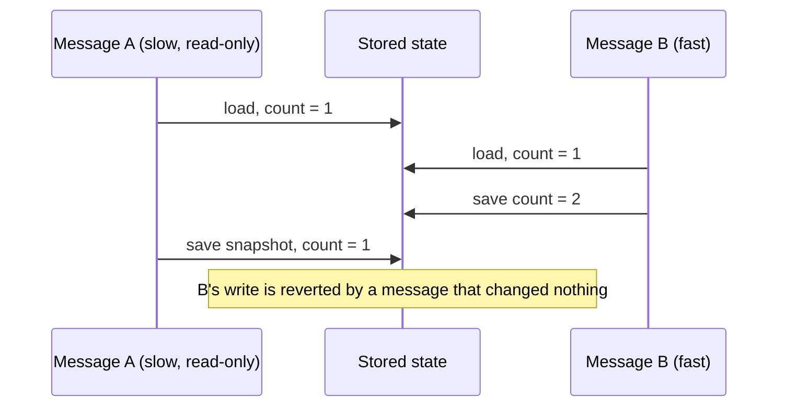
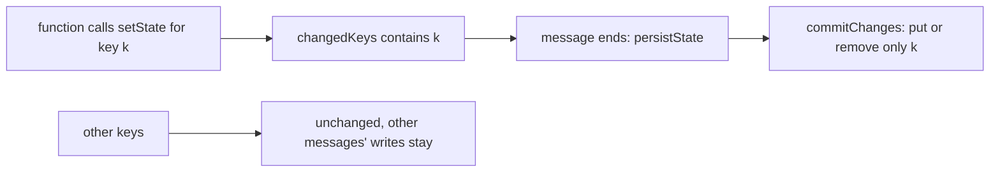
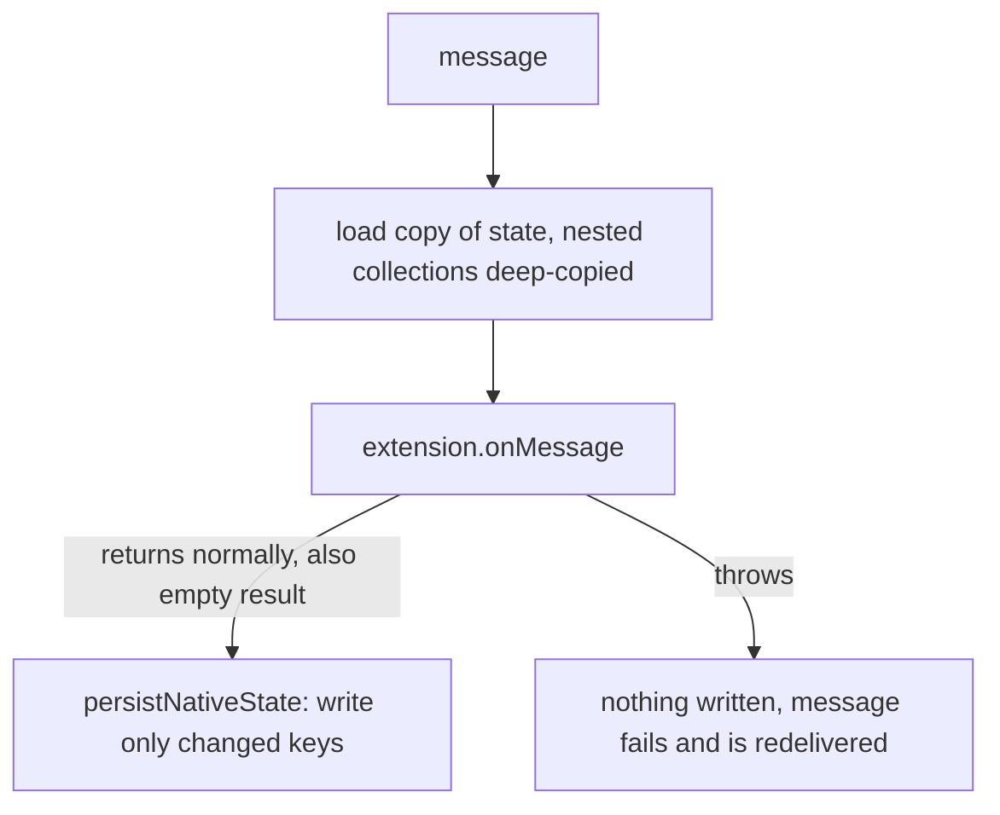
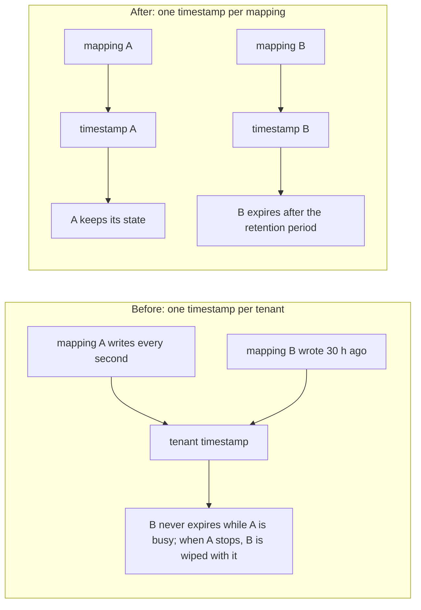

# Review: state in Smart Functions and Java extensions

Review date: 2026-10-31. Basis: reading the code and adding tests; nothing was run against a deployed tenant.

Status: findings 1 (lost updates and torn reads), 2 (Java extension state), and 3 (tenant-wide retention timer) are fixed. The other findings are open.

## How state works

State is a per-mapping key-value map held in service memory. Smart Function code reads and writes it with
`context.getState`, `setState`, `getStateAll`, `getStateKeySet`, and `clearState`. Java extensions use
`setNativeState` and `getNativeState`.

- **Scope:** `tenant -> mappingIdentifier -> key -> value`. A mapping cannot read or write another mapping's state.
- **Lifetime:** memory only, so it is lost on restart and not shared between service instances. A mapping's state is
  removed when the mapping is deleted. A scheduled job removes a mapping's state after `flowStateRetention` minutes
  (default 1440) without a write by that mapping.
- **Tests:** Dry Run and Live Test use an empty copy and never write back.

## Findings

| # | Priority | Finding | Status |
|---|---|---|---|
| 1 | P1 | Concurrent messages overwrite each other's state, and readers can see a half-rebuilt map | Fixed (Smart Functions) |
| 2 | P1 | Java extension state is never persisted | Fixed |
| 3 | P2 | The retention timer is tenant-wide | Fixed |
| 4 | P2 | Changing an object returned by `getState` is lost unless `setState` is called | Documented |
| 5 | P2 | No size limit on state | Open |
| 6 | P3 | Smaller issues (see below) | Open |

### 1. Lost updates and torn reads (fixed)

Before the fix, every message saved its whole snapshot at the end with `saveState`, which cleared the stored map and
then copied the snapshot in.

Three effects followed from it:

- **Lost increments:** two messages loaded `count=5` and both saved `6`.
- **Read-only messages reverted others:** a late message restored its old snapshot, even if it wrote nothing. This
  also happened for a message cancelled before the function ran.
- **Torn reads:** between `clear()` and `putAll()` another message could load an empty or partial map and then save a
  counter starting from 0. A new test reproduced this: with the old behavior 10,503 of 20,000 concurrent reads saw
  missing keys.

A separate failure sat in the same code: `setState("x", null)` stored a `null` value, and `ConcurrentHashMap` cannot
hold one. The save threw a `NullPointerException`, `ProcessingContext.close()` logged a warning, and the mapping's
whole state update was lost silently.

**The fix.**

- `SmartFunctionContext` records which keys the function wrote (`changedKeys`) and whether it called `clearState()`.
- At the end of the message, `ProcessingContext.close()` calls the package-private `persistState()`. It is not
  visible to JavaScript, so the documented `clearState()` keeps its meaning.
- `persistState()` calls the new `FlowStateStore.commitChanges(tenant, mapping, wipe, upserts, removals)`, which
  applies one `ConcurrentHashMap` operation per changed key and never clears the map. A `null` value removes the key.
- `clearState()` from the function now keeps collected logs and warnings and wipes only state, effective at the end
  of the message.

**What remains.** Two messages that write the *same* key still race: the last one wins. A true counter needs an atomic
operation such as `incrementState(key, delta)` or `updateState(key, fn)`. That adds a method to the Smart Function API,
which has to be mirrored in the TypeScript types, the editor autocomplete, and the AI prompts. The procedure is in
[changing-the-runtime-api.md](../changing-the-runtime-api.md). The user docs now state the same-key limit.

**Tests.**

- `FlowStateStoreTest`: merge of different keys, a read-only commit not reverting, `null` and removals, wipe, mapping
  isolation, and the concurrent reader.
- `SmartFunctionContextStatePersistenceTest`: write-back, a read-only invocation, different keys, `null`,
  `clearState`, and that logs and warnings are never persisted.
- The full backend suite passes (1,439 tests, 0 failures, 7 skipped).

### 2. Java extension state was never persisted (fixed)

`JavaExtensionContextImpl.setNativeState` saved only inside `clearState()`, and nothing called it for extension
mappings: `ProcessingContext.close()` calls `clearState()` on the flow context, and an extension mapping has none.
Outbound extensions got no `FlowStateStore` at all. The shipped sample `ProcessorExtensionSmartInbound04` depended on
persistence, and the user docs had to say the values last for one message only.

**The fix.**

- `JavaExtensionContextImpl` tracks changed keys, as `SmartFunctionContext` does, and has a public
  `persistNativeState()` that calls `FlowStateStore.commitChanges`.
- `ExtensibleInboundProcessor` and `ExtensibleOutboundProcessor` call it right after `onMessage` returns. The outbound
  processor now receives the `FlowStateStore`, loads state, and isolates test runs like the inbound one.
- **Empty result:** state is written. Deduplication extensions record what they saw and return nothing.
- **Exception:** state is not written. The failed message is redelivered, and a state change from the failed attempt
  would make the retry look like a duplicate and drop the message.
- **Load:** nested lists, maps, and sets are deep-copied, because the stored objects are shared by parallel messages.
- `clearState()` wipes the stored state at the end of the message, as for Smart Functions.

Smart Functions still write state when the message fails. That is inconsistent with the rule above and has the same
duplicate-loss risk; it is listed under finding 6.

**Tests.**

- `JavaExtensionContextStatePersistenceTest`: write-back and next-message read, read-only invocation, `null`, wipe,
  test run without a store, and the deep copy.
- `ExtensibleProcessorStatePersistenceTest`: both directions through the real processors with mocked extensions:
  state carried to the next message, written for an empty result, not written on an exception, and untouched by a test
  run. Removing the persist call in the inbound processor makes two of these fail.
- The full backend suite passes (1,451 tests, 0 failures, 7 skipped).

### 3. Tenant-wide retention timer (fixed)

The last-save time was kept once per tenant, and the cleanup job removed the state of every mapping of the tenant once
nothing had saved for `flowStateRetention` minutes.

- One busy mapping kept every idle mapping's state alive, so memory use was not bounded by the setting.
- When the tenant finally went quiet, a mapping that had written a minute earlier lost its state together with the
  old ones. A deduplication mapping then let one duplicate through.

**The fix.** `FlowStateStore` keeps `lastSavedAt` per tenant and mapping, set on every write
(`commitChanges`, `saveState`). `clearExpiredEntries` judges each mapping by its own last write and removes only
expired ones. A read does not restart the timer. A mapping that was only loaded and never written has nothing to keep,
and its empty entry is dropped. Deleting a mapping or a tenant also removes the timestamps. The UI help text and the
user docs now say the expiry is per mapping.

**Tests** (with a clock the test can move): a busy mapping does not keep an idle one alive; a recent mapping survives
when another expires; a read does not refresh the timer; expiry is limited to one tenant and `0` disables it; a mapping
that writes again after expiry starts fresh. The full backend suite passes (1,456 tests, 0 failures, 7 skipped).

### 4. `getState` returns a copy (documented)

`getState` converts the stored value into a new JavaScript object. `getState("list").push(x)` changes the copy and is
lost unless the function calls `setState("list", ...)`. It is silent, and the runtime cannot detect it, because the copy
has no link back to the store. The flow-state page now says so, and the documentation is the only protection.

### 5. No size limit (open)

A mapping can store any amount per key. A state keyed by device id grows without bound until the mapping expires.
Proposed fix: a per-mapping limit on total entries or serialized size, with a warning in the test result and the log.

### 6. Smaller issues (open)

- `getStateAll()` and `getStateKeySet()` include the internal `_LOGS_` and `_WARNINGS_` keys.
- Smart Functions write state back even when the message failed, with whatever the function wrote before the error or kill. Java extensions do not. A failed message is redelivered, so the Smart Function behavior can make the retry look like a duplicate. Align Smart Functions with the extension rule.
- The state is per service instance. Running several instances gives each its own state.
- Outbound Smart Functions use the same store and now the same merge; no separate finding.

## Suggested order

1. Atomic API (`incrementState` or `updateState`) for real counters, following the runtime API procedure.
2. A size limit per mapping.
3. Do not write Smart Function state when the message failed.
4. Hide the internal keys from `getStateAll()` and `getStateKeySet()`.

## Where documented

- [flow-state.md](../../dynamic-mapper-ui/public/docs/flow-state.md): user documentation, concurrency and copy semantics
- [transformation-smart-functions.md](../feature/transformation-smart-functions.md): runtime state
- [transformation-java-extensions.md](../feature/transformation-java-extensions.md): extension state
- [javaextension.md](../../dynamic-mapper-ui/public/docs/javaextension.md): user documentation for extensions
