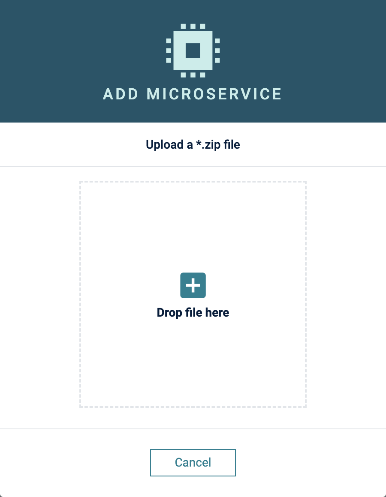
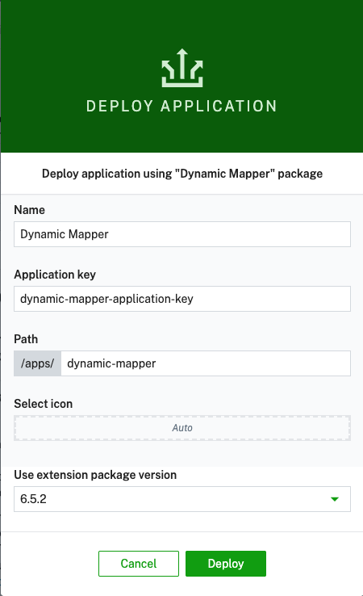
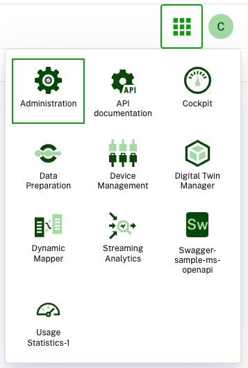

# Installation Guide

## Prerequisites

If you want to use the dynamic mapper, the following prerequisites must be met:

- a Cumulocity Tenant with **microservice** feature subscribed (if not available, please ask your contact or support)
- Admin privileges for your user in the tenant

### AI pre-requisites

To leverage **AI capabilities** of the dynamic mapper, you need to have the following prerequisites:
- **AI Agent Manager** microservice deployed in your tenant. This is currently in public preview.
- **AI Model Provider + API key** is required which must be configured in the **AI Agent Manager** and is leveraged by the AI agents. We tested `claude-sonnet-4-7` model from Anthropic, but you can use any other model that supports the required functionality.

## Installation

You need to install two components to your Cumulocity Tenant:

1. microservice - (Java)
2. Web App Plugin & Blueprint - (angular/Cumulocity WebSDK)

Both are provided as binaries in [releases](https://github.com/Cumulocity-IoT/cumulocity-dynamic-mapper/releases).

The microservice is provided in 4 variants:
* **Starter** - Uses 0.5 CPUs and 2 GB RAM, suitable for up to 625 messages per second to be processed.
* **Standard** - Uses 2 CPU and 4 GB RAM, suitable for up to 2500 messages per second to be processed.
* **Performance** - Uses 8 CPU and 8 GB RAM, suitable for up to 10.000 messages per second to be processed.
* **Max** - Uses 16 CPU and 16 GB RAM, suitable for up to 20.000 messages per second to be processed.

Download the binaries from the latest release and upload them to your Cumulocity Tenant.

## Permissions

The solution defines the following roles:

* `ROLE_DYNAMIC_MAPPER_ADMIN` that allows to manage the dynamic mapper, including the configuration of connectors and mappings.
* `ROLE_DYNAMIC_MAPPER_CREATE` that allows the user to create/manage mappings and subscriptions only.
* `ROLE_DYNAMIC_MAPPER_HTTP_CONNECTOR_CREATE` that allows to ingest messages via the HTTP connector.

Please assign the roles to the users that should be able to use the dynamic mapper.

### Microservice

In your Enterprise Tenant or Tenant navigate to "Administration" App, go to "Ecosystem" -> "Microservices" and click on "Add Microservice" on the top right.

The **Add microservice** dialog opens. Drop the `dynamic-mapper-service-*.zip` onto the upload area, or click it
to browse for the file — note that the microservice is uploaded as a **`*.zip`**, unlike a processor extension,
which is a `*.jar`.

Make sure that you subscribe the microservice to your tenant when prompted.

### Web app

The frontend can be deployed in your tenant as a **Blueprint** standalone Application selectable from the App switcher.

#### Community store (Preferred)

The Web App is part of the community store and should be available directly in your tenant under
"Administration" -> "Ecosystem" -> "Extensions" -> "dynamic-mapper". Here you have the choice to install it as a plugin or as a blueprint app.

##### Blueprint

For the blueprint go to "Administration" -> "Ecosystem" -> "dynamic-mapper" -> "Deploy application"

Enter an application key and path and click on "Deploy".

After successful deployment you can find the dynamic-mapper App in the Application Switcher

#### Manual

If you made changes or your want to upload the plugin manually you can do that by following these steps:

1. In "Administration" App go to "Ecosystem" -> "Packages" and click on "Add Application" on the top right.
2. Select `dynamic-mapper-ui.zip` and wait until it is uploaded.

Follow the steps from the point above to assign the plugin to your Administration App.

## Monitoring (OpenTelemetry)

By default the microservice exports traces, metrics, and logs via OTLP/HTTP to an internal
Grafana Alloy collector at `http://cumulocity-grafana-alloy:4318` (see
`dynamic-mapper-service/src/main/resources/application-prod.properties`). Building and sending
these happens on background threads after startup — an unreachable collector does not block or
fail microservice startup.

Since deployers of this microservice don't control the environment variables it starts with, it
can't rely on someone externally setting `OTEL_SDK_DISABLED` for edge/air-gapped installs. Instead,
`OtlpCollectorReachabilityEnvironmentPostProcessor` probes the configured collector endpoint once at
startup (a plain TCP connect, 1.5s timeout) before the OpenTelemetry SDK autoconfigures, and sets
`otel.sdk.disabled=true` for that run if it's unreachable — so an absent collector no longer
retries forever and spams the log with connection-failure stack traces
(`io.opentelemetry.exporter...HttpExporter`, e.g. `SocketException: Socket closed`). This is a
one-shot check: if the collector comes back later, export stays off until the process restarts. As
a second line of defense, `logback-spring.xml` also mutes that exporter's own logger, in case
export is left enabled and the collector drops mid-run.

To point at a different collector, set `OTEL_EXPORTER_OTLP_ENDPOINT`. To force export on even
though the probe can't reach it (e.g. while debugging the collector itself), set
`OTEL_SDK_DISABLED=false` explicitly — Spring Boot environment variables take precedence over the
packaged properties, but the post-processor only disables the SDK, it never re-enables one that's
already explicitly disabled.
