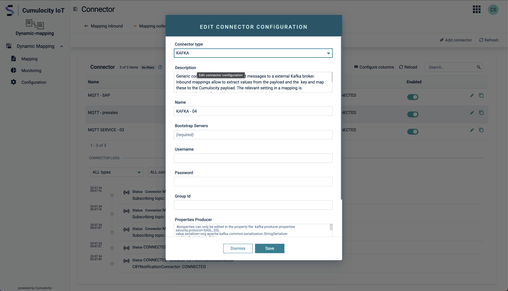

### Kafka connector security {#kafka-connector-security}

The Kafka connector derives its `security.protocol` automatically. You do not set it directly:

| Credentials set? | Custom CA trusted? | Resulting protocol |
|:---:|:---:|---|
| yes | either | `SASL_SSL` |
| no | yes | `SSL` (TLS only, no authentication) |
| no | no | `PLAINTEXT` |

**Authentication.** Set **Username** and **Password** (a secret), then pick the **SASL mechanism** your broker
offers: `SCRAM-SHA-256` (default), `SCRAM-SHA-512`, or `PLAIN`. The password and mechanism fields appear after you
enter a username. Use `PLAIN` for brokers that authenticate with an API key and secret pair. Confluent Cloud, for
example, supports only `PLAIN` and `OAUTHBEARER`, so a SCRAM mechanism there fails with
`UnsupportedSaslMechanismException`.

**Trusting a self-signed or internal CA.** Public-CA brokers (Confluent Cloud, most managed services) need no extra
configuration, because the JVM's default truststore already trusts them. For a broker presenting a certificate from
an internal or self-signed CA, enable **Trust custom server certificate** and supply the CA in one of two ways, as
for the MQTT, AMQP, and Pulsar connectors:

| Property | Description |
|---|---|
| `trustCustomCertificate` (**Trust custom server certificate**) | Enables custom CA trust. The remaining properties below appear only when it is on. |
| `nameCertificate` + `trustedCertificateFingerprint` (**Trusted certificate name**, **Trusted certificate fingerprint**) | Reference a certificate already uploaded to the Cumulocity trusted-certificate store (**Device Management → Management → Trusted certificates**). The fingerprint is the SHA-1 fingerprint. |
| `certificateChainInPemFormat` (**Certificate chain (PEM)**) | Paste the CA certificate chain inline in PEM format, as an alternative to the certificate store. |
| `disableHostnameValidation` (**Disable hostname validation**) | Skips TLS hostname verification. **Insecure. Use only for development and testing.** |

:::caution
Client-certificate authentication (mTLS) is not supported: the Cumulocity certificate store holds trust material
only, not private keys.
:::

Mechanisms beyond the three listed above (`OAUTHBEARER`, `GSSAPI`/Kerberos, AWS MSK IAM) have no dedicated
fields. You can still configure them with the raw Kafka client properties (`sasl.mechanism`,
`sasl.jaas.config`, `security.protocol`, and others) in **Additional producer properties** and **Additional
consumer properties**. Those maps are applied last and therefore override anything derived above.
