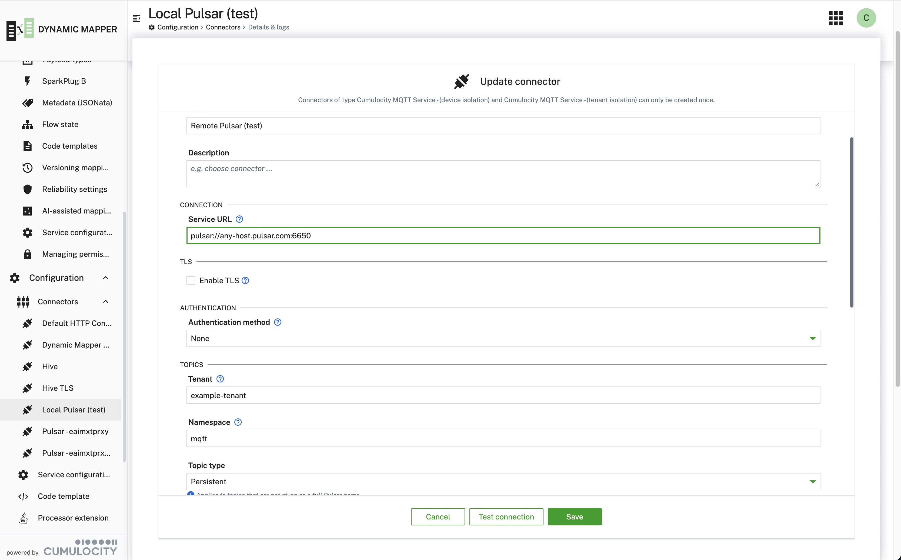

### Pulsar connector topics {#pulsar-connector-topics}



A mapping contains only a logical, MQTT-style topic, for example `pulsar/test/inbound`. Everything that belongs to the
Pulsar broker is connector configuration. The connector combines both into the full Pulsar topic name. To move a
mapping to another broker layout, change the connector and leave the mapping as it is.

A full Pulsar topic name has this form:

```
persistent://example-tenant/mqtt/pulsar-test-inbound
└─ domain ┘  └── tenant ──┘└ns ┘ └──── topic ─────┘
```

#### How the connector builds the topic name

The connector resolves the name in two steps.

1. **Flatten the topic.** A Pulsar topic name is a single segment, so the connector converts the mapping topic:

   | Rule | Example |
   |---|---|
   | `/` becomes `-` | `pulsar/test/inbound` becomes `pulsar-test-inbound` |
   | Spaces and characters outside `a-z A-Z 0-9 . _ -` become `_` | `my topic!` becomes `my_topic_` |
   | Leading and trailing `.`, `_`, and `-` are removed | `-abc-` becomes `abc` |
   | Letter case is kept | `Telemetry` stays `Telemetry` |

2. **Add domain, tenant, and namespace** from the connector properties:

   | Connector property | Default | Value in the screenshot |
   |---|---|---|
   | **Topic type** (`pulsarTopicDomain`) | Persistent | Persistent, so the name starts with `persistent://` |
   | **Tenant** (`pulsarTenant`) | `public` | `example-tenant` |
   | **Namespace** (`pulsarNamespace`) | `default` | `mqtt` |

With the settings in the screenshot, the mapping topic `pulsar/test/inbound` resolves to
`persistent://example-tenant/mqtt/pulsar-test-inbound`.

More examples:

| Mapping topic | Connector settings | Resulting Pulsar topic |
|---|---|---|
| `telemetry` | Tenant `example-tenant`, Namespace `mqtt` | `persistent://example-tenant/mqtt/telemetry` |
| `telemetry` | Namespace `example-tenant/mqtt` (combined form) | `persistent://example-tenant/mqtt/telemetry` |
| `telemetry` | Topic type Non-persistent | `non-persistent://example-tenant/mqtt/telemetry` |
| `devices/+/data` | Tenant `public`, Namespace `default` | Topics that match `persistent://public/default/devices-<one level>-data` |
| `persistent://t/n/telemetry` | any | Used as written. The tenant, namespace, and topic type settings are ignored. |

If you enter `tenant/namespace` in **Namespace**, that value overrides **Tenant**. **Topic type** applies only to
topics that you do not enter as a full Pulsar name.

#### Wildcards and the reverse conversion

Inbound mappings accept the MQTT wildcards `+` (exactly one level) and `#` (all remaining levels) when **Wildcards in
inbound topics** is on. The connector translates the filter into a Pulsar topic regex. `#` must be the last character
and must follow a `/`. `+` must sit between two `/` characters.

For an incoming message, the connector reverses the conversion when it can check the result against the mapping's topic
filter. In that case, `_TOPIC_LEVEL_` and topic-based mapping resolution work with `pulsar/test/inbound`. When the
connector cannot verify the match, the mapping sees the Pulsar local name, for example `pulsar-test-inbound`.

#### Limits

- Because `/` becomes `-`, `a/b-c` and `a-b/c` both resolve to `a-b-c`. Avoid `-` inside topic levels when you use
  wildcards.
- Letter case matters. `Telemetry` and `telemetry` are different Pulsar topics.
- A short topic name always resolves inside the one namespace of the connector. To read from two namespaces, create
  two connectors, or enter a full `persistent://...` name in one mapping.
- Prefer the logical form. A full `persistent://...` name ties that mapping to one broker layout.

For the Pulsar subscription name, the subscription type, and a comparison with Kafka and MQTT terms, see
[Pulsar, Kafka, and MQTT compared](/c8y-pkg-dynamic-mapper/introduction/how-to-pulsar-kafka-mqtt).
