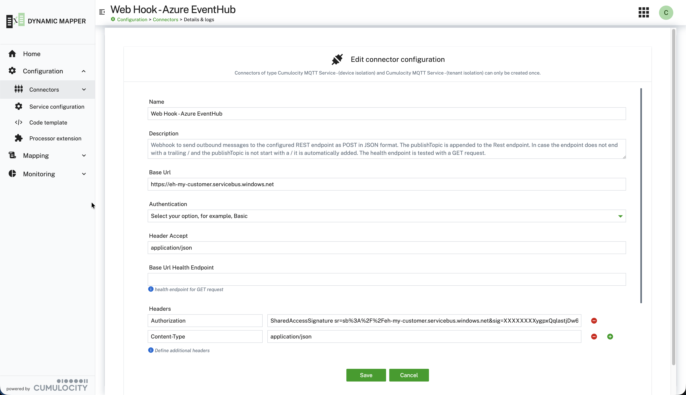

### Webhook connector {#webhook-connector}

The **Webhook** connector (outbound only) has a setting **Use Cumulocity API of this tenant**. Use it when
Cumulocity measurements, events, and alarms (MEA) should be processed and sent back to Cumulocity Core as
transformed MEA, for example to receive an `EVENT` of type `c8y_Uplink` and use a **SMART_FUNCTION** to decode the
payload and transform it into a `MEASUREMENT`. With the setting on, the connector uses the microservice credentials
and the endpoint of the tenant, and the settings **Base URL**, **Authentication**, and the other connection
settings are hidden. Otherwise, set the **Base URL** and choose **Authentication** `None`, `Basic`, or `Bearer`.
The separate **Cumulocity API** connector type is a preconfigured variant of this connector for the same purpose.

#### Text and binary payloads (outbound)

A Smart Function or Java Extension can send text or binary instead of JSON (see [Any Payload](/c8y-pkg-dynamic-mapper/introduction/payload-types)). Sent to an
external system, the body is the text or the bytes unchanged, with the content type set on the message (`text/plain`
for text and `application/octet-stream` for binary by default, `application/json` for JSON). With **Use Cumulocity API
of this tenant** on, the connector always sends JSON, because the payload is routed to a Cumulocity API.
