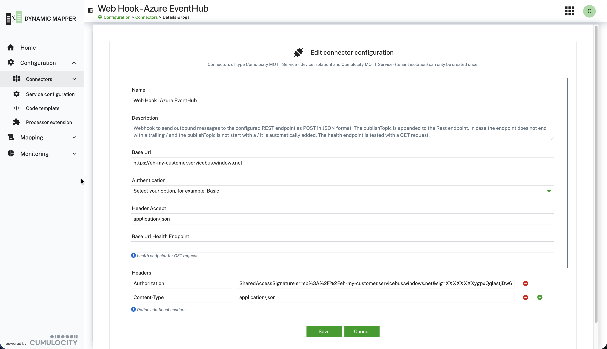

### Webhook connector {#webhook-connector}

The **Webhook** connector (outbound only) has a setting **Use Cumulocity API of this tenant**. Use it when
Cumulocity measurements, events, and alarms (MEA) should be processed and sent back to Cumulocity Core as
transformed MEA, for example to receive an `EVENT` of type `c8y_Uplink` and use a **SMART_FUNCTION** to decode the
payload and transform it into a `MEASUREMENT`. With the setting on, the connector uses the microservice credentials
and the endpoint of the tenant, and the settings **Base URL**, **Authentication**, and the other connection
settings are hidden. Otherwise, set the **Base URL** and choose **Authentication** `None`, `Basic`, or `Bearer`.
The separate **Cumulocity API** connector type is a preconfigured variant of this connector for the same purpose.

