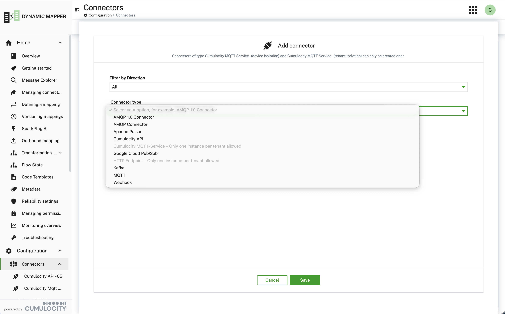
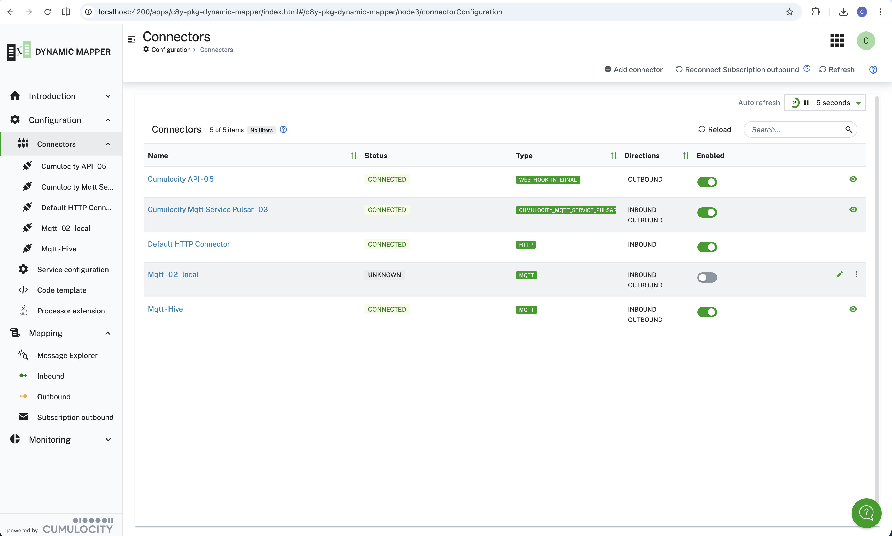
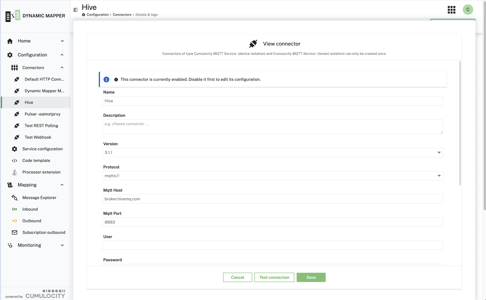
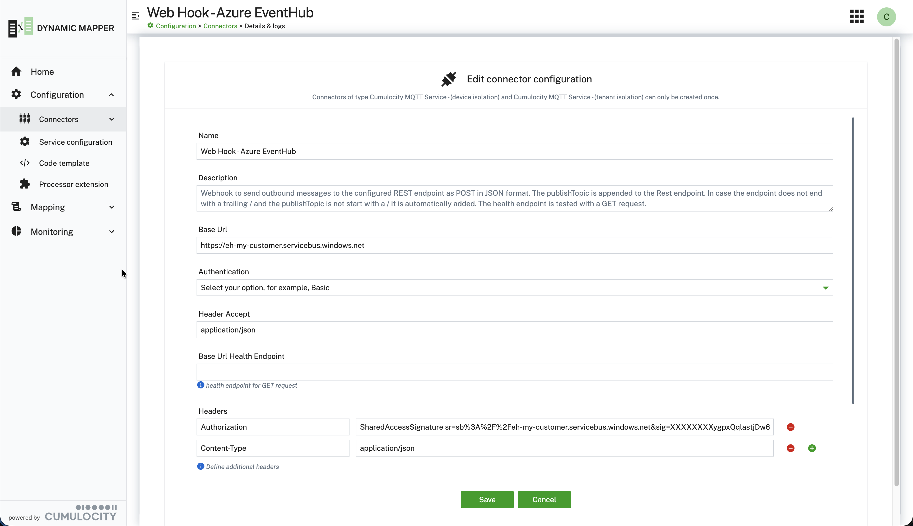
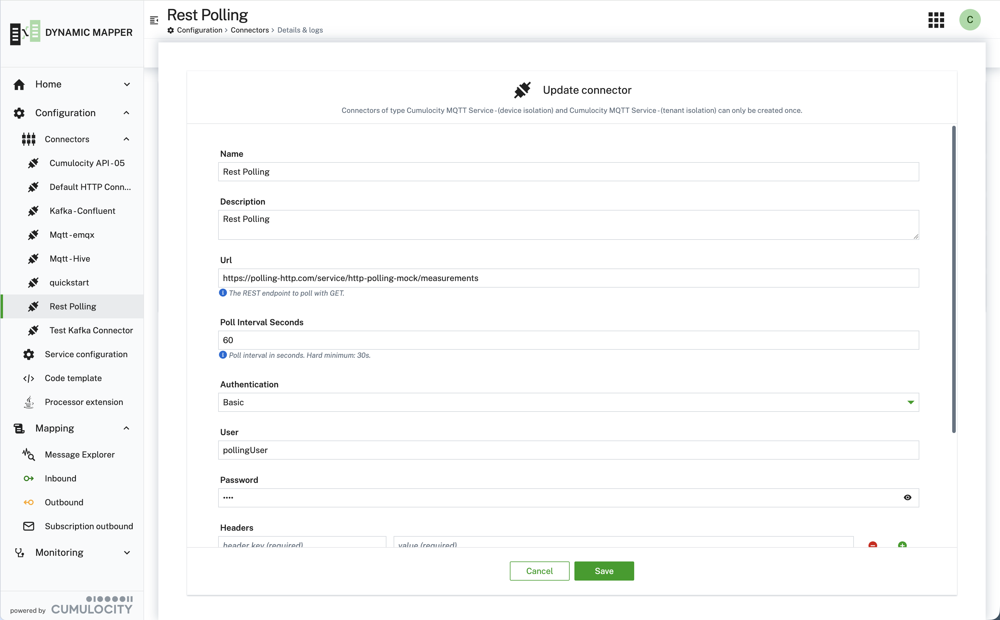
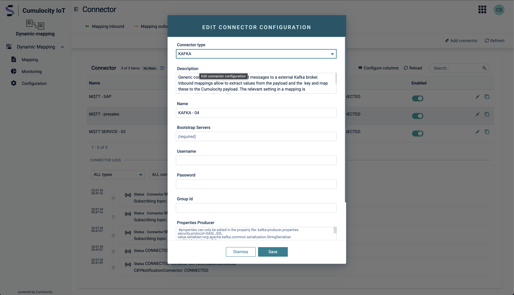
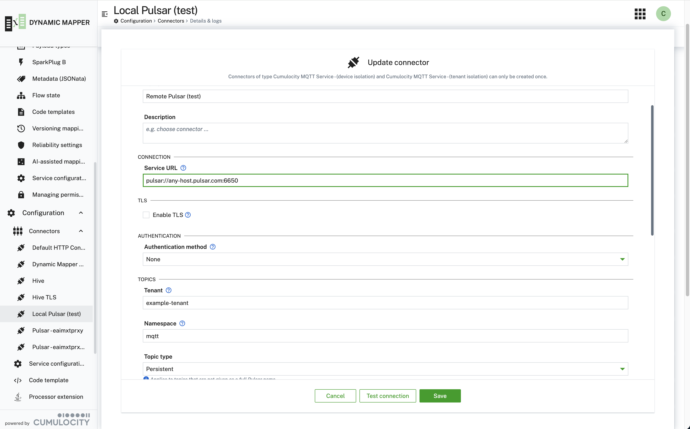

This page walks through the connector configuration UI and covers connector-specific setup details. For the list
of supported connectors, directions, and payload formats, see the table in
[Managing connectors](/c8y-pkg-dynamic-mapper/introduction/managing-connectors#managing-connectors).

### Adding and managing connectors

Add a new connector with
[**Configuration → Connectors → Add connector**](/c8y-pkg-dynamic-mapper/node3/connectorConfiguration). The
configuration properties shown adapt to the selected connector type. Creating, editing, deleting, and connecting
connectors requires the `ROLE_DYNAMIC_MAPPER_ADMIN` role. See
[Managing permissions](/c8y-pkg-dynamic-mapper/introduction/access-control).



The configured connectors are listed in a table with the columns **Name**, **Status**, **Identifier**, **Type**,
**Directions**, and **Enabled**. The row actions are edit, **Duplicate**, delete, and **Export connector**. A
connector must be disabled before you can edit it. The **Status** is one of `UNKNOWN`, `CONFIGURED`, `ENABLED`,
`CONNECTING`, `CONNECTED`, `DISCONNECTED`, `DISCONNECTING`, `FAILED`, or `RETRYING`. `RETRYING` means the connector
is connected, but a temporary platform error delays the start of its subscriptions, and the service retries
automatically. A mapping runs on a connector only while the connector is enabled and `CONNECTED`.

For connector types that support it (Webhook, Cumulocity API, and REST Polling), the **Test connection** button in
the connector form checks the configuration before you save it.

The **⋮** menu of the page also holds **Reconnect Subscription outbound**, **Export all connectors**, and
**Import connectors**. Exported files contain the value `****` instead of every password, token, and other secret.
An imported connector is created disabled, and the service drops masked secrets, so open the imported connector,
enter the secrets again, and then enable it. The Default HTTP Connector is neither exported nor imported.



When a connection fails to establish, the **Details & logs** page of the connector (open it from the table) shows
the underlying error, which is often the fastest way to spot an incorrect parameter. The page records status
changes only while **Send connector lifecycle** is on under **Configuration → Service configuration → Monitoring**.
It is off by default. Otherwise, the page shows **Logs not updated: lifecycle logging disabled**.



### Default HTTP Connector

The **Default HTTP Connector** (connector type **HTTP Endpoint**) does not need to be created manually. The
service creates it automatically for every tenant at microservice startup. It is reachable at
`https://<YOUR_CUMULOCITY_TENANT>/service/dynamic-mapper-service/httpConnector/<MAPPING_TOPIC>`: the path segment
after `.../httpConnector/` is used directly as the mapping topic. For example, a JSON payload POSTed to
`.../httpConnector/temp/berlin_01` is resolved against a mapping with mapping topic `temp/berlin_01`. The
**Cut off leading slash** property (on by default) removes a leading `/` of that sub path before the lookup.

The sender needs the `ROLE_DYNAMIC_MAPPER_HTTP_CONNECTOR_CREATE` role and authenticates against Cumulocity. The
connector has no credentials of its own. The endpoint answers `200` only after the mapping pipeline succeeded. A
pipeline failure or a timeout returns `500`, so the sender can retry. Errors while handing over the message, for
example when no HTTP connector is configured, return `400`.

 configuration properties.")

### Webhook connector

The **Webhook** connector (outbound only) has a setting **Use Cumulocity API of this tenant**. Use it when
Cumulocity measurements, events, and alarms (MEA) should be processed and sent back to Cumulocity Core as
transformed MEA, for example to receive an `EVENT` of type `c8y_Uplink` and use a **SMART_FUNCTION** to decode the
payload and transform it into a `MEASUREMENT`. With the setting on, the connector uses the microservice credentials
and the endpoint of the tenant, and the settings **Base URL**, **Authentication**, and the other connection
settings are hidden. Otherwise, set the **Base URL** and choose **Authentication** `None`, `Basic`, or `Bearer`.
The separate **Cumulocity API** connector type is a preconfigured variant of this connector for the same purpose.



### REST Polling connector

The **REST Polling** connector is for sources that only expose a REST API and cannot push data
themselves: instead of subscribing to a broker topic, it periodically sends a GET request and
feeds each response into the inbound mapping pipeline.



| Property (form label) | Notes |
|---|---|
| `url` (**URL**, required) | Base URL. Each deployed mapping's **topic** is appended as the request path, for example `url=https://api.example.com/v1` plus mapping topic `devices/measurements` gives `GET https://api.example.com/v1/devices/measurements`. |
| `pollIntervalSeconds` (**Poll interval (s)**) | Default 60. The minimum is **30 seconds**, enforced when you save the connector. |
| `authentication` | `None` (default), `Basic`, or `Bearer`. `Basic` requires `user` and `password`. `Bearer` requires `token`. Password and token are secrets. |
| `headers` | Additional static headers sent with every poll request. |
| `supportsWildcardInTopicInbound`, `supportsWildcardInTopicOutbound` (**Wildcards in inbound topics**, **Wildcards in outbound topics**) | Both off by default. |

Each mapping deployed to one REST Polling connector instance gets its **own independently
scheduled poll job**, and, since the topic becomes the path, can target its own endpoint under
the connector's base URL. All mappings on one connector instance still share the same **poll
interval** and **credentials/host**; a different interval or a different host needs a separate
connector instance.

#### Incremental fetch and pagination

Both are optional and off by default (every poll otherwise fetches the full response fresh):

| Property | Notes |
|---|---|
| `cursorParam` (**Cursor parameter**) | Query parameter name used to send an incremental-fetch cursor with each poll (for example `since`). Leave it empty to disable. |
| `cursorExtractionExpression` (**Cursor expression**) | JSONata evaluated against each response to compute the next cursor value (for example `items[-1].timestamp`). Used only together with `cursorParam`. |
| `paginationMode` (**Pagination mode**) | `None` (default), `NextLinkHeader`, `NextFieldInBody`, or `PageNumber`. Controls how the connector drains multiple pages within one poll cycle. |
| `maxPagesPerPoll` (**Maximum pages per poll**) | Default 20. Safety cap on pages drained per cycle, regardless of whether more are available. |
| `pageParam` (**Page parameter**) | Query parameter the next page's token or number is sent under (`NextFieldInBody` and `PageNumber` modes only). |
| `nextPageExpression` (**Next page expression**) | JSONata expression that extracts the next page's token from the response (`NextFieldInBody` mode only). |
| `pageStartValue` (**First page number**) | First page number (`PageNumber` mode only), for example `0` for a zero-indexed API. |

Each pagination mode stops on its own signal from the response, with no separate "last page" flag to
configure: `NextLinkHeader` stops once an RFC 5988 `Link: rel="next"` header is absent,
`NextFieldInBody` stops once `nextPageExpression` returns nothing, and `PageNumber` stops once a
response is an empty `[]` or `{}`.

The cursor advances after *every* page is successfully processed, not just once per poll cycle,
so if pagination fails partway through, the next poll resumes from the last page that made it
through rather than re-fetching already-processed pages or losing the unprocessed remainder.

If the mapping fails to process a page, the cursor does not move and the next poll tries the same page again,
with a growing delay. When the same page has failed **Maximum processing attempts per message** times (Service
configuration, default 5), the connector skips it. A failure with a server error (HTTP 5xx), for example while
Cumulocity is unavailable, is retried but not counted, so an outage never skips data.

When the connector skips a page, the cursor moves past it and the data of that page is not processed. The skip is
recorded as the **Last error** of the mapping and in the microservice log. Fix the mapping and, if the data matters,
fetch it again from the source. Without a cursor, every poll returns the same full response, so the response itself
identifies the page.

Message Explorer works on this connector too, but with a cost that does not apply to broker-based
connectors: exploring a topic with no mapping deployed on it yet starts real periodic requests
against the endpoint for as long as the session is open. See the note in
[Message Explorer](/c8y-pkg-dynamic-mapper/introduction/message-explorer).

### Kafka connector security {#kafka-connector-security}



The Kafka connector derives its `security.protocol` automatically. You do not set it directly:

| Credentials set? | Custom CA trusted? | Resulting protocol |
|:---:|:---:|---|
| yes | either | `SASL_SSL` |
| no | yes | `SSL` (TLS only, no authentication) |
| no | no | `PLAINTEXT` |

**Authentication.** Set **Username** and **Password** (a secret), then pick the **SASL mechanism** your broker
offers: `SCRAM-SHA-256` (default), `SCRAM-SHA-512`, or `PLAIN`. The password and mechanism fields appear after you
enter a username. Use `PLAIN` for brokers that authenticate with an API key and secret pair. Confluent Cloud, for
example, supports only `PLAIN` and `OAUTHBEARER`, so a SCRAM mechanism there fails with
`UnsupportedSaslMechanismException`.

**Trusting a self-signed or internal CA.** Public-CA brokers (Confluent Cloud, most managed services) need no extra
configuration, because the JVM's default truststore already trusts them. For a broker presenting a certificate from
an internal or self-signed CA, enable **Trust custom server certificate** and supply the CA in one of two ways, as
for the MQTT, AMQP, and Pulsar connectors:

| Property | Description |
|---|---|
| `trustCustomCertificate` (**Trust custom server certificate**) | Enables custom CA trust. The remaining properties below appear only when it is on. |
| `nameCertificate` + `trustedCertificateFingerprint` (**Trusted certificate name**, **Trusted certificate fingerprint**) | Reference a certificate already uploaded to the Cumulocity trusted-certificate store (**Device Management → Management → Trusted certificates**). The fingerprint is the SHA-1 fingerprint. |
| `certificateChainInPemFormat` (**Certificate chain (PEM)**) | Paste the CA certificate chain inline in PEM format, as an alternative to the certificate store. |
| `disableHostnameValidation` (**Disable hostname validation**) | Skips TLS hostname verification. **Insecure. Use only for development and testing.** |

:::caution
Client-certificate authentication (mTLS) is not supported: the Cumulocity certificate store holds trust material
only, not private keys.
:::

Mechanisms beyond the three listed above (`OAUTHBEARER`, `GSSAPI`/Kerberos, AWS MSK IAM) have no dedicated
fields. You can still configure them with the raw Kafka client properties (`sasl.mechanism`,
`sasl.jaas.config`, `security.protocol`, and others) in **Additional producer properties** and **Additional
consumer properties**. Those maps are applied last and therefore override anything derived above.

### Pulsar connector topics {#pulsar-connector-topics}



A mapping contains only a logical, MQTT-style topic, for example `pulsar/test/inbound`. Everything that belongs to the
Pulsar broker is connector configuration. The connector combines both into the full Pulsar topic name. To move a
mapping to another broker layout, change the connector and leave the mapping as it is.

A full Pulsar topic name has this form:

```
persistent://example-tenant/mqtt/pulsar-test-inbound
└─ domain ┘  └── tenant ──┘└ns ┘ └──── topic ─────┘
```

#### How the connector builds the topic name

The connector resolves the name in two steps.

1. **Flatten the topic.** A Pulsar topic name is a single segment, so the connector converts the mapping topic:

   | Rule | Example |
   |---|---|
   | `/` becomes `-` | `pulsar/test/inbound` becomes `pulsar-test-inbound` |
   | Spaces and characters outside `a-z A-Z 0-9 . _ -` become `_` | `my topic!` becomes `my_topic_` |
   | Leading and trailing `.`, `_`, and `-` are removed | `-abc-` becomes `abc` |
   | Letter case is kept | `COMMON` stays `COMMON` |

2. **Add domain, tenant, and namespace** from the connector properties:

   | Connector property | Default | Value in the screenshot |
   |---|---|---|
   | **Topic type** (`pulsarTopicDomain`) | Persistent | Persistent, so the name starts with `persistent://` |
   | **Tenant** (`pulsarTenant`) | `public` | `example-tenant` |
   | **Namespace** (`pulsarNamespace`) | `default` | `mqtt` |

With the settings in the screenshot, the mapping topic `pulsar/test/inbound` resolves to
`persistent://example-tenant/mqtt/pulsar-test-inbound`.

More examples:

| Mapping topic | Connector settings | Resulting Pulsar topic |
|---|---|---|
| `COMMON` | Tenant `example-tenant`, Namespace `mqtt` | `persistent://example-tenant/mqtt/COMMON` |
| `COMMON` | Namespace `example-tenant/mqtt` (combined form) | `persistent://example-tenant/mqtt/COMMON` |
| `COMMON` | Topic type Non-persistent | `non-persistent://example-tenant/mqtt/COMMON` |
| `devices/+/data` | Tenant `public`, Namespace `default` | Topics that match `persistent://public/default/devices-<one level>-data` |
| `persistent://t/n/COMMON` | any | Used as written. The tenant, namespace, and topic type settings are ignored. |

If you enter `tenant/namespace` in **Namespace**, that value overrides **Tenant**. **Topic type** applies only to
topics that you do not enter as a full Pulsar name.

#### Wildcards and the reverse conversion

Inbound mappings accept the MQTT wildcards `+` (exactly one level) and `#` (all remaining levels) when **Wildcards in
inbound topics** is on. The connector translates the filter into a Pulsar topic regex. `#` must be the last character
and must follow a `/`. `+` must sit between two `/` characters.

For an incoming message, the connector reverses the conversion when it can check the result against the mapping's topic
filter. In that case, `_TOPIC_LEVEL_` and topic-based mapping resolution work with `pulsar/test/inbound`. When the
connector cannot verify the match, the mapping sees the Pulsar local name, for example `pulsar-test-inbound`.

#### Limits

- Because `/` becomes `-`, `a/b-c` and `a-b/c` both resolve to `a-b-c`. Avoid `-` inside topic levels when you use
  wildcards.
- Letter case matters. `COMMON` and `common` are different Pulsar topics.
- A short topic name always resolves inside the one namespace of the connector. To read from two namespaces, create
  two connectors, or enter a full `persistent://...` name in one mapping.
- Prefer the logical form. A full `persistent://...` name ties that mapping to one broker layout.

For the Pulsar subscription name, subscription type, and the comparison with Kafka and MQTT terms, see
[How Pulsar, Kafka, and MQTT concepts map to Dynamic Mapper](https://github.com/Cumulocity-IoT/cumulocity-dynamic-mapper/blob/main/docs/how-to-pulsar-kafka-mqtt.md).
