### Defining a mapping {#define-mapping}

When you start with a new mapping, the first considerations are about the payload format and the transformation
type to use:

1. In which format is the payload sent? This defines the payload type (**Payload Format** in the dialog): JSON,
   Flat File, Hexadecimal, SparkPlug B, or Any Payload. See [Payload types](/c8y-pkg-dynamic-mapper/introduction/payload-types).
2. How do you define the transformation? This defines the transformation type. A new mapping uses a **Smart
   Function**. In Expert Mode you can also choose JSONata or a Java Extension. See
   [Transformation types](/c8y-pkg-dynamic-mapper/introduction/transformation-types).

:::important
If any of the templates: source or target is a JSON array - instead of a JSON object - then you have to choose
**Smart Function** as a transformation type.

JSONata mappings add metadata, for example `_IDENTITY_.externalId`, to the template, and this is not possible for
JSON arrays.
:::

Start adding a mapping with [**Mapping → Inbound**](/c8y-pkg-dynamic-mapper/node1/mappings/inbound) (or
**Outbound**) and **Add mapping**. The **Select Payload Format and Transformation Type** dialog contains:

- **Expert Mode**: off by default. Switch it on to show the **Transformation Type** selector.
- **Payload Format**: always shown. The default is **JSON Payload**.
- **Transformation Type**: shown in Expert Mode only. Otherwise the mapping uses a Smart Function.
- **Smart Function Source** (JSONata: **Substitutions Source**): shown when an AI agent is deployed for that
  transformation type. Choose **Generate with AI** to create the code in the Transformation step, or **Choose Code
  Template** to start from an existing [code template](/c8y-pkg-dynamic-mapper/introduction/code-templates). Without
  an AI agent, the dialog shows the **JavaScript Code Template** selector only. See
  [AI-assisted mapping](/c8y-pkg-dynamic-mapper/introduction/ai-assisted).
- For a Java Extension: the **Extensions** and **Events** selectors.

Click **Continue** to open the wizard.

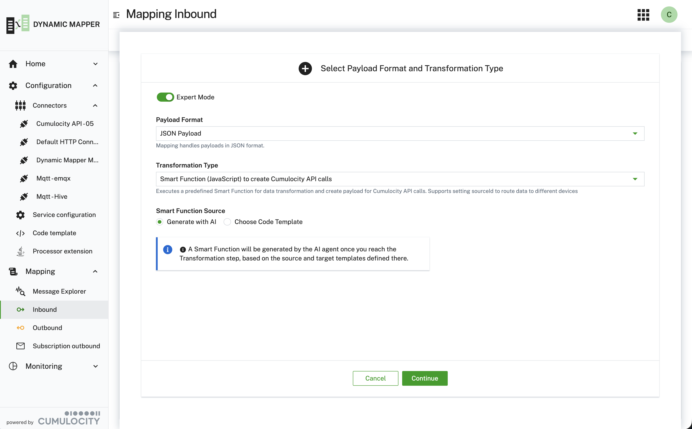

:::important
**Payload type and transformation type cannot be changed after mapping creation.** If you need a different type,
delete the mapping and create a new one. To avoid this, enable **Expert Mode** in the creation dialog to see all
options upfront.
:::

The wizard has five steps:

1. **Add and select connector**: choose the connector (where payloads come from or go to). You can select more than
   one connector to deploy the same mapping to all of them at once.
2. **General settings**: topic, target API, and the options described below.
3. **Select templates**: enter or select the source payload template. For a Smart Function it is the sample input
   for the test. For JSONata it is the source of the substitution paths.
4. **Transformation**: the Smart Function editor (or, for JSONata, the substitution editor), applied at runtime.
5. **Test mapping**: run a Dry Run or Live Test, then save the mapping.

**Outbound** mappings have one more step, **Subscription**, between **General settings** and **Select templates**
(so six steps, and the unified editor has a **Subscription** tab at the same place). It decides which devices
trigger the mapping. See [Defining a subscription for outbound mapping](/c8y-pkg-dynamic-mapper/introduction/define-subscription-for-outbound#in-the-mapping-editor).

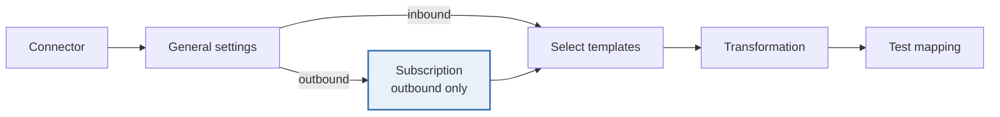

For **Any Payload** and **SparkPlug B** mappings the wizard shows no source or target template editors, because the
payload is binary. To see a real binary message, use the
[Message Explorer](/c8y-pkg-dynamic-mapper/introduction/message-explorer).

 a mapping is deployed to.")

In the second step of the wizard you define the most important properties for the mapping, e.g. Mapping Name,
Target API, Mapping Topic (topic to which this mapping should listen for, this supports wildcards: `#`, `+`). The
Mapping Topic Sample is a sample topic replacing all wildcards from the Mapping Topic, e.g. `datalogger/+` becomes
`datalogger/logger_13579`, this helps in the later steps to use concrete values instead of the abstract wildcards.

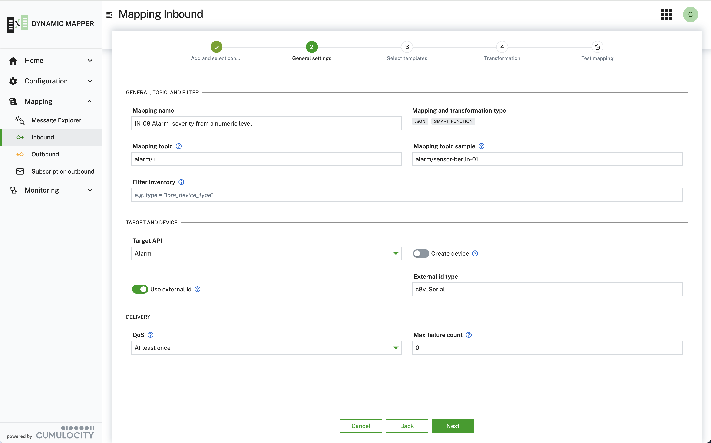

The remaining fields of the **General settings** step depend on the direction and the API:

| Field | Applies to | What it does |
|---|---|---|
| **Target API** (inbound) or **Source API** (outbound) | Both | The Cumulocity API the mapping creates data in (inbound), or the kind of change that triggers the mapping (outbound). |
| **Publish Topic** and **Publish Topic Sample** | Outbound | The topic the message is published to. A Smart Function can override it per message. |
| **Create device** | Inbound, except Inventory | Creates the device when a message arrives for an unknown external ID. |
| **Update Existing Device** | Inbound, Inventory API | Updates the device when it already exists. |
| **Auto acknowledge** | Outbound, Operation API | Sets the operation to `EXECUTING` before sending, then to `SUCCESSFUL`, or `FAILED` when the transformation fails. |
| **Event contains attachment** | Inbound, Event API | Handles an event with a binary attachment that is stored separately. |
| **Use external id** and **External Id type** | Both | Addresses the device by external ID (default type `c8y_Serial`) instead of the Cumulocity ID. Live Test and `context.getExternalId()` need it. |
| **Execution filter** | Outbound | Writes the **Filter execution mapping** of the Templates step: **Filter by type** (`type = '<value>'`), **Filter by fragment** (`$exists(<value>)`), or **Custom filter** (empty, enter the expression in the Templates step). The choice is required: a new mapping has none selected, and **Filter by type** and **Filter by fragment** also need a value. When you create a mapping from the Message Explorer, the type of the selected message is prefilled. An existing mapping opens with the option that matches its expression. |
| **Inventory filter** | Outbound | Shown when **Expert Mode** is on (on by default when a filter is set). JSONata filter on the device. See [Outbound mapping](/c8y-pkg-dynamic-mapper/introduction/define-subscription-for-outbound#inventory-filter). |
| **QoS** | Both | Delivery guarantee. Outbound offers at most once and at least once. See [Reliability settings](/c8y-pkg-dynamic-mapper/introduction/reliability-settings). |
| **Max failure count** | Both | Consecutive failures after which the mapping is deactivated automatically. `0` (the default) means no limit. The counter resets after one message is processed without error, and when you reactivate the mapping. |

Mappings are organized in a tree, one node per topic segment (`+`/`#` wildcards are ordinary segment values in
that tree). When a message arrives, the tree is walked one segment at a time; exact-match and wildcard branches
are followed in parallel, so a single message can match more than one mapping (e.g. both `device/+/data` and
`device/#`). For the detailed matching algorithm, see
[Mapping processing (inbound)](https://github.com/Cumulocity-IoT/cumulocity-dynamic-mapper/blob/main/docs/feature/mapping-processing-inbound.md)
in the developer documentation.

The levels of the Mapping Topic are split and added to the source payload as `_TOPIC_LEVEL_`, e.g.
`["device", "express", "berlin_01"]` for topic `device/express/berlin_01`. See
[Using metadata in source templates](/c8y-pkg-dynamic-mapper/introduction/metadata).

**Best practice:** Always test your mapping with sample payloads before activating it. Use the test feature in
step 5 to verify that your substitutions produce the expected Cumulocity format. This helps catch errors early and
ensures smooth operation.

The following screenshot shows the **Transformation** step for transformation type **Substitution as JSONata
Expression**. This step shows a JavaScript editor if you choose **Smart Function (JavaScript)**.

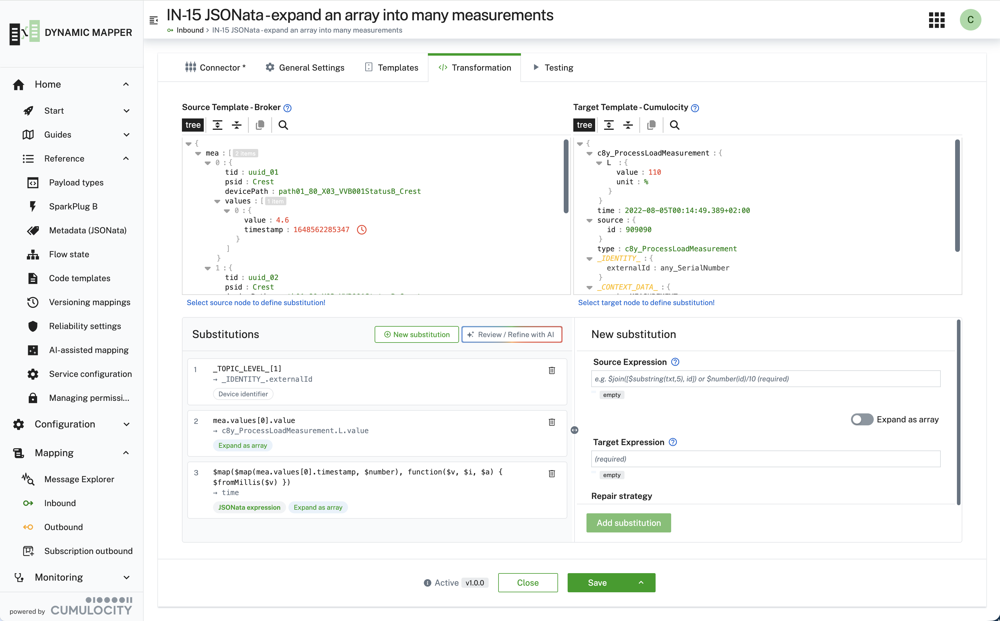


#### Execution Filter {#execution-filter}

An optional **execution filter** lets you narrow which messages a mapping actually processes, without writing any
transformation code. It applies to **both inbound and outbound mappings**.

You define it in the third step of the wizard, **Select templates**, in the **Filter execution mapping** field.
Select a node in the source template and press **Update Filter Execution Mapping** to seed the expression, then
refine it. The **Filter Result** field below shows the value the expression currently evaluates to against the
source template.

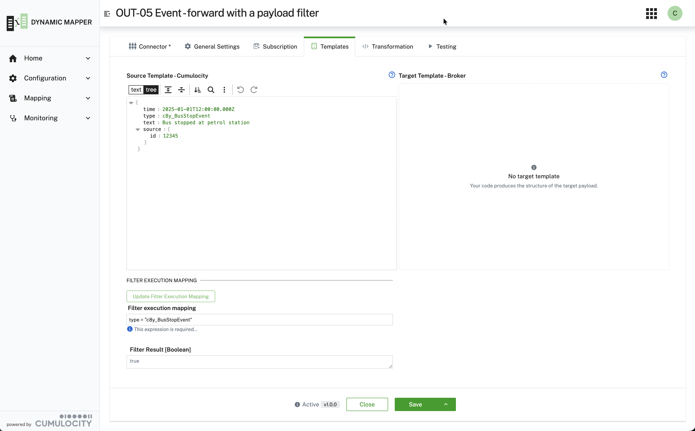

The expression is a JSONata expression that **must evaluate to a boolean**. The editor rejects anything else: an
expression returning a number or a string leaves the step invalid and you cannot continue. When the expression
returns `false` for a message, the mapping is skipped for that message:

- **Inbound:** the message is not mapped to Cumulocity. If no other mapping matches the topic, the message is
  discarded.
- **Outbound:** the message is silently dropped and not forwarded to the broker.

```javascript
// Inbound: only process readings above a threshold
telemetry.telemetryReadings[0].value > 10.00

// Outbound: only forward high-temperature measurements
c8y_TemperatureMeasurement.T.value > 95

// Outbound: only forward critical alarms
severity = "CRITICAL"

// Only process messages of a specific type
type = "c8y_Uplink"
```

The default value is `true`, i.e. every message is processed.

The expression is evaluated against the **incoming payload**: the broker message for inbound mappings, and the
notification that Cumulocity sends for outbound mappings. For an inventory update, that notification contains only
the changed fragments. If the expression fails, the message is skipped. Execution filters are not available for Any
Payload and SparkPlug B mappings. To filter on **device inventory** properties instead, use the [Inventory
Filter](/c8y-pkg-dynamic-mapper/introduction/define-subscription-for-outbound#inventory-filter), which is available for outbound mappings only.


### Managing mappings {#managing-mappings}

The **Inbound Mappings** / **Outbound Mappings** table is the entry point for working with existing mappings:

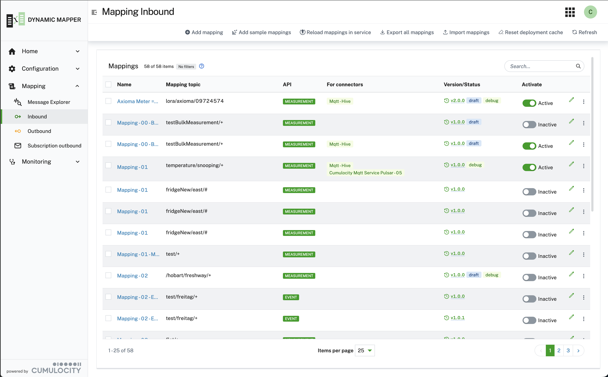

- **Add mapping** starts the wizard described above.
- The pencil icon on a row opens that mapping for editing. Editing does not need the mapping to be deactivated
  first. Your changes are saved as a **draft** alongside the running, active configuration and only take effect
  once you publish and activate that draft. See [Versioning mappings](/c8y-pkg-dynamic-mapper/introduction/versioning)
  for the full draft, publish, and activate flow, including rollback to a previous version.
- The **Activate** column switches a mapping on or off. A mapping that is not activated never runs.
- The row menu offers **Duplicate**, **Publish draft** (only while a draft exists), **Versions**, **Enable
  debugging** or **Disable debugging**, and **Export mapping**.
- The delete icon removes a mapping. It is available only while the mapping is deactivated.
- Select several rows to activate, deactivate, export, or delete them in one action.
- The **⋮** menu of the page offers **Add sample mappings**, **Reload mappings in service**, **Export all mappings**,
  **Import mappings**, and **Reset deployment cache**. Sample files to try import with:
  [inbound](https://github.com/Cumulocity-IoT/cumulocity-dynamic-mapper/blob/main/resources/samples/mappings-INBOUND.json),
  [outbound](https://github.com/Cumulocity-IoT/cumulocity-dynamic-mapper/blob/main/resources/samples/mappings-OUTBOUND.json).

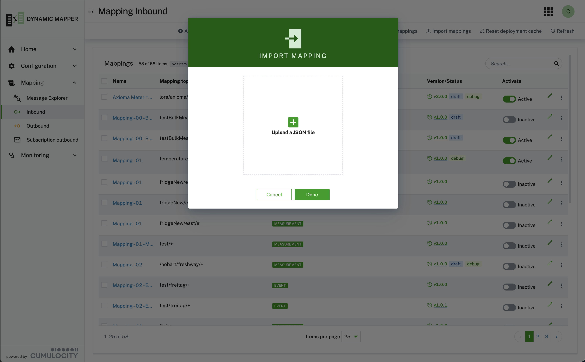

#### Testing a mapping {#testing-a-mapping}

Before activating a mapping, use the **Test mapping** step of the wizard (or reopen an existing mapping) to verify the
transformation without waiting for a real device message:

- **Dry Run**: applies the mapping's substitutions (or Smart Function / Java Extension code) to
  the sample source payload and shows the resulting Cumulocity request. Nothing is written to your tenant: device
  lookups run against mocked data. If the device does not exist and **Create device** is off, the test says so and
  offers to re-run assuming the device exists. A single test payload can produce more
  than one request, e.g. a measurement for a device that does not exist yet and is implicitly created also
  produces an inventory request. Use **Show Next Test Result** to step through all of them.

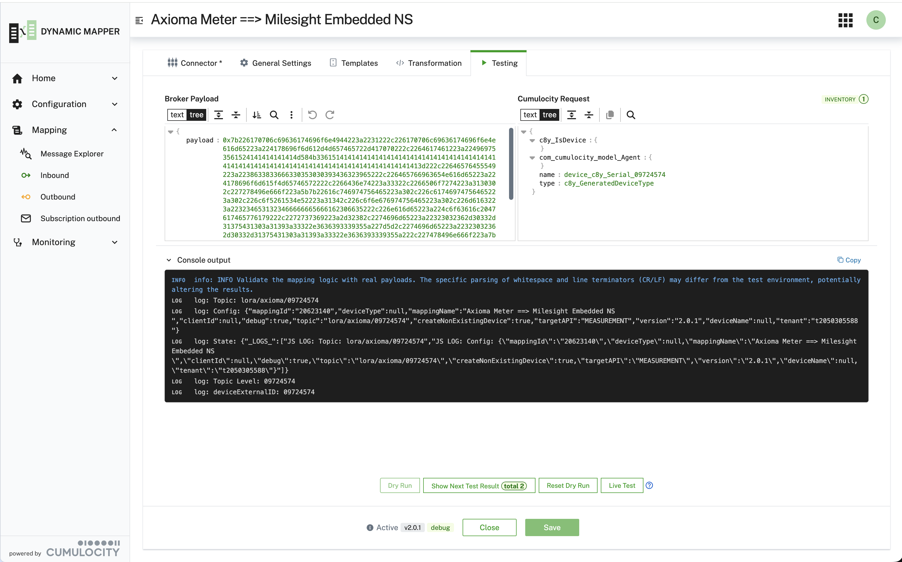

If the device named in the message does not exist and the mapping setting **Create device** is off, the Dry Run
does not invent one silently. It reports that the device does not exist and asks whether to **assume for this test
that the device exists**. Confirm to run the test again with a throwaway device in the mock; nothing is created in
your tenant. The choice applies to that one run only: the next Dry Run asks again, and a Live Test is never offered
this choice, because it runs against a test device (see below).

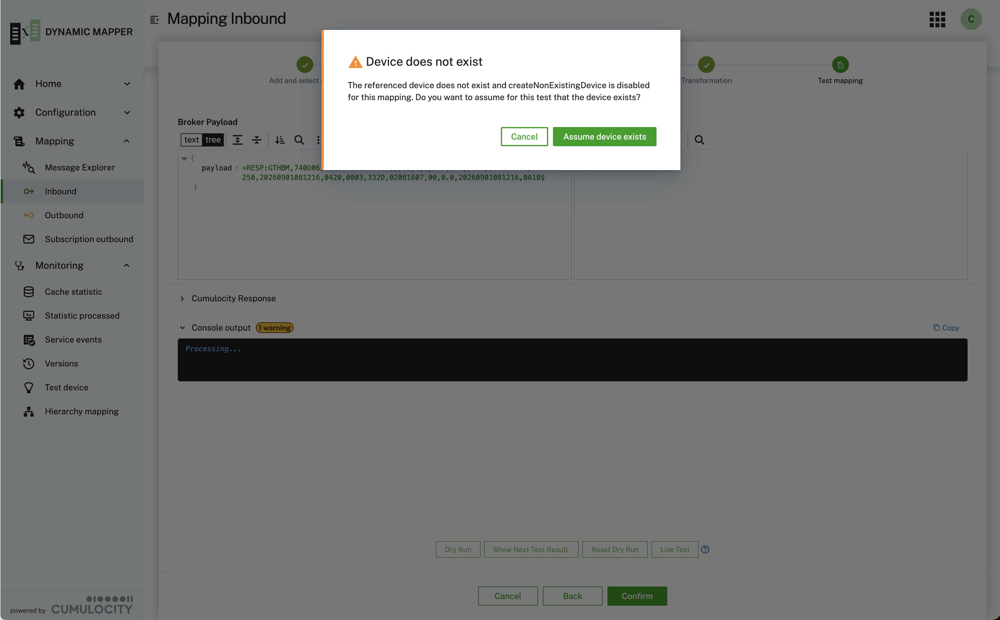

- **Reset Dry Run**: clears the test results and lets you run the Dry Run again, e.g. after editing the
  source payload or a substitution.
- **Live Test**: sends the transformed result(s) to Cumulocity for real. This requires the mapping to use an
  external ID (it is disabled otherwise). An inbound Live Test always runs against a **test device**, never against
  the real device that owns the message's external ID. The test device is registered under the external ID
  `d11r_liveTest_` + the mapping's external ID (for example `d11r_liveTest_862524060507262`), so when the real device later sends its
  first message, that message is not written to the test device. If no such device exists yet, it is created in
  inventory with the type and the fragment `d11r_testDevice`, so it can be identified and cleaned up afterwards; on
  the next Live Test it is reused. The confirmation says which of the two happened. A Live Test never creates a
  device through the mapping's **Create device** setting, so it cannot leave an untagged real device behind.
  For an **outbound** mapping, Live Test publishes the result to the topics of all connected, non-test connectors
  that deploy the mapping. No device is created: the identity is mocked, and the external ID in the topic carries the
  prefix `d11r_liveTest_`, so the message can never reach a real device. A test run never changes the mapping's
  statistics, error counters or failure streak, so a failing test cannot deactivate the mapping.
  SparkPlug B: a Live Test of NDATA/DDATA messages reads the alias map of the real node, so metrics may be shown
  without alias names; a Dry Run never finds an alias map, because it only sees mocked data.

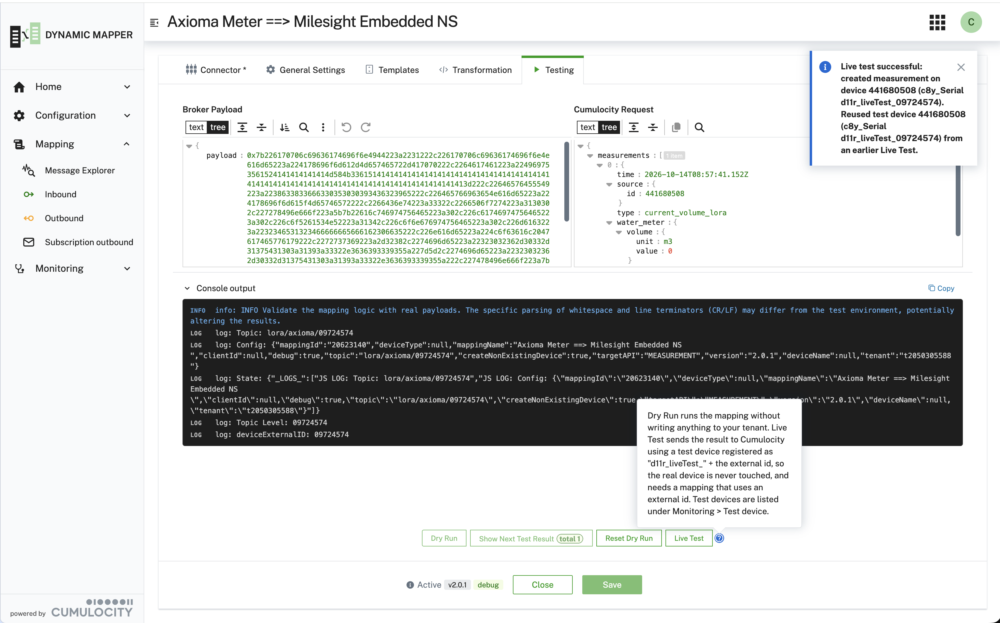

##### Testing a Smart Function and reading its console output {#testing-smart-function}

A Smart Function is ordinary JavaScript, so it is tested the same way: **Dry Run** executes your
`onMessage()` function against the source payload and shows what it returned. You do not have to publish a real
broker message, or even activate the mapping, to find out whether the code works.

Anything the function writes with `console.log()` appears in the **Console output** panel below the two payloads.
It is collapsed by default. Click the header to expand it. This is the quickest way to see what your function
actually received and how far it got: print the incoming payload, an intermediate value or a device lookup result,
run the test, and read it back.

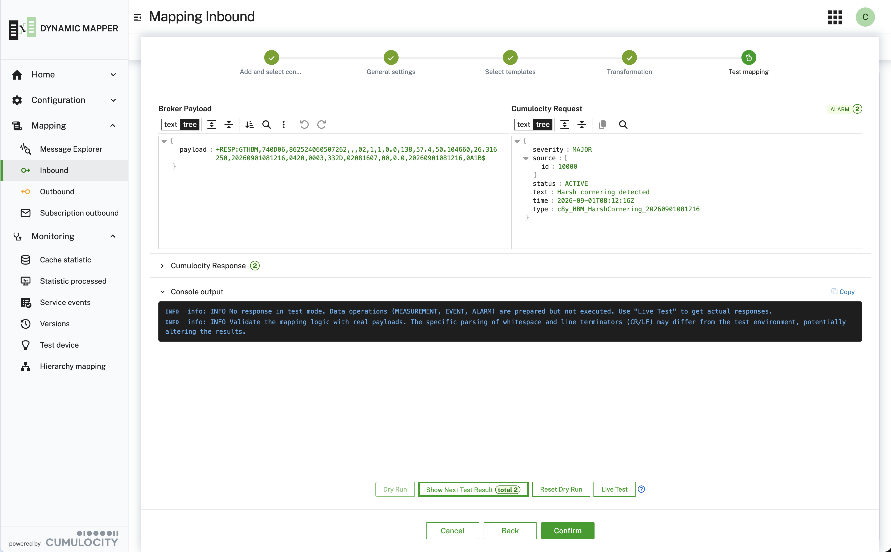

Each line is prefixed with the level it was logged at, and colour-coded accordingly:

| In your Smart Function | Appears as |
|---|---|
| `console.log(...)` | `JS LOG:` |
| `console.warn(...)` | `JS WARN:` |
| `console.error(...)` | `JS ERROR:` |
| `console.debug(...)` | `JS DEBUG:` |

Objects are serialised before being printed, so `console.log("payload:", payload)` shows the whole structure
rather than `[object Object]`.

The panel distinguishes two empty states, and the difference is worth knowing: **No output yet** means the test
has not been run, while **No console output for this test run** means the function ran but logged nothing. If you
expected log lines and see the latter, execution never reached your `console.log()` call.

The same messages also go to the microservice log, prefixed with the tenant, so a Smart Function that is already
active can be followed in production the same way. One difference applies there: `console.debug()` reaches the
microservice log only when **debug mode** is enabled for that mapping, whereas it always appears in this test
console. See [Enabling debug mode for a mapping](/c8y-pkg-dynamic-mapper/introduction/troubleshooting#debug-mode).

:::caution
Console output contains whatever you print. Avoid logging complete payloads from a mapping that handles personal
or otherwise sensitive data once it is running in production.
:::

#### Managing test devices {#test-devices}

You can delete a test device at any time. The next **Live Test** looks it up fresh, so it creates a new one; if a
send still fails because the deleted device's ID was cached, the Live Test evicts it, re-creates the device and
retries once. Only if that fails too does it ask you to clear the **Inbound ID cache** (Monitoring → Cache statistic).

Every time a **Live Test** needs a new device, the mapper creates a real managed
object in inventory tagged with the fragment `d11r_testDevice`. Over a few testing sessions these accumulate, so
the mapper keeps them in one place: **Monitoring → Test device**.

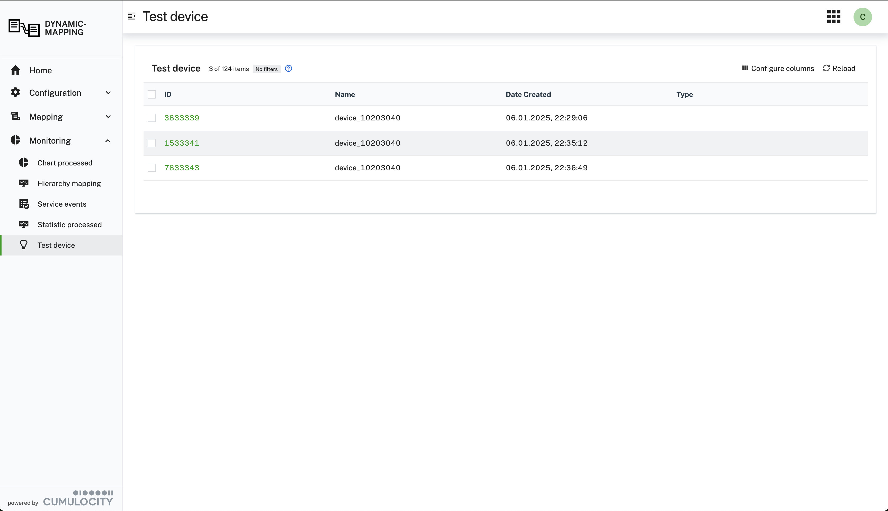

The page lists only devices carrying that fragment, never your production devices, with their **ID**, **Name**,
**Date Created** and **Type**. ID, Name and Type are filterable and sortable, so you can narrow a long list down
to the run you care about. The ID links through to the device in the standard Device Management app if you want
to inspect the measurements, events or alarms your mapping actually produced.

To clean up, delete a single device from its row menu, or tick several rows and delete them in one action. This
is ordinary inventory deletion: the device and its data are removed from the tenant.

:::info
Test devices are real devices. They count towards your tenant's device inventory. They are registered under
`d11r_liveTest_` + the real device's external ID, so messages from the real device never reach them. Deleting
them when a test round is finished keeps your inventory clean; the test itself never changes your mapping's
statistics.
:::

