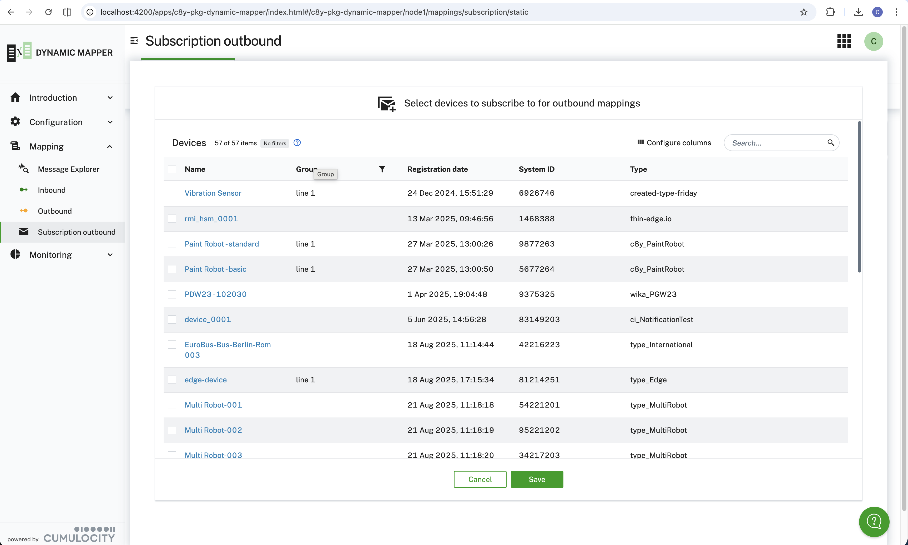
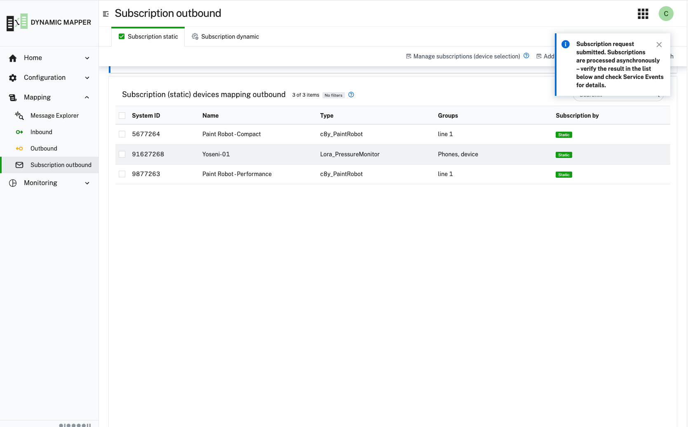
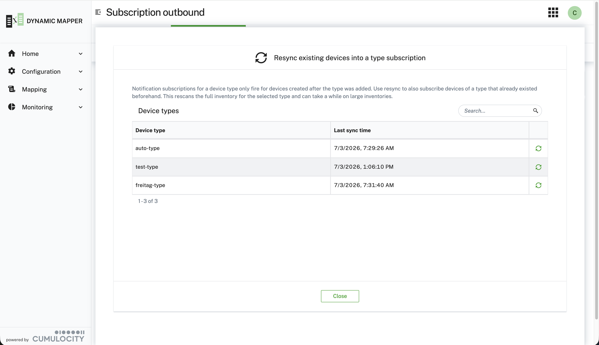
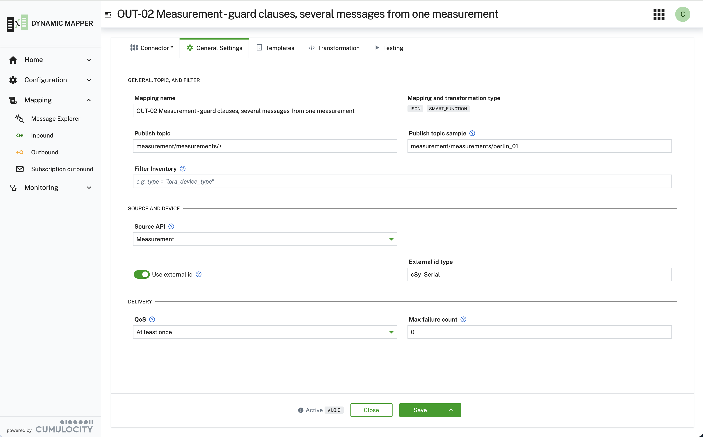

### Defining a subscription for outbound mapping {#define-subscription-for-outbound}

For a worked end-to-end example (subscribe a device, build the mapping, and trigger it with a real operation), see
the [outbound quickstart](/c8y-pkg-dynamic-mapper/introduction/quickstart-outbound).

An outbound mapping runs when data for a device changes in Cumulocity. The Dynamic Mapper only receives these
changes for devices that have a subscription. The details on how to create subscriptions are explained later in this
section.

:::important
Outbound mappings require subscriptions. Without a subscription, the mapping is not triggered even if it is
activated. Make sure to configure subscriptions for your devices, device groups, or device types.
:::

An outbound mapping is processed only if all of the following conditions apply:

- A subscription for this device exists
- The mapping is activated and a connector is assigned to it
- The **Source API** of the mapping matches the type of the change (measurement, event, alarm, operation, or
  inventory)
- If an inventory filter is defined for the mapping, e.g. `type = "pressure_sensor"`, it evaluates to `true`
- If an execution filter for the mapping is defined, e.g. `temperature > 95`, it evaluates to `true`

#### In the mapping editor {#in-the-mapping-editor}

The **Subscription** step of the wizard, and the **Subscription** tab of the unified editor, let you define the
subscription while you define the mapping. They appear for outbound mappings only, after **General settings**.

| Option | What it does |
|--------|--------------|
| **Skip for now** | Changes no subscription. This is the default. Add one later on the **Subscription outbound** page. |
| **Dynamic** | Subscribe by device type (**Manage subscriptions (by device type)**) or by device group (**Manage subscriptions (by device groups)**). |
| **Static** | Subscribe specific devices (**Manage subscriptions (device selection)** or **Add subscriptions (device table)**). |

The selection is written when you save the mapping, after the mapping itself was saved. Cancel the editor and
nothing changes. The lists start from the current subscriptions, so you can also remove a type, group, or device. The
removal is applied on save. If the saving of the subscription fails, the mapping stays saved, a warning explains
the failure, and the unified editor stays open so you can save again.

With **Dynamic**, the type list has a second column, **Also subscribe existing devices**. It is off by default and
shows a checkbox in the row of each new type. A device type rule only subscribes devices that are created afterward.
Tick the box of a type to also subscribe the devices of that type that already exist. This rescans the inventory in
the background and can take a while on large inventories. Types that are already subscribed show "subscribed already".

When you create a mapping from the [Message Explorer](/c8y-pkg-dynamic-mapper/introduction/message-explorer), the
step offers the type, the groups, and the device of the selected message as one-click suggestions.

#### On the Subscription outbound page

**Mapping → Subscription outbound** has two tabs for defining subscriptions. Subscriptions are processed
asynchronously, so refresh the list or check **Service Events** to see the result.

- **Subscription static**: Select specific devices or device groups. Use **Manage subscriptions (device selection)**
  for the tree view, where you can also remove subscriptions, or **Add subscriptions (device table)** to add devices
  with the table filters (add only). Subscriptions are created for the chosen devices and are not updated
  automatically when devices are added to or removed from a group.

  
- **Subscription dynamic**, **Manage subscriptions (by device groups)**: Specify device groups. When a group is added, subscriptions for all
  assigned devices are created. When a device is added to or removed from a chosen group, the subscription is
  automatically created or deleted. The filter applies to child assets and child devices.
- **Subscription dynamic**, **Manage subscriptions (by device type)**: Specify a list of device types. When a new device of one of the
  configured types is registered, a subscription is automatically created for it.

Use **dynamic subscriptions** with device types when you have many devices of the same type. This automatically
creates subscriptions for new devices as they're added to the system, reducing manual configuration overhead.



#### Resync existing devices into a type subscription

Dynamic subscriptions by device type only subscribe devices that are **created after** the type was added to the
list. Devices of that type which already existed beforehand are not picked up automatically. Use **Resync
existing devices** to backfill subscriptions for those pre-existing devices.

When a device type is removed from the dynamic subscription list, subscriptions that were already created for
that type are **not** deleted.

Clicking **Resync existing devices** next to the device type list opens a dialog listing all configured device
types together with the time of their last successful resync. Selecting **Resync existing devices** for a given
type triggers a background job that rescans the full inventory for devices of that type and creates the missing
subscriptions. This can take a while on large inventories, so the request is submitted asynchronously. Progress
and the outcome (e.g. number of devices subscribed) can be tracked in **Service Events**.



#### Inventory Filter and Execution Filter {#outbound-filters}

Two optional filters let you narrow which outbound messages are processed without writing any transformation
code.

##### Inventory Filter {#inventory-filter}

Evaluated for each change against the device's cached inventory fragments. If the expression returns `false` or
fails, the mapping is skipped for that message. The expression is a JSONata expression. It is not affected by which
fields the change contains, because it reads the device's inventory and not the notification.

This filter is the **Filter Inventory** field on the **General settings** step of the wizard and is available for
**outbound mappings only**.



```javascript
// Only process pressure sensors
type = "c8y_PressureSensor"

// Only process devices with a hardware serial number fragment
$exists(c8y_Hardware.serialNumber)

// Only process active devices of a specific model
c8y_IsDevice = true and c8y_Hardware.model = "SmartSensor v2"
```

:::important
Any property referenced here has to be added under **Configuration → Service configuration → Caching → Fragments
from inventory to cache**, otherwise it is not available to the filter at runtime. By default only `type`, `name`,
and `id` are cached.
:::

##### Execution Filter {#outbound-execution-filter}

Evaluated at runtime against the notification that Cumulocity sends. If the expression returns `false`, or fails, the
message is silently dropped and not forwarded to the broker.

The execution filter is not specific to outbound mappings. It works the same way for inbound mappings and is
defined on the same wizard step in both directions. See [Execution Filter →](/c8y-pkg-dynamic-mapper/introduction/define-mapping#execution-filter) for the full
description, the editor's boolean requirement, and examples.

The **Inventory Filter** operates on the device's cached inventory fragments, while the **Execution Filter** operates
on the triggering payload (measurement, event, alarm, operation, or inventory update). Use filters to reduce
unnecessary broker traffic without modifying your transformation logic.

:::caution
For an **inventory update**, Cumulocity sends only the changed fragments. An execution filter that reads a fragment
which is not part of that update treats it as missing, even when the fragment exists on the device. To filter on
something that is not in every update, such as the device type, use the **Inventory Filter** instead.
:::

A **Dry Run** or **Live Test** of an outbound mapping does not apply either filter, so test the filter expressions in
the editor and with a real notification.

