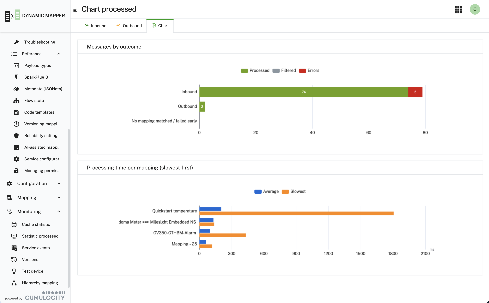
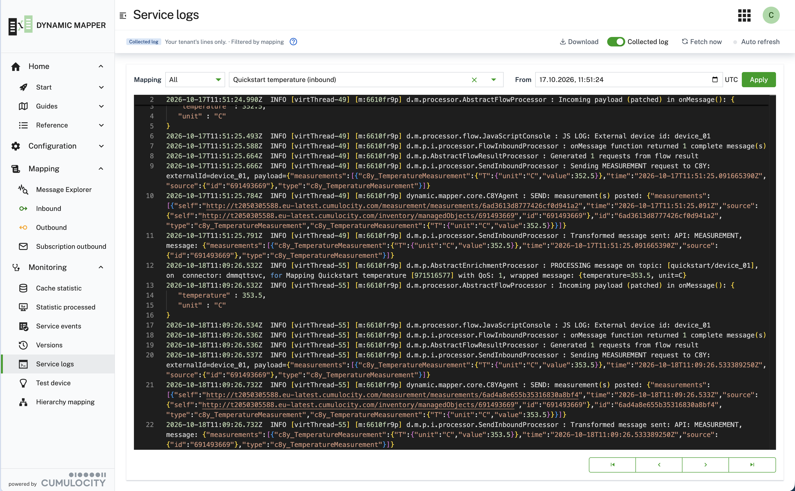
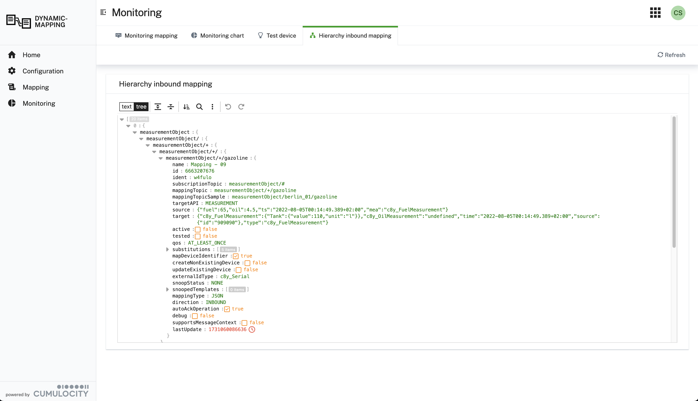

### Monitoring {#monitoring}

The **Monitoring** section in the left navigation contains views for **Statistic processed**, **Chart
processed**, **Cache statistic**, **Service events**, **Service logs**, and **Hierarchy mapping**. Each gives a different
operational perspective on what the mapper is doing at runtime.

#### Statistic processed (Inbound / Outbound)

This view shows one row per mapping in a data grid, plus a catch-all row **Unmapped messages** at the end
(messages no mapping claimed, and failures that happened before a mapping could be chosen). The columns are:

| Column | Meaning |
|---|---|
| **Name** | The mapping name. Click the name to open the mapping editor directly. |
| **Mapping topic** | The subscription topic pattern the mapping listens on (inbound) or the Cumulocity source object type (outbound). |
| **Publish topic** | The broker topic the mapping publishes to (outbound only). |
| **Status** | The health of the mapping *right now*: **OK**, **Failing (N in a row)** when the last N messages in a row failed, or **Idle** when the mapping has not received anything yet. It is based on the consecutive-failure streak, so it returns to **OK** after the first message that succeeds. |
| **Received** | Messages that reached this mapping. Counted per mapping: one message matching three mappings counts three times. |
| **Processed** | Messages that completed without an error and were not dropped. |
| **Filtered** | Messages that matched the topic but were dropped on purpose — the mapping filter or the inventory filter did not match, or a Smart Function / extension chose to ignore the message. Not an error. |
| **Errors** | Messages that failed during transformation or submission. A non-zero value means at least one message was lost — see **Last error** and **Service events**. |
| **Last message** | When the mapping last finished processing a message (any outcome). Empty if none yet. |
| **Last error** | Time and text of the most recent error, so you can triage without opening the service events. Empty if there was none. |

These columns are hidden by default. Turn them on in the column menu of the grid:

| Column | Meaning |
|---|---|
| **Error rate** | **Errors** divided by **Received**, capped at 100 %. |
| **Requests (failed)** | Requests the mapping produced — Cumulocity API calls (inbound) or broker publishes (outbound) — and, in brackets, how many of them failed. Counted per request, so one message can add several. |
| **Time avg / max** | Average and slowest processing time of a message in milliseconds, measured from when the message enters processing to when the mapping is done. Time spent in the connector or the broker is not included. |

As a rule, **Received** = **Processed** + **Filtered** + **Errors**. The sum can differ slightly while messages
are still in flight, or when one message raises several errors.

If your data does not arrive, check **Filtered** first: a mapping with many filtered messages and no errors is
receiving data that its filter rejects.

Counters accumulate since the last reset (or since microservice startup). Use the **Reset statistics** button in
the action bar to zero all counters — useful for measuring throughput during a specific time window. Test runs
from the mapping editor are not counted.

 view listing received/error counts per mapping.")

#### Chart processed

The Chart view shows two charts, both built from the same live counters as the statistic tables:

- **Messages by outcome** — one stacked bar each for **Inbound**, **Outbound** and **No mapping matched / failed
  early**, split into **Processed** (green), **Filtered** (grey) and **Errors** (red).
- **Processing time per mapping** — the ten slowest mappings by average processing time, with each mapping's
  slowest single message next to it. It stays empty until a mapping has processed a message.

Both show totals since the last reset, not a trend over time. They update live as messages arrive.

#### Cache statistic

The Cache statistic view shows three cache panels side by side, each displaying two KPI cards:

| Cache panel | KPI card | Meaning |
|---|:---:|---|
| **Inventory Cache** | **# Entries** | Number of managed object fragments currently held in memory. Below the card the configured size limit is shown (default: 100 000). When the limit is reached, the least-recently-used entry is evicted to make room. |
| **Inventory Cache** | **% Percent** | Fill rate — `Entries / Limit × 100`. A value approaching 100 % means the cache is nearly full and evictions are occurring frequently, which may slow down message processing. |
| **Inbound ID Cache** | **# Entries** | Number of external-ID → internal managed object ID mappings currently cached. Each mapping is resolved once and then stored here, so subsequent inbound messages skip the identity resolution REST call entirely. |
| **Inbound ID Cache** | **% Percent** | Fill rate for the inbound ID cache, same calculation as above. A high fill rate with many devices indicates you may want to increase the cache limit in the service configuration. |
| **Outbound ID Cache** | **# Entries** | Number of internal managed object ID (+ external ID type) → external-ID resolutions currently cached. Used by outbound mappings with **useExternalId** enabled — e.g. a Smart Function or Flow function reading `context.getConfig().externalId` — to avoid resolving the device's external ID from Cumulocity on every outbound message. |
| **Outbound ID Cache** | **% Percent** | Fill rate for the outbound ID cache, same calculation as above. |

The action bar at the top of the page provides four buttons:

- **Clear inbound external ID cache** — removes all cached external-ID-to-internal-ID resolutions (used by
  inbound mappings resolving a device from its external ID). Use this after deleting or re-registering a device
  to prevent stale identity lookups. The cache is rebuilt automatically as new messages arrive.
- **Clear outbound external ID cache** — removes all cached internal-ID-to-external-ID resolutions (used by
  outbound mappings with **useExternalId** enabled). Use this after re-enrolling a device under a different
  external ID, or reassigning an external ID to a different device, to avoid outbound messages being routed
  using a stale external ID. The cache is rebuilt automatically as new outbound messages arrive.
- **Clear inventory cache** — removes all cached managed object fragments. Use this after updating a device's
  managed object directly in Cumulocity (outside the mapper) so the mapper picks up the latest values. The
  fragments you configured under **Service Configuration → Function → Fragments from inventory to cache** are
  re-fetched on demand. Entries can be exact fragment names or glob patterns (e.g. `sparkPlugB_DBIRTH_*`).
- **Reload** — refreshes the KPI cards without clearing the caches, useful to get an up-to-date snapshot of the
  current fill levels.

:::caution
All three caches are held in memory and are lost on microservice restart. After a restart they are rebuilt
automatically as messages arrive — no manual action is needed.
:::

Both ID caches are also cleared automatically on a configurable schedule — see **Days lifetime inbound Id
cache** and **Days lifetime outbound Id cache** under
[**Service Configuration → Caching**](/c8y-pkg-dynamic-mapper/node3/serviceConfiguration/caching). This is a
full-cache wipe on a timer (not per-entry expiry), so set the retention short enough for your device
re-enrollment/reassignment cadence if you rely on it instead of manually clearing the cache.

#### Service events

The Service events view is the primary place to diagnose individual message failures without needing access to
the microservice container logs. It displays a filterable list of events emitted by the mapper backend. Each
entry shows:

- **Type** — event severity/category (e.g. `STATUS_MAPPING_CHANGED`, `STATUS_CONNECTOR_EVENT`,
  `MAPPING_FAILURE`)
- **Timestamp** — when the event occurred
- **Message** — the full error or status description, including the mapping name, tenant, and root cause

Use the **Type** dropdown and **Date from / Date to** pickers to narrow the event list to a specific time window
or event category. This is particularly useful when correlating errors with known message arrival times.

:::caution
Service events are stored in an in-memory ring buffer and are lost on microservice restart. For long-term audit
trails, configure the Cumulocity platform's built-in audit log or forward events to an external monitoring
system.
:::

#### Service logs {#service-logs}

The Service logs view shows the log of the `dynamic-mapper-service` microservice inside the Dynamic Mapper, so you
can follow what the mapper did for your tenant without opening the Administration application. Where the lines come
from depends on who owns the microservice. The badge at the left of the action bar tells you which one you are
looking at:

| Badge | What you see | When |
|---|---|---|
| **Platform log** | The complete log of the microservice instance, including the lines of every tenant that shares it. | You are in the tenant that owns the microservice and your user may read applications. |
| **Collected log** | Only the lines that were logged for **your** tenant. | Every other case: your tenant only subscribes to the microservice, or you own it but your user may not read its log in Administration. |

The page picks the source itself; there is nothing to choose. Both look and behave the same.

##### The collected log

The service stores the lines of each tenant as events in that tenant and this view reads them back. What that means
for you:

- **Only your tenant's lines.** A line is shown to a tenant only if it was logged for that tenant. Lines of other
  tenants, and lines that belong to no tenant (start-up, shared infrastructure), never appear.
- **Warnings and errors by default.** Lines below the level the operator configured are not collected. Informational
  lines can contain device payloads, which is why the default is **WARN**.
- **Limited and slightly late.** Lines are kept for a limited time (24 hours by default) and arrive within about a
  minute. A very busy period can exceed the per-tenant limit; the view then says how many lines were left out.
- **Same line format** as the platform log: time (UTC), level, thread, logger and message. A stack trace stays with
  the line it belongs to.

##### Controls

| Control | What it does |
|---|---|
| **Instance name** | Selects the microservice instance. Each instance has its own log; the collected log lists the instances that have stored lines for your tenant. |
| **From** and **Apply** | Jumps to a start time. The time is in **UTC**, not your local time. |
| **First / Previous / Next / Last** | Pages through the log. **Last** shows the newest lines. **Next** and **Last** are disabled while auto refresh is on, because it already follows the newest lines. |
| **Dark theme** | Switches the log between a dark and a light theme. The choice is remembered in your browser. |
| **Auto refresh** | Reloads the newest lines every 10 seconds. |
| **Download** | Saves the whole log of the selected instance as `<instance>.log`. |

##### Who can open it

The view requires `ROLE_DYNAMIC_MAPPER_ADMIN`; users without it do not see the menu entry. See
[Managing permissions](/c8y-pkg-dynamic-mapper/introduction/access-control).

:::info
The collected log is stored as ordinary Cumulocity events of type `d11r_serviceLog`, attached to a managed object
named **Dynamic Mapper service log** in your tenant. Anyone who may read events in your tenant can also list them
there, independent of the Dynamic Mapper roles.
:::

##### Switching the collection on

Collecting the log is off by default. Whoever deploys the microservice switches it on with a property of the
service. How a property is set depends on how the microservice is deployed; a restart is required.

| Property | Default | Meaning |
|---|---|---|
| `service.logs.collector.enabled` | `false` | Switches the collection on. |
| `service.logs.collector.min-level` | `WARN` | Lowest level that is collected: `TRACE`, `DEBUG`, `INFO`, `WARN` or `ERROR`. |
| `service.logs.collector.interval-ms` | `30000` | How often collected lines are stored. |
| `service.logs.collector.max-lines-per-tenant` | `500` | Most lines stored for one tenant per run; the rest is counted as left out. |
| `service.logs.collector.max-chunk-bytes` | `65536` | Size of one stored event. |
| `service.logs.collector.retention-hours` | `24` | How long stored lines are kept. Older lines are deleted by the clean-up described below, even when the collection itself is switched off. |
| `service.logs.retention.enabled` | `true` | Switches the clean-up of old stored lines on or off. |
| `service.logs.retention.interval-ms` | `3600000` | How often old lines are deleted (every hour by default). |
| `service.logs.collector.max-buffered-records-per-tenant` | `2000` | Lines one tenant can have waiting in memory. When it is full the oldest are dropped. |

**Clean-up.** A separate job deletes the stored lines of every subscribed tenant once they are older than the retention
period, so the number of `d11r_serviceLog` events does not keep growing. It runs on its own schedule and does not
depend on the collection: if you switch the collection off, lines that were stored earlier are still removed when
their time is up. Every instance of the microservice runs it; deleting lines that are already gone does nothing.
The lines of a tenant that unsubscribes are left alone, because they belong to that tenant.

:::caution
At level **INFO** the service logs the full payload of every message it processes, and the collected log shows it to
the tenant's administrators. Keep the default **WARN** unless you need the processing steps. Lines that are still in
the service's memory when an instance stops are lost, because they are stored a short time after they are logged.
:::

#### Hierarchy mapping

This view exposes the topic-matching tree described under [Mapping Topic](/c8y-pkg-dynamic-mapper/introduction/define-mapping) as a JSON document: an
array of nodes, each keyed by a topic segment, nested the same way the tree is walked at runtime, down to the
mapping registered at each leaf (its full definition, including its substitutions). It is the most direct way to
trace why a message did — or did not — match a particular mapping, especially once several mappings share
overlapping topic prefixes.

