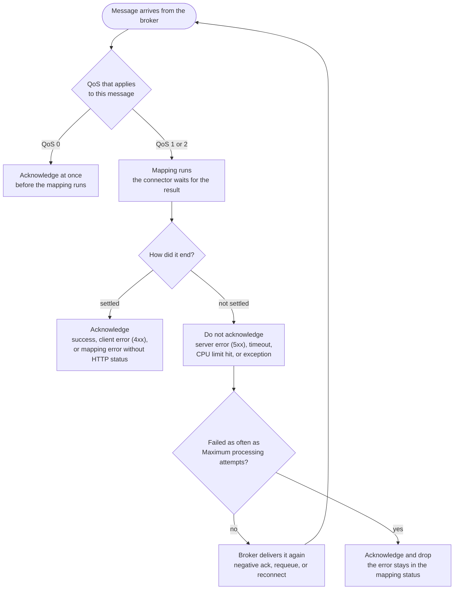

### Using reliability settings in mappings {#reliability-settings}

You can set a QoS (Quality of Service) level for a mapping in the **QoS** field of the mapping properties. The
level states when the connector may acknowledge a message to its broker: before the mapping runs (QoS 0), or only
after the mapping pipeline succeeded (QoS 1 and 2). A connector that does not support the selected level handles
the mapping at the nearest lower level it supports, and the QoS field shows which connectors do so. The service logs
each such clamp once as a warning. When several mappings match one message, the strongest requested level wins.

The diagram shows what a connector does with a message, once it knows the QoS that applies.

A message that is not acknowledged comes back, so the same message can run through the mapping again. A mapping
must therefore tolerate duplicates. With QoS 0 the message is acknowledged before the mapping runs, so a failure
loses it. A client error such as a malformed payload counts as settled, because a redelivery would fail the same
way. The error is still counted in the mapping status.

Three connectors deviate from the diagram:

- **HTTP Endpoint** answers the sender instead of acknowledging to a broker: `200` when the message is settled, `500`
  when it is not, so the sender can retry. The sender owns the retry, and the limit does not apply.
- **REST Polling** has no broker to deliver again. A page that is not settled is fetched again by the next poll.
  After the limit, the connector skips the page and records the skip as the **Last error** of the mapping. A server
  error (5xx) is retried but never counted, so an outage does not skip data.
- **AMQP 1.0** leaves a failed message unacknowledged. The broker delivers it again only when the session restarts,
  and the limit does not apply.

The effect of QoS depends on the connector (message source):

- **AMQP 0-9-1**: Supports QoS 0 and 1. QoS 0 uses automatic acknowledgment and non-persistent delivery. QoS 1
  acknowledges after processing, requeues the message on failure, and publishes persistently.
- **AMQP 1.0**: Supports QoS 0 and 1. QoS 1 acknowledges after processing and publishes persistently (JMS delivery
  modes).
- **Apache Pulsar**: Supports QoS 0, 1, and 2. QoS 0 acknowledges immediately. QoS 1 and 2 acknowledge after
  successful processing.
- **Cumulocity MQTT-Service (device isolation)**: Supports QoS 0 and 1. Inbound messages are always acknowledged
  after processing, whatever the mapping says.
- **Google Cloud Pub/Sub**: Outbound always waits for the Pub/Sub publish acknowledgement (message ID) before
  considering a message sent, regardless of the mapping's QoS setting. Inbound, QoS 0 acks the message
  immediately before processing (at-most-once). QoS 1 acks only after successful processing and nacks on
  error to trigger redelivery (at-least-once). QoS 2 is handled as QoS 1.
- **HTTP Endpoint (Default HTTP Connector)**: Inbound only. The connector answers after the pipeline ran, so it
  always works at-least-once. A mapping with QoS 0 is handled at QoS 1. A pipeline failure or timeout returns HTTP
  500, so the sender can retry.
- **Kafka**: Supports QoS 0 and 1. QoS 0 commits the offset immediately. QoS 1 commits the offset only after
  successful processing and reads the record again on failure. QoS 2 is handled as QoS 1.
- **MQTT**: Supports all QoS levels (0-2) with varying acknowledgment behaviors.
- **REST Polling**: Inbound only. The connector acknowledges a poll response after the pipeline ran.
- **Webhook**: Outbound only. It always works at-least-once.

**Understanding QoS Levels:**
- **QoS 0 (At most once):** Fastest, no delivery guarantee. Use for non-critical data where occasional loss is
  acceptable.
- **QoS 1 (At least once):** Guaranteed delivery, but duplicates possible. Recommended for most use cases.
- **QoS 2 (Exactly once):** Highest reliability, slowest. Use for critical data where duplicates must be avoided.
  Inbound MQTT messages are handled at QoS 1 without duplicate detection, so a mapping must still tolerate
  duplicates.

:::caution
**Performance Considerations:** Higher QoS levels (1-2) provide better delivery guarantees but impact
performance. QoS 2 requires a four-way handshake and is significantly slower. Choose the lowest QoS level that
meets your reliability requirements.
:::

Higher QoS levels (1-2) provide better delivery guarantees, but not all connectors support them. Only MQTT and
Apache Pulsar offer all three levels.

#### Outbound messages while the broker is down {#broker-outage}

When a connector loses the connection to its broker, the Dynamic Mapper stops receiving the connector's outbound
messages from Cumulocity. It neither publishes nor discards them. Cumulocity keeps the messages and delivers them
after the connector is connected again. The Dynamic Mapper stores nothing itself.

This applies to the MQTT, AMQP 0-9-1, AMQP 1.0, Kafka, and Cumulocity MQTT-Service connectors. For the Apache Pulsar
connector, the Dynamic Mapper does not acknowledge an outbound message that it cannot publish, and Cumulocity
delivers the message again every few seconds until the broker is back. Other connectors behave as before.

- The Dynamic Mapper checks the connectors every 10 seconds. If a message arrives before the next check, the
  connector does not acknowledge it and Cumulocity delivers it again. These retries do not count toward
  **Maximum processing attempts**, because the message is not the cause.
- After the connector is connected again, the waiting messages arrive in the order Cumulocity delivers them. A
  message can arrive more than once, so the receiving system must tolerate duplicates.
- Cumulocity keeps waiting messages only for a limited time and amount. An outage that lasts longer than that can
  still lose messages. See the Notification 2.0 documentation of your Cumulocity version for the limits.
- A message that fails for its own reason, for example because it is too large for the broker, is not retried.

The service log shows `paused its device WebSockets` when a connector is held and `resuming its device WebSockets`
when it is released. See [Troubleshooting](/c8y-pkg-dynamic-mapper/introduction/troubleshooting).

#### QoS behavior by connector {#qos-by-connector}

Each connector below lists what happens at each QoS level, for messages that come in from the broker (inbound) and
for messages the Dynamic Mapper sends to it (outbound).

##### AMQP 0-9-1 (RabbitMQ, etc.)

<!--table:equal-columns-->

| QoS | Inbound | Outbound |
|:---:|---|---|
| 0 | Automatic acknowledgment, before processing | Non-persistent delivery |
| 1 | Acknowledged after processing, requeued on failure | Persistent delivery |
| 2 | Handled as QoS 1 | Handled as QoS 1 |

##### AMQP 1.0 (Azure Service Bus, Artemis, Solace, etc.)

<!--table:equal-columns-->

| QoS | Inbound | Outbound |
|:---:|---|---|
| 0 | Acknowledged before processing | `NON_PERSISTENT` delivery mode |
| 1 | `CLIENT_ACKNOWLEDGE` after processing | `PERSISTENT` delivery mode |
| 2 | Handled as QoS 1 | Handled as QoS 1 |

##### Apache Pulsar

<!--table:equal-columns-->

| QoS | Inbound | Outbound |
|:---:|---|---|
| 0 | Acknowledged immediately | Asynchronous send, no acknowledgment |
| 1 | Acknowledged after successful processing, negative acknowledgment on failure | Blocking send |
| 2 | As QoS 1, plus broker-side duplicate suppression | Blocking send |

##### Cumulocity MQTT-Service (device isolation)

<!--table:equal-columns-->

| QoS | Inbound | Outbound |
|:---:|---|---|
| 0 | Not used. Messages are always acknowledged after processing. | Asynchronous send to the MQTT Service, failures are only logged |
| 1 | Not used. Messages are always acknowledged after processing. | The send waits for the MQTT Service to confirm |
| 2 | Handled as QoS 1 | Handled as QoS 1 |

##### Google Cloud Pub/Sub

<!--table:equal-columns-->

| QoS | Inbound |
|:---:|---|
| 0 | Ack sent immediately, before processing (at-most-once) |
| 1 | Ack sent only after successful processing, nack (redelivery) on error |
| 2 | Handled as QoS 1 |

Outbound: the QoS setting has no effect. Publish always waits for the Pub/Sub publish acknowledgement (message ID).

##### HTTP Endpoint

Inbound only, for every QoS level. The response is sent after the pipeline ran: `200` on success, `500` on pipeline
failure or timeout. QoS 0 is handled as QoS 1.

##### Kafka

<!--table:equal-columns-->

| QoS | Inbound | Outbound |
|:---:|---|---|
| 0 | Offset committed immediately | Waits for the broker acknowledgment of all in-sync replicas (`acks=all` default, overridable per connector) |
| 1 | Offset committed after successful processing, record read again on failure | Same as QoS 0 |
| 2 | Handled as QoS 1 | Handled as QoS 1 |

##### MQTT

<!--table:equal-columns-->

| QoS | Inbound | Outbound |
|:---:|---|---|
| 0 | ACKs are sent to broker directly after message received | Received as QoS 1 at Notification 2.0 but published as QoS 0 |
| 1 | ACKs are sent only when the message is successfully processed at C8Y | ACKs are sent only to Notification 2.0 when the message is successfully published to broker, published as QoS 1 |
| 2 | Currently handled as QoS 1, no logic to check for de-duplication | Handled as QoS 1, published as QoS 2 |

##### REST Polling

Inbound only, for every QoS level. The poll response is acknowledged after the pipeline ran.

##### Webhook

Outbound only, for every QoS level. It always works at-least-once: the Notification 2.0 message is acknowledged only
when the HTTP request succeeded.

#### Acknowledgment and redelivery

With QoS 1 or 2, a failed message stays unacknowledged, and the broker delivers it again. A client-side error (HTTP
status below 500) counts as handled and is acknowledged, because a redelivery would fail again. Redelivery
repeats the whole mapping, so a mapping must tolerate duplicates. To prevent one faulty message from blocking a
subscription, connectors that retry (MQTT, Pulsar, Cumulocity MQTT Service, Kafka, AMQP, and Google Pub/Sub) drop a message
after it failed the number of times set in **Maximum processing attempts per message** (Service configuration,
Processing tab, default 5). The error stays in the mapping status. A slow mapping delays acknowledgments and
therefore the whole subscription. Use QoS 0 for high-volume data that tolerates loss.

QoS covers the leg between the broker and the Dynamic Mapper only. For example, over Cumulocity MQTT-Service a
message sent to a disconnected device is dropped whatever the QoS, because the service requires clean sessions.

#### Processing timeouts

Two tenant-wide limits protect the service from a Smart Function that runs too long. You set them under
**Configuration → Service configuration → Processing**. See
[Service configuration](/c8y-pkg-dynamic-mapper/introduction/service-configuration).

- **Maximum CPU time for Smart Function JavaScript code** (default 5000 ms) stops the JavaScript.
- **Maximum end-to-end processing time for Smart Functions** (default 8000 ms) covers the JavaScript and the
  Cumulocity API calls that follow. It must be greater than the CPU time.

Messages of other mapping types are not limited by these two settings, but the service still cancels a message that
runs longer than 120 seconds. When the end-to-end time expires, the message is not acknowledged and the broker
redelivers it, and the retry gets more time. The HTTP Endpoint answers `500`.

#### Deactivating a failing mapping

The **Max failure count** field in the mapping properties sets how many failures in a row deactivate the mapping
automatically. The default 0 turns the check off.

- The count restarts at 0 after the first message that succeeds, and when you activate the mapping again.
- A message dropped by a filter is not a failure. A test run does not count.
- A failure is an error in any processing step: reading the payload, resolving the device, a JSONata or Smart
  Function error, an error from a Java extension, or a failed request to Cumulocity. A Smart
  Function that the end-to-end time limit cancels counts as a failure. An empty result from a Java extension is
  ignored and is not a failure.
- One message that fails in two steps adds 2 to the count.
- When the limit is reached, the service writes a `d11r_mappingFailureEvent` (see **Monitoring → Service events**),
  sets the mapping inactive, and releases its topic subscription. The broker keeps sending, and the mapping no
  longer receives anything, so check the mapping status when data stops.
- A mapping that alternates between success and failure never reaches the limit. Use the **Errors** and **Status**
  columns under **Monitoring → Statistic processed** to find such mappings.
