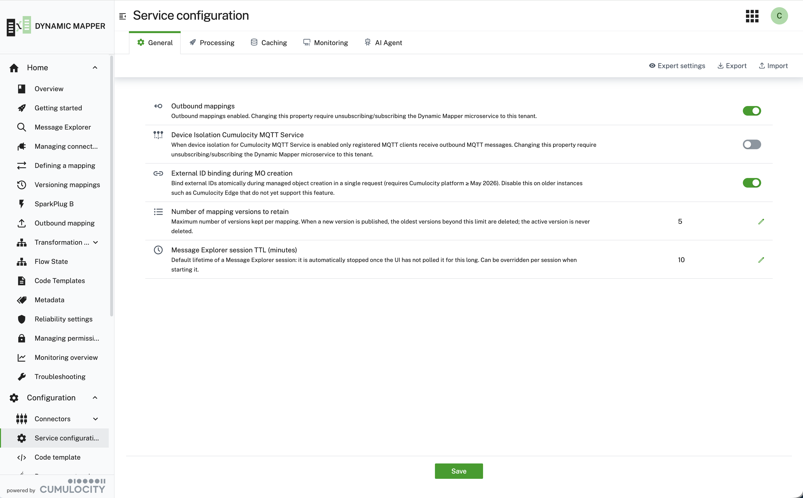

### Service configuration {#service-configuration}

Tenant-wide behavior of the Dynamic Mapper is controlled under **Configuration → Service configuration**.
These settings apply to the whole service, unlike the per-mapping options in the mapping wizard.

The settings are grouped into tabs (**General**, **Processing**, **Caching**, **Monitoring**, and **AI Agent**).
**Save** applies the changes. **Export** and **Import** move the whole configuration in and out as a file, which is
the quickest way to reproduce a tenant's setup elsewhere. **Expert settings** reveals additional advanced options
that are hidden by default. The choice is remembered in your browser, and each tab shows how many settings it
hides. Everyone can read the configuration, but editing it, saving it, and the buttons on the **Processing** and
**Caching** tabs need the `ROLE_DYNAMIC_MAPPER_ADMIN` role. See
[Managing permissions](/c8y-pkg-dynamic-mapper/introduction/access-control).

#### General {#service-configuration-general}

| Setting | Effect |
|---|---|
| **Outbound mappings** (Expert settings) | Enables the Cumulocity → broker direction. On by default. Changing it requires unsubscribing and re-subscribing the Dynamic Mapper microservice for the tenant. |
| **Device Isolation Cumulocity MQTT Service** (Expert settings) | When enabled, only registered MQTT clients receive outbound MQTT messages. Off by default. Also requires a re-subscribe to take effect. |
| **External ID binding during MO creation** | Binds external IDs atomically while the managed object is created, in a single request. Requires a Cumulocity platform of May 2026 or later. Disable it on older instances such as Cumulocity Edge. |
| **Number of mapping versions to retain** | How many versions are kept per mapping. Publishing a new version deletes the oldest ones beyond this limit. The active version is never deleted. See [Versioning mappings](/c8y-pkg-dynamic-mapper/introduction/versioning). |

Two of these settings, **Outbound mappings** and **Device Isolation Cumulocity MQTT Service**, do not take
effect until the microservice is unsubscribed and subscribed again for the tenant. The rest apply on **Save**.
When **Outbound mappings** is off, the outbound mapping and subscription pages are hidden. When **Device Isolation
Cumulocity MQTT Service** is off, the client relation page is hidden.

#### Processing {#service-configuration-processing}

| Setting | Effect |
|---|---|
| **Maximum CPU time for Smart Function JavaScript code** | Default 5000 ms. The service stops a Smart Function that uses more CPU time than this. |
| **Maximum end-to-end processing time for Smart Functions** | Default 8000 ms (1000 to 120000). Covers the JavaScript and the Cumulocity API calls that follow. When it expires, the message is not acknowledged (QoS above 0) and the broker redelivers it. Must be greater than the CPU time limit, otherwise the form does not save. |
| **Maximum processing attempts per message** | Default 5, minimum 1. How many times a message may fail before the connector drops it instead of asking the broker to deliver it again. The error stays in the mapping status. Applies to MQTT, Pulsar, Cumulocity MQTT Service, Kafka, AMQP, Google Pub/Sub, and outbound notifications. For REST polling, a page of polled data that keeps failing is skipped after this many attempts: the cursor moves on and the skip is recorded as the mapping's last error. Failures with a server error (HTTP 5xx) do not count there, so an outage does not skip data. |
| **Support ESM modules** (Expert settings) | Allows `export function` syntax in mapping code. |
| **GraalVM engine rotation threshold** (Expert settings) | Number of distinct code sources after which the JavaScript engine is replaced to release memory. Default 1000. |
| **GraalVM context pool size** (Expert settings) | Idle JavaScript contexts kept per mapping. Default 20, range 1 to 100. |

The **Rotate GraalVM Engine** button replaces the JavaScript engine immediately. See
[Reliability settings](/c8y-pkg-dynamic-mapper/introduction/reliability-settings) for how timeouts and failures
interact.

#### Caching {#service-configuration-caching}

| Setting | Effect |
|---|---|
| **Size inbound Id cache**, **Size outbound Id cache**, **Size inventory cache** | Maximum entries per cache. Clear the cache after you change a size. |
| **Days lifetime inbound Id cache**, **Days lifetime outbound Id cache**, **Days lifetime inventory cache** | Number of days after which the whole cache is cleared. |
| **Fragments from inventory to cache** | Fragments of the managed object that Smart Functions and `filterInventory` can read. Each entry is an exact name or a glob pattern such as `sparkPlugB_DBIRTH_*`. |
| **Minutes lifetime flow state** (Expert settings) | Minutes after which the flow state of a Smart Function or Java Extension mapping is cleared when that mapping has not written it. Each mapping expires on its own. 0 disables the limit. |
| **Cache alias maps for SparkPlug B mappings** (Expert settings) | Adds the SparkPlug B birth fragments to the inventory cache automatically. |

The buttons **Clear inbound external ID cache**, **Clear outbound external ID cache**, **Clear inventory cache**,
and **Clear flow state** act immediately.

#### Monitoring {#service-configuration-monitoring}

| Setting | Effect |
|---|---|
| **Send connector lifecycle** | Sends an event when a connector changes status. Required for the connector **Details & logs** page. Off by default. |
| **Send mapping statistics** | Publishes the mapping counters shown under **Monitoring → Statistic processed**. On by default. |
| **Send events on topic subscriptions** | Sends an event when the subscription of a topic changes. Off by default. |
| **Send notification lifecycle** | Sends an event when the status of outbound notifications changes. Off by default. |
| **Log payload** | Writes message payloads to the microservice log. |
| **Log substitution** (Expert settings) | Writes each substitution to the microservice log. |
| **Log connector errors** (Expert settings) | Writes connection errors to the microservice log. |

The events appear under **Monitoring → Service events** and count against the storage of your tenant.

All **Service logs** settings are Expert settings. They control whether the log lines of your tenant are stored for
the **Service logs** view, at which level, how long they are kept, and how much is stored per run. They apply on
**Save** like the rest. See [Service logs](/c8y-pkg-dynamic-mapper/introduction/monitoring#service-logs-settings).

#### AI Agent {#service-configuration-ai}

Select the agent used to generate JSONata substitutions (**JSONata AI Agent**) and the agent used to generate Smart
Function code (**SmartFunction AI Agent**). Both agents must exist in the AI Agent Manager. When AI capabilities
are disabled for the tenant, the tab shows a notice. See
[AI-assisted mapping](/c8y-pkg-dynamic-mapper/introduction/ai-assisted).
