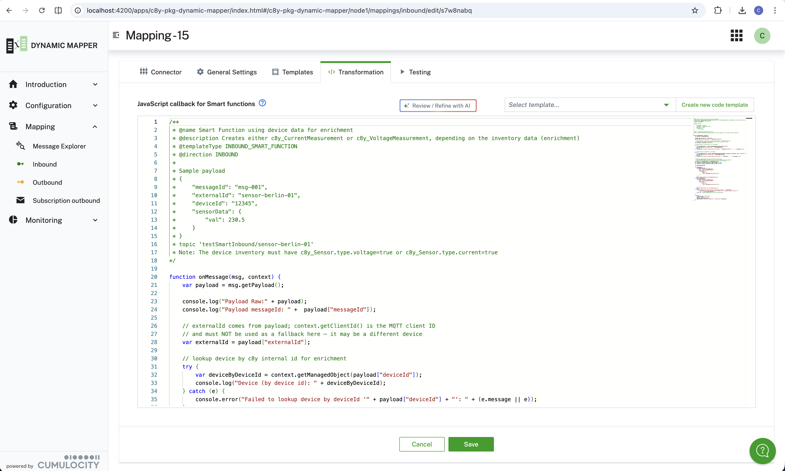

When you select **Smart Function** as the **Transformation Type**, you can write JavaScript code that returns the
entire payload, rather than just substitutions. At runtime the JavaScript code is evaluated and creates the target
payload. This gives you the freedom to see the payload exactly as it is sent to the Cumulocity backend.

**Power of Smart Functions:** Smart Functions offer maximum flexibility:
- Complete control over the payload structure
- Access to device inventory data for enrichment
- Complex business logic and calculations
- Multiple outputs from a single input message
- State management across messages using context

A Smart Function returns nothing, `null`, or an empty array when a message needs no output. The mapper then ignores
the message and records a warning, not an error. Returning anything else that is not a message object or an array of
message objects, for example a string, fails the message.

:::caution
The JavaScript editor for Smart Function is only available if you select **Smart Function** as a **Transformation
Type** when creating the mapping.
:::

The signature and structure of a **Smart Function** has the form:

```javascript
function onMessage(inputMsg, context) {
  const msg = inputMsg;
  var payload = msg.getPayload(); // contains payload
  console.log("Context: " + JSON.stringify(context.getStateAll()));
  console.log("Payload Raw: " + JSON.stringify(msg.getPayload()));
  console.log("Payload messageId" + payload['messageId']);
  // Get externalId from context first, fall back to payload
  var externalId = context.getClientId() || payload["externalId"];
  // insert transformation logic here
  // then return result
  return [{
    cumulocityType: "measurement",
    action: "create",
    payload: {
      "time": new Date().toISOString(),
      "type": "c8y_TemperatureMeasurement",
      "c8y_Steam": { "Temperature": { "unit": "C", "value": payload["sensorData"]["temp_val"] } }
    },
    externalSource: [{ "type": "c8y_Serial", "externalId": externalId }]
  }];
}
```

To try a function out, use the **Testing** step of the mapping editor: it runs `onMessage()` against your sample
payload and shows everything printed with `console.log()` in the **Console output** panel. See
[Testing a Smart Function](/c8y-pkg-dynamic-mapper/introduction/define-mapping#testing-smart-function).

The **Smart Function** allows enriching the payload with inventory data from the device, e.g.:

```javascript
// Get externalId from context first, fall back to payload
var externalId = context.getClientId() || payload["externalId"];
// lookup device for enrichment
var deviceBySourceId = context.getManagedObject(payload["c8ySourceId"]);
console.log("Device (by C8Y source id): " + deviceBySourceId);
var deviceByExternalId = context.getManagedObjectByExternalId({ externalId: externalId, type: "c8y_Serial" });
console.log("Device (by external id): " + deviceByExternalId);
```

:::important
**Important Configuration:** Only device fragments configured in
[**Configuration → Service Configuration → Function → Fragments from inventory to cache**](/c8y-pkg-dynamic-mapper/node3/serviceConfiguration/general)
can be referenced in Smart Functions. Each entry can be an exact fragment name or a glob pattern using `*` (any
sequence) and `?` (single character), e.g. `sparkPlugB_DBIRTH_*` to cache all fragments whose name starts with
`sparkPlugB_DBIRTH_`. Make sure to add all required fragments to this list before using them in your code.
:::



#### ECMAScript module (ESM) support

By default, Smart Function code is evaluated in **flat-script mode**: any `export` and `import` statements are
stripped and the code is wrapped in an IIFE so that `onMessage` is registered on `globalThis`. When you enable
**Support ESM modules** in
[**Configuration → Service Configuration → General**](/c8y-pkg-dynamic-mapper/node3/serviceConfiguration/general),
the execution model changes to true ES module semantics. The setting is stored per tenant. New installations have it
enabled, and a tenant that stored a value earlier keeps that value.

##### ESM mode: what changes

- **Mapping code runs unmodified**, no `export`/`import` stripping, no IIFE wrapping. (Shared code is always
  converted to a plain script regardless of this setting.)
- **Strict mode enforced**, undeclared variables, duplicate parameters, and silent type coercions throw errors
  instead of failing silently.
- **Real module scope**, top-level `const` / `let` / `class` declarations are isolated to the module and do not
  pollute `globalThis`.
- **Top-level `await` supported**, useful for lazy one-time initialization before the first message arrives.
- **`onMessage` must be exported**, use `export { onMessage }` or `export function onMessage(…)` so the runtime
  can locate the entry point.

Example Smart Function written for ESM mode:

```javascript
function onMessage(inputMsg, context) {
  const payload = inputMsg.getPayload();
  const externalId = context.getClientId() || payload["externalId"];
  return [{
    cumulocityType: "measurement",
    action: "create",
    payload: {
      "time": new Date().toISOString(),
      "type": "c8y_TemperatureMeasurement",
      "c8y_Steam": { "Temperature": { "unit": "C", "value": payload["temp_val"] } }
    },
    externalSource: [{ "type": "c8y_Serial", "externalId": externalId }]
  }];
}

export { onMessage };   // required in ESM mode
```

:::caution Constraints
Static `import` statements (e.g. `import { helper } from './utils.mjs'`) are **not supported** even in ESM mode.
All mapping and shared code is stored in the database and loaded as in-memory literals, GraalJS cannot resolve
module paths to real files on disk. Helpers and libraries provided in the **Shared Code** template are available
as globals and can be used directly without an `import`. Static imports would require a custom module resolver
(future work).
:::

##### Flat-script mode (`supportESM = false`)

When ESM support is disabled, the runtime automatically:
1. Strips any `export` and `import` lines from the mapping code.
2. Wraps the code in an IIFE and registers `onMessage` on `globalThis`.

This means flat-script code does **not** need, and should not have, an `export` statement. Existing mappings
continue to work unchanged when the setting is off.

#### Shared code templates

The Dynamic Mapper supports **Shared Code** templates, reusable JavaScript libraries that are automatically
injected into the GraalVM context before every Smart Function is executed. Functions and variables defined in a
Shared Code template are available as globals in all Smart Functions without any import statement.

##### How shared code is loaded

1. Navigate to [**Configuration → Code Templates**](/c8y-pkg-dynamic-mapper/node3/codeTemplate/INBOUND_SMART_FUNCTION).
2. Select the template of type **Shared** from the dropdown. The Shared template always exists. You cannot delete or
   duplicate it, only edit or empty it. Only administrators can save it.
3. Write your helper functions in the editor and save. All functions declared at the top level are available
   globally in every Smart Function. A change applies to the next message without a restart.

Shared code is always evaluated in flat-script mode (even when ESM support is enabled), so do **not** use `export`
statements in shared templates.

```javascript
// Example Shared Code template content
// These functions are available in all Smart Functions without import

function parseTimestamp(raw) {
  return raw ? new Date(raw).toISOString() : new Date().toISOString();
}

function celsiusToFahrenheit(celsius) {
  return (celsius * 9) / 5 + 32;
}
```

Then in any Smart Function:

```javascript
function onMessage(msg, context) {
  var payload = msg.getPayload();
  return [{
    cumulocityType: "measurement",
    action: "create",
    payload: {
      "time": parseTimestamp(payload["ts"]),          // from Shared Code
      "type": "c8y_TemperatureMeasurement",
      "c8y_Temp": {
        "F": { "unit": "F", "value": celsiusToFahrenheit(payload["temp"]) }  // from Shared Code
      }
    },
    externalSource: [{ "type": "c8y_Serial", "externalId": payload["deviceId"] }]
  }];
}
```

#### Binary helpers: `atob`, `btoa`, and `TextEncoder` {#binary-helpers}

Smart Functions running in GraalVM have access to browser-compatible Base64 and text encoding helpers, provided
automatically via the System code template. These are particularly useful when working with **Hexadecimal**,
**Protobuf**, or **Any Payload** types.

| Function | Description |
|---|---|
| `btoa(str)` | Encodes a UTF-8 string to a Base64 string. Equivalent to the browser `btoa()`. |
| `atob(base64)` | Decodes a Base64 string back to a UTF-8 string. Equivalent to the browser `atob()`. |
| `new TextEncoder()` | Encodes a JavaScript string to a `Uint8Array` of UTF-8 bytes. Use `.encode(str)` on the instance. |

**Example: Decode a Base64-encoded binary payload (Any Payload type)**

```javascript
function onMessage(msg, context) {
  // For "Any Payload" type the raw bytes arrive as a Base64 string
  var base64Payload = msg.getPayload();
  var decodedString = atob(base64Payload);    // decode to UTF-8 string
  var parsed = JSON.parse(decodedString);     // parse if the inner format is JSON

  return [{
    cumulocityType: "measurement",
    action: "create",
    payload: {
      "time": new Date().toISOString(),
      "type": "c8y_TemperatureMeasurement",
      "c8y_Temp": { "T": { "unit": "C", "value": parsed["temp"] } }
    },
    externalSource: [{ "type": "c8y_Serial", "externalId": parsed["deviceId"] }]
  }];
}
```

**Example: Encode a value to Base64 for outbound**

```javascript
function onMessage(msg, context) {
  var payload = msg.getPayload();
  var encoded = btoa(JSON.stringify(payload));   // produce Base64 for the broker
  return [{
    topic: "devices/" + payload["source"]["id"] + "/raw",
    payload: { "data": encoded }
  }];
}
```

#### Using metadata in Smart Functions {#metadata}

When using **Smart Functions** as the **Transformation Type**, metadata is handled differently than in
substitution-based mappings. Instead of using metadata nodes like `_IDENTITY_` or `_CONTEXT_DATA_` in templates,
you define metadata directly in the JavaScript return object.

**Key Difference:** In Smart Functions, you don't manipulate `_IDENTITY_` or `_CONTEXT_DATA_` nodes. Instead, you
return JavaScript objects with specific properties that control how the mapper processes your data. For the
JSONata equivalent (transformation type **Substitution as JSONata Expression**), see
[Metadata (JSONata)](/c8y-pkg-dynamic-mapper/introduction/metadata).

#### Metadata properties for inbound Smart Functions

For **inbound** mappings, your Smart Function should return an array of objects with the following properties:

| Property | Required | Description |
|---|:---:|---|
| `cumulocityType` | Yes | The Cumulocity API to use: `"measurement"`, `"event"`, `"alarm"`, `"operation"`, `"managedObject"`, or `"custom"`. Use `"custom"` to forward the payload directly to a tenant-local microservice instead of a built-in Cumulocity API. When `"custom"` is set, the `targetPath` property is required and device identity resolution is skipped. |
| `action` | Yes | The action to perform: `"create"`, `"update"`, `"patch"`, or `"delete"`. **Note:** Measurements are immutable time-series data and don't support `"update"` or `"patch"` operations. If you specify these actions for measurements, the mapper automatically converts them to `"create"` to create a new measurement instead. For other Cumulocity objects (events, alarms, inventory), all actions are supported. |
| `payload` | Yes | The actual data object to send to Cumulocity (e.g., measurement, event, alarm) |
| `externalSource` | Yes* | Array defining the external device identifier: `[{type: "c8y_Serial", externalId: "deviceId"}]`. Required unless the device already exists in Cumulocity. |
| `contextData` | No | Object with additional properties: `deviceName` (name for implicitly created devices), `deviceType` (type for implicitly created devices), `processingMode` (`"PERSISTENT"` (default) or `"TRANSIENT"`), `deviceFragments` (map of additional managed object fragments to merge into the implicitly created device, e.g. `c8y_Hardware`, `c8y_SupportedOperations`, the value of each key must be an object or array, nested structures are preserved), `deviceGroups` (list of device group names the implicitly created device is assigned to as a child asset, e.g. `["line 1", "line 2"]`, groups that do not exist yet are created automatically; group lookup is by name, if multiple groups share the same name the device is assigned to the first match returned by the platform and a warning is logged). |

**Context Methods for Accessing Incoming Metadata**

| Method | Description |
|---|---|
| `context.getClientId()` | Returns the publisher's client ID from MQTT 5 user properties. Returns `null` if not available. **MQTT 5 only**, the publisher must include `clientId` as a user property. Example: `var clientId = context.getClientId();` |
| `context.getManagedObject()` | Lookup device properties by Cumulocity internal source ID. Returns device object or `null`. Example: `var device = context.getManagedObject("12345");` |
| `context.getManagedObjectByExternalId()` | Lookup device properties by external ID. Requires object with `externalId` and `type`. Example: `var device = context.getManagedObjectByExternalId({externalId: "sensor-01", type: "c8y_Serial"});` |

**The `msg` object**

| Property | Description |
|---|---|
| `msg.payload` (or `msg.getPayload()`) | The parsed payload. For **Any Payload** mappings, the raw bytes arrive as a Base64 string. |
| `msg.topic` | The topic of the message. Split it to read topic levels, for example `msg.topic.split("/")[1]`. |
| `msg.clientId` | Inbound: the MQTT 5 publisher client ID, or `null`. Outbound: `null`. |
| `msg.sourceId` | Outbound: the Cumulocity ID of the source device. Inbound: `null`. |
| `msg.cumulocityType` | Outbound: the API of the triggering object, for example `"measurement"`. Inbound: `null`. |
| `msg.time` | ISO-8601 timestamp of when the mapper received the message. |
| `msg.transportId` | Inbound: the connector identifier. Outbound: `null`. |
| `msg.transportFields` | Transport-specific fields, see below. |

Smart Functions do not receive the `_TOPIC_LEVEL_`, `_IDENTITY_`, or `_CONTEXT_DATA_` nodes that JSONata mappings add
to the payload. Read the same information from `msg` and `context`.

**Reading the broker message key and metadata, `msg.transportFields`**

| Property | Description |
|---|---|
| `msg.transportFields` | Transport-specific fields of the received broker message. For **Kafka**, `key` holds the record key (the key, *not* a header); absent when the record has no key. For **Pulsar**, `key` holds the message key (absent when the message has none; Pulsar message properties are not exposed). Other broker metadata is delivered next to `key`, with names that show where it comes from, see the table below. Empty object when the transport carries neither. |

| Field | Connector | Content |
|---|---|---|
| `key` | Kafka, Pulsar | The record key or message key. |
| `header.<name>` | Kafka, AMQP 0-9-1 | One field per message header. Kafka header values are read as UTF-8 text. |
| `property.<name>` | Pulsar, MQTT 5 | One field per Pulsar message property or MQTT 5 user property. |
| `attribute.<name>` | Google Pub/Sub | One field per message attribute. |
| `routingKey`, `exchange` | AMQP 0-9-1 | The original routing key (the topic has the dots replaced by slashes) and the exchange. |
| `contentType`, `correlationId`, `messageId`, `type`, `appId` | AMQP 0-9-1 | The standard message properties, when set. |
| `contentType`, `correlationData`, `responseTopic` | MQTT 5 | The MQTT 5 properties, when set. |
| `orderingKey` | Google Pub/Sub | The ordering key, when set. |

MQTT 3, AMQP 1.0, HTTP, and Webhook connectors provide no metadata. A header can be missing on individual messages of the same stream, so check that the field exists before you use it. Each message carries at most 50 metadata fields, and each value is cut at 1024 characters.

```javascript
var tenantHeader = msg.transportFields["header.tenant"];   // undefined if the header is absent
```

The key is delivered **out-of-band, it is not part of `msg.payload`**, so it does not appear in the mapping's source template. A Kafka record key or Pulsar message key is frequently the device identifier, which makes it a good source for the external ID:

```javascript
function onMessage(msg, context) {
    var payload = msg.payload;
    var deviceId = msg.transportFields["key"];   // e.g. "863859042393327"
    ...
}
```

The same value is available to **Java Extensions** as `message.getTransportFields().get("key")`, and to **JSONata** mappings as `_CONTEXT_DATA_.key` (which, unlike the above, *is* injected into the payload).

**Context Config Properties, available via `context.getConfig()`**

| Property | Scope | Description |
|---|:---:|---|
| `tenant` | All | The Cumulocity tenant identifier. |
| `topic` | All | The actual topic or URL path of the received message, for example `testDevice/sensor-01/data`. It is not the subscription pattern of the mapping. |
| `clientId` | Connector-dependent | The publisher or producer client identifier. Its value depends on the connector type: **MQTT 5**, the publisher's client ID read from the MQTT 5 user property named `clientId` (`null` if not included; same value as `context.getClientId()`); **MQTT 3**, always `null`, MQTT 3.1.1 does not carry a per-message publisher identity; **Kafka**, always `null`, Kafka identifies messages by topic/partition/offset; read the record key via `msg.transportFields["key"]` instead (it is delivered out-of-band, not inside the payload); **HTTP / Webhook / AMQP 0-9-1 / AMQP 1.0**, always `null`; **Pulsar / MQTT-over-Pulsar**, the name of the producer that published the message (may be `null`). Example: `var id = context.getConfig().clientId \|\| context.getConfig().topic;` |
| `mappingName` | All | The name of the mapping. |
| `mappingId` | All | The internal ID of the mapping. |
| `targetAPI` | All | The Cumulocity target API (e.g. `"MEASUREMENT"`, `"EVENT"`). |
| `aliasMap` / `isActive` | Outbound only | SparkPlug B-specific context properties (`aliasMap` and `isActive`) are available for **outbound** SparkPlug B mappings only. See the *Metadata Properties for Outbound Smart Functions* table for details. |

##### Context methods for accessing metadata

**Available Context Methods:**

In addition to the properties you return, Smart Functions can access incoming metadata through the `context`
object:

- `context.getClientId()` - Returns the publisher's client ID from MQTT 5 user properties (MQTT 5 only, returns
  `null` if not available)
- `context.getManagedObject(c8ySourceId)` - Lookup device properties by Cumulocity internal source ID
- `context.getManagedObjectByExternalId({externalId, type})` - Lookup device properties by external ID
- `context.getTesting()` - Returns `true` if running in test mode
- `context.setState(key, value)` / `context.getState(key)` - Store/retrieve a single value across message
  processing. `getState(key, defaultValue)` returns the default when the key is absent. State is kept in memory per
  mapping and is lost on a service restart, see [Flow state](/c8y-pkg-dynamic-mapper/introduction/flow-state).
- `context.getStateAll()` - Returns a read-only view of all state entries for this mapping as a Map-like object.
  Useful for inspecting or iterating all stored keys.
- `context.getConfig()` - Returns the mapping configuration as a JavaScript object. For inbound mappings this
  includes the `topic` field, which holds the actual topic of the received message (e.g.
  `"testDevice/sensor-01/data"`) and can be split to read topic levels. For outbound mappings it additionally
  provides the resolved `externalId` of the source device.
- `context.getExternalId()` - Returns the resolved external ID of the source device. This is the recommended way
  to identify the device in an **outbound** function, an operation carries the device under `deviceId`, not
  `source`, so reading `payload["source"]["id"]` is unreliable and throws when absent. Requires **Use external
  id** and an **External Id type** on the mapping.
- `context.isDuplicate(key, windowSeconds)` - Returns `true` if the same key was seen for this mapping less than
  `windowSeconds` ago (1 to 3600), and records it otherwise. Use it to drop a message that a broker or gateway
  delivered twice: `if (context.isDuplicate(deviceId + "|" + time, 60)) { return []; }`. Unlike `getState` and
  `setState`, the check is atomic, so of two copies running at the same time exactly one gets `false`. Keys expire
  with the window, and a mapping holds at most 100,000. The window starts at the first message and does not restart
  when a repeat arrives. The check returns `false` and adds a warning when the key has no value or the window is not a
  whole number from 1 to 3600 (larger values are not shortened). A key built with `+` from a missing field contains
  the text `undefined`, so check the fields before you build it. Changing the code or the execution filter, or deleting the mapping, removes its keys. It always returns `false` in Dry Run and Live Test and records nothing. Keys are kept in
  memory, are lost on a service restart, and are not shared between service instances. A dropped inbound message
  counts under **Repeated** in the monitoring table. It shares its store with the `$isDuplicate` function of the
  [execution filter](/c8y-pkg-dynamic-mapper/introduction/define-mapping#drop-repeated-messages).
- `context.getStateKeySet()` - Returns just the keys currently held in state, without their values.
- `context.clearState()` - Removes every state entry held for this mapping.
- `context.getDTMAsset(assetId)` - Not implemented yet. It returns a placeholder object with `found: false`. Do not
  rely on it.
- `context.addWarning(message)` - Records a non-fatal warning against this message. Warnings surface in the test
  result and in the [microservice log](/c8y-pkg-dynamic-mapper/introduction/troubleshooting#microservice-log),
  without failing the mapping.
- `context.addLogMessage(message)` / `context.logMessage(message)` - Appends a message to the processing log for
  this execution. For ordinary debugging prefer `console.log()`, `console.warn()`, `console.error()`, or
  `console.debug()`. Their output is also written to the microservice log and shown in the **Console output** panel of
  the mapping editor, see
  [Testing a Smart Function](/c8y-pkg-dynamic-mapper/introduction/define-mapping#testing-smart-function).

**Example:** `var publisherClientId = context.getClientId();`

:::caution
When using `contextData.deviceName`, `contextData.deviceType`, `contextData.deviceFragments`, or
`contextData.deviceGroups`, make sure the mapping has the **Create device** option enabled.
Otherwise, the mapper will fail if the device doesn't exist yet.

`deviceFragments` and `deviceGroups` are only applied when the device is *first created*. They are not re-applied
on subsequent messages once the device already exists.
:::

**Example: Basic inbound Smart Function with device identification**

```javascript
function onMessage(msg, context) {
  var payload = msg.getPayload();
  // Get externalId from context first, fall back to payload
  var externalId = context.getClientId() || payload["externalId"];
  return [{
    cumulocityType: "measurement",
    action: "create",
    payload: {
      "time": new Date().toISOString(),
      "type": "c8y_TemperatureMeasurement",
      "c8y_Steam": { "Temperature": { "unit": "C", "value": payload["sensorData"]["temp_val"] } }
    },
    externalSource: [{ "type": "c8y_Serial", "externalId": externalId }]
  }];
}
```

**Example: Implicitly creating a device with name, type and custom fragments**

```javascript
function onMessage(msg, context) {
  var payload = msg.getPayload();
  // Get externalId from context first, fall back to payload
  var externalId = context.getClientId() || payload["externalId"];
  return [{
    cumulocityType: "measurement",
    action: "create",
    payload: {
      "time": new Date().toISOString(),
      "type": "c8y_TemperatureMeasurement",
      "c8y_Steam": { "Temperature": { "unit": "C", "value": payload["sensorData"]["temp_val"] } }
    },
    externalSource: [{ "type": "c8y_Serial", "externalId": externalId }],
    contextData: {
      "deviceName": "Temperature-Sensor-01",        // display name of the implicitly created device
      "deviceType": "sensor-type",                  // managed object type
      "deviceGroups": ["line 1", "line 2"],          // groups the device is assigned to as child asset
      "deviceFragments": {                          // additional fragments merged into the device on creation
        "c8y_Hardware": {
          "model":        "SmartSensor v2",
          "serialNumber": externalId,
          "revision":     "2.0"
        },
        "c8y_SupportedOperations": ["c8y_Restart", "c8y_Configuration"]
      }
    }
  }];
}
```

**Example: Conditionally creating measurements or events**

```javascript
function onMessage(msg, context) {
  var payload = msg.getPayload();
  // Get externalId from context first, fall back to payload
  var externalId = context.getClientId() || payload["externalId"];
  const payloadType = payload["payloadType"];
  if (payloadType == "telemetry") {
    return [{
      cumulocityType: "measurement",
      action: "create",
      payload: {
        "time": new Date().toISOString(),
        "type": "c8y_TemperatureMeasurement",
        "c8y_Steam": { "Temperature": { "unit": "C", "value": payload["sensorData"]["temp_val"] } }
      },
      externalSource: [{ "type": "c8y_Serial", "externalId": externalId }]
    }];
  } else {
    // Create an event for error cases
    return [{
      cumulocityType: "event",
      action: "create",
      payload: {
        "time": new Date().toISOString(),
        "type": "c8y_ErrorEvent",
        "text": payload["logMessage"],
        "severity": "MAJOR"
      },
      externalSource: [{ "type": "c8y_Serial", "externalId": externalId }]
    }];
  }
}
```

**Example: Using patch action to partially update inventory**

```javascript
function onMessage(msg, context) {
  var payload = msg.getPayload();
  // Partially update a managed object (inventory) without replacing the entire object
  return [{
    cumulocityType: "managedObject",
    action: "patch",  // Partial update - only specified fields are changed
    payload: {
      "c8y_Notes": "Last updated: " + new Date().toISOString(),
      "customData": { "temperature": payload["temp"], "humidity": payload["hum"] }
    },
    externalSource: [{ "type": "c8y_Serial", "externalId": payload["deviceId"] }]
  }];
}
```

**Note:** Using `action: "patch"` is useful when you want to update only specific properties of an inventory
object without affecting other existing properties. This is more efficient than fetching the entire object,
modifying it, and sending it back with `action: "update"`.

**Example: Extracting the device identity from the topic**

The topic of the received message (e.g. `testDevice/sensor-berlin-01/data`) is available as `msg.topic`. Splitting it
gives you the topic levels. `context.getConfig()["topic"]` holds the same actual topic.

```javascript
function onMessage(msg, context) {
  var payload = msg.getPayload();

  // msg.topic is the topic of the received message, e.g. "testDevice/sensor-berlin-01/data"
  var topicLevels = msg.topic ? msg.topic.split("/") : [];
  var externalId = topicLevels[1];

  if (!externalId) {
    console.error("Cannot determine externalId from topic: " + msg.topic);
    return [];
  }

  return [{
    cumulocityType: "measurement",
    action: "create",
    payload: {
      "time": payload["time"] ? payload["time"] : msg.time,
      "type": "c8y_TemperatureMeasurement",
      "c8y_Steam": { "Temperature": { "unit": "C", "value": payload["temp"] } }
    },
    externalSource: [{ "type": "c8y_Serial", "externalId": externalId }]
  }];
}
```

**Note:** `msg.topic` and `context.getConfig()["topic"]` are the actual topic of the received message, not the
subscription pattern of the mapping. The topic levels are not injected into the payload in Smart Functions.

#### Metadata properties for outbound Smart Functions

For **outbound** mappings, your Smart Function should return an object (or array of objects) with the following
properties:

| Property | Required | Description |
|---|:---:|---|
| `topic` | Yes* | The MQTT topic or URL path to publish to. Can include dynamic values like device IDs. For Webhook connectors, this is appended to the base URL as the context path. **For Webhook connectors with Cumulocity Internal enabled:** If `cumulocityType` is not specified, the `topic` is used to derive the Cumulocity API endpoint. Topics should start with the API name (e.g., `"measurement"`, `"event"`, `"alarm"`, `"inventory"`) to automatically route to the correct Cumulocity REST API endpoint. However, using `cumulocityType` is recommended for more reliable API routing. |
| `payload` | Yes | The data object or array to send to the external broker/system |
| `action` | No | The action to perform: `"create"` (POST), `"update"` (PUT), `"patch"` (PATCH), or `"delete"` (DELETE). The action is automatically mapped to the corresponding HTTP method. **For Webhook connectors with Cumulocity Internal enabled:** The `action` property is essential for determining how to interact with the Cumulocity REST API. Combined with the `topic`, it controls whether to create, update, patch, or delete Cumulocity objects (measurements, events, alarms, inventory). **Special case:** Measurements are immutable time-series data and don't support update or patch operations. If you specify `action: "update"` or `action: "patch"` for measurements, the mapper automatically converts it to `"create"` (POST) to create a new measurement instead. |
| `cumulocityType` | No | Explicitly specifies which Cumulocity API type to use: `"measurement"`, `"event"`, `"alarm"`, `"operation"`, `"managedObject"`, or `"custom"`. **When specified:** The mapper uses this explicit value to determine the target Cumulocity API endpoint, making the API selection less ambiguous. **When not specified:** The mapper falls back to deriving the API type from the `topic` string (e.g., a topic starting with `"measurements/"` automatically routes to the Measurement API). **Custom routing (`"custom"`):** Forwards the payload to a tenant-local microservice at the path given by `targetPath`. Device identity resolution and broker publishing are both skipped. The `action` value is mapped to the corresponding HTTP method (`"create"` → POST, `"update"` → PUT, etc.). **Recommended for Webhook connectors with Cumulocity Internal:** Using `cumulocityType` provides explicit control over API routing and is more reliable than topic-based derivation. |
| `externalSource` | No | Array specifying the external ID type: `[{type: "c8y_Serial"}]`. Defines which external ID type should be used to resolve the device identity for `_externalId_` token replacement in the broker topic. Ignored when `sourceId` is set explicitly. |
| `sourceId` | No | Explicitly sets the Cumulocity internal managed object ID for this message, overriding the device that triggered the mapping. **Default behavior (omitted):** The mapper uses the internal ID of the device that triggered the outbound mapping. For external broker connectors, it additionally resolves the external ID (e.g. LoRa EUI, serial) via `externalSource` for `_externalId_` token replacement in the broker topic. **When set:** The provided ID is used as the internal C8Y managed object ID for the Cumulocity REST API call (`source.id`) and also for broker topic routing. The `externalSource` lookup is skipped. **Use case:** Cross-device routing, when data from one device should be associated with a different device in Cumulocity. For example, a gateway device triggers the mapping but the resulting measurement should be stored under a child device: `sourceId: childDeviceInternalId`. **Note:** This must be a Cumulocity *internal* numeric managed object ID, not an external identifier like a serial number or LoRa EUI. |
| `targetPath` | No* | Required when `cumulocityType: "custom"` is set. Relative REST path of the tenant-local microservice to call, e.g. `/service/my-processor/ingest`. Must start with `/service/`. The mapper validates this at runtime and rejects requests that do not match. Ignored for all other `cumulocityType` values. |
| `transportFields` | No | Object with transport-specific fields: `key` (the Kafka record key, the key, not a header, or the Pulsar message key; for Kafka and Pulsar connectors), `method` (HTTP method like `"POST"`, `"PUT"`, for Webhook connectors), `retain` (boolean to set MQTT retained message flag, for MQTT connectors). The same field is also populated **inbound** on `msg.transportFields`, see *Metadata Properties for Inbound Smart Functions*. |

**Context Properties, available via `context.getConfig()`**

| Property | Scope | Description |
|---|:---:|---|
| `tenant` | All | The Cumulocity tenant identifier. |
| `topic` | All | The inbound topic that triggered the outbound mapping. |
| `mappingName` | All | The name of the mapping. |
| `mappingId` | All | The internal ID of the mapping. |
| `targetAPI` | All | The Cumulocity target API (e.g. `"MEASUREMENT"`, `"EVENT"`). |
| `externalId` | All | The resolved external ID of the source device (present when `useExternalId` is enabled on the mapping). |
| `aliasMap` | SparkPlug B only | A `{ metricName → alias }` map loaded from the `sparkPlugB_NBIRTH` (or `sparkPlugB_DBIRTH`) fragment stored on the device managed object during inbound BIRTH processing. Use it to include numeric aliases in outbound NCMD / DCMD metrics so that the edge node can match them without a full name lookup: <br>`const aliasMap = context.getConfig().aliasMap \|\| {};`<br>`function metric(name, type, value) {`<br>`  const m = { name, type, value };`<br>`  if (aliasMap[name] !== undefined)`<br>`    m.alias = parseInt(aliasMap[name], 10);`<br>`  return m;`<br>`}` |
| `isActive` | SparkPlug B only | Boolean flag reflecting the current online/offline state of the target Edge Node or Device. Set to `true` when a NBIRTH / DBIRTH / NDATA / DDATA message was last received, and `false` after a NDEATH / DDEATH message. Defaults to `true` when no status fragment is present yet. Use it to suppress outbound commands to devices that have gone offline: <br>`if (!context.getConfig().isActive) {`<br>`  return null; // device offline, suppress command`<br>`}` |

:::important Important: Webhook with Cumulocity Internal
**Using Webhook connectors with Cumulocity Internal enabled:**

When the Webhook connector is configured with **Cumulocity Internal** enabled, the mapper interacts with the
Cumulocity REST API using these properties:

- **cumulocityType** (recommended): Explicitly specify the API type (`"measurement"`, `"event"`, `"alarm"`,
  `"operation"`, `"managedObject"`). This provides the most reliable API routing and is preferred over topic-based
  derivation.
- **topic**: If `cumulocityType` is not specified, the mapper derives the API endpoint from the topic. Start your
  topic with the API name (e.g., `"measurement"`, `"event"`) to route to the correct REST API.
- **action**: Determines the HTTP method and operation type:
  - `"create"` → POST (create new objects)
  - `"update"` → PUT (replace entire object)
  - `"patch"` → PATCH (partial update - GET + merge + PUT)
  - `"delete"` → DELETE (remove object)

**Example:** To partially update a device's custom properties, use `cumulocityType: "managedObject"` or
`topic: "inventory/12345"` with `action: "patch"`. The mapper will automatically fetch the device, merge your
changes, and send a PUT request.
:::

**Dynamic Topic Resolution:** Use `context.getConfig().externalId` to include the device's resolved external ID in
the topic. For example: `` topic: `measurements/${context.getConfig().externalId}` `` resolves to
`"measurements/device-serial-123"` at runtime. Requires the mapping to have **Use External Id** enabled and an
**External Id Type** configured.

**Example: Basic outbound Smart Function**

```javascript
function onMessage(msg, context) {
  var payload = msg.getPayload();
  return {
    topic: "measurements/" + payload["source"]["id"],
    payload: {
      "time": new Date().toISOString(),
      "c8y_Steam": { "Temperature": { "unit": "C", "value": payload["c8y_TemperatureMeasurement"]["T"]["value"] } }
    }
  };
}
```

**Example: Using `context.getConfig().externalId` in the topic**

```javascript
function onMessage(msg, context) {
  var payload = msg.getPayload();
  // context.getConfig().externalId contains the resolved external ID of the source device.
  // Requires the mapping to have 'useExternalId' enabled and an 'externalIdType' configured.
  var externalId = context.getConfig().externalId;
  return [{
    topic: "measurements/" + externalId,
    payload: {
      "time": new Date().toISOString(),
      "c8y_Steam": { "Temperature": { "unit": "C", "value": payload["c8y_TemperatureMeasurement"]["T"]["value"] } }
    }
  }];
}
```

**Example: Using `cumulocityType` for explicit API specification (recommended)**

```javascript
function onMessage(msg, context) {
  var payload = msg.getPayload();
  return [{
    topic: "custom/device/topic",  // Custom topic - API won't be derived from this
    cumulocityType: "measurement",  // Explicitly specify to use Measurement API
    payload: {
      "time": new Date().toISOString(),
      "c8y_Steam": { "Temperature": { "unit": "C", "value": payload["c8y_TemperatureMeasurement"]["T"]["value"] } }
    },
    action: "create"  // Create a new measurement
  }];
}
```

**Example: Setting Kafka message key**

```javascript
function onMessage(msg, context) {
  var payload = msg.getPayload();
  return [{
    topic: "measurements/" + payload["source"]["id"],
    payload: {
      "time": new Date().toISOString(),
      "c8y_Steam": { "Temperature": { "unit": "C", "value": payload["c8y_TemperatureMeasurement"]["T"]["value"] } }
    },
    transportFields: { "key": payload["source"]["id"] }  // Set Kafka record key / Pulsar message key
  }];
}
```

**Example: Using the action property for external Webhook**

```javascript
function onMessage(msg, context) {
  var payload = msg.getPayload();
  // Determine action based on the message type or content
  var actionType = payload["c8y_IsDeleted"] ? "delete" : "update";
  return [{
    topic: "devices/" + payload["source"]["id"],
    action: actionType,  // Can be "create", "update", "delete", or "patch"
    payload: {
      "deviceId": payload["source"]["id"],
      "temperature": payload["c8y_TemperatureMeasurement"]["T"]["value"],
      "timestamp": new Date().toISOString()
    },
    transportFields: {
      "method": actionType === "delete" ? "DELETE" : "PUT"
    }
  }];
}
```

**Example: Using action and topic for Cumulocity Internal (Webhook)**

```javascript
function onMessage(msg, context) {
  var payload = msg.getPayload();
  // For Cumulocity Internal, topic determines the API endpoint
  // and action determines the HTTP method (create=POST, update=PUT, patch=PATCH, delete=DELETE)

  // Example: Partially update a managed object (inventory) using PATCH
  return [{
    topic: "inventory/" + payload["source"]["id"],  // Derives API from "inventory"
    action: "patch",  // Maps to HTTP PATCH method
    payload: {
      "c8y_Notes": "Updated via Dynamic Mapper",
      "customFragment": { "lastSync": new Date().toISOString() }
    }
  }];
}
```

**Note:** For Webhook connectors with **Cumulocity Internal** enabled, the `action` property controls the HTTP
method, and the `topic` determines which Cumulocity REST API to call. The mapper automatically handles the REST
path construction and proper request formatting. When using `action: "patch"`, the mapper performs a GET + merge +
PUT operation to partially update the object while preserving existing fields.

**Return Type Flexibility:** For outbound Smart Functions, you can return either a single object or an array of
objects. Returning `null`, `undefined`, an empty object, or an empty array skips the message and records a warning. If you need to send a message to multiple topics or transform one Cumulocity event into multiple external
messages, return an array.

##### Accessing metadata from incoming messages

When your Smart Function receives a message, you can access metadata information through the payload:

- **Topic levels**: Split `msg.topic`. For example, if the topic is `device/12345/telemetry`, then
  `msg.topic.split("/")[1]` returns `"12345"`. Smart Functions do not receive a `_TOPIC_LEVEL_` payload node.
- **Publisher Client ID** (inbound, MQTT 5 only): Access the MQTT client ID of the message publisher using
  `context.getClientId()`. This returns the `clientId` from MQTT 5 user properties, or `null` if not available.
  **Note:** The publisher must include the `clientId` as a user property when publishing. Not available for MQTT
  3.1.1 connections.
- **External ID** (outbound only): Access the device's external ID using `context.getExternalId()` or
  `context.getConfig().externalId`. This requires **Use external id** and an **External Id type** on the mapping.
  Smart Functions do not receive an `_IDENTITY_` payload node.
- **Cumulocity Source ID** (outbound only): Access the device's internal Cumulocity ID using `msg.sourceId`.

**Example: Extracting device ID from MQTT topic (inbound)**

```javascript
function onMessage(msg, context) {
  var payload = msg.getPayload();
  // Extract device ID from second level of topic: device/12345/telemetry
  var deviceId = msg.topic ? msg.topic.split("/")[1] : null;
  console.log("Device ID from topic: " + deviceId);
  return [{
    cumulocityType: "measurement",
    action: "create",
    payload: {
      "time": new Date().toISOString(),
      "type": "c8y_TemperatureMeasurement",
      "c8y_Steam": { "Temperature": { "unit": "C", "value": payload["temp"] } }
    },
    externalSource: [{ "type": "c8y_Serial", "externalId": deviceId }]
  }];
}
```

**Example: Using publisher client ID from MQTT 5 user properties (inbound)**

```javascript
function onMessage(msg, context) {
  var payload = msg.getPayload();
  // Get client ID from MQTT 5 user properties
  var publisherClientId = context.getClientId();
  console.log("Publisher Client ID: " + publisherClientId);

  // Use it as external device ID
  return [{
    cumulocityType: "measurement",
    action: "create",
    payload: {
      "time": new Date().toISOString(),
      "type": "c8y_TemperatureMeasurement",
      "c8y_Steam": { "Temperature": { "unit": "C", "value": payload["temp"] } }
    },
    externalSource: [{ "type": "c8y_Serial", "externalId": publisherClientId }]
  }];
}
```

:::caution
**Best Practice:** Always validate metadata values before using them. Check that `msg.topic` has the
expected number of levels before accessing one. Similarly, verify external IDs and source IDs are present in outbound
mappings. For `context.getClientId()`, always check if the value is not `null` before using it, as it's only
available for MQTT 5 connections when the publisher includes it as a user property.
:::

#### Routing to a Cumulocity tenant microservice

Smart Functions can forward payloads directly to a tenant-local microservice instead of (or in addition to) the
built-in Cumulocity APIs. Set `cumulocityType: "custom"` and supply a `targetPath` starting with `/service/`. The
mapper calls the microservice using the tenant's own credentials, so no additional authentication setup is
required. Device identity resolution and broker publishing are both skipped for custom-routed objects.

:::important Important, Security restriction
The `targetPath` must start with `/service/`. The mapper enforces this at runtime and throws a processing error
for any other path. This ensures that only microservices subscribed to the same Cumulocity tenant can be called.
:::

**Example: Inbound, create a measurement and forward to a custom microservice**

```javascript
function onMessage(msg, context) {
  var payload = msg.getPayload();
  var externalId = context.getClientId() || payload["externalId"];
  return [
    // Standard Cumulocity measurement
    {
      cumulocityType: "measurement",
      action: "create",
      payload: {
        "time": new Date().toISOString(),
        "type": "c8y_TemperatureMeasurement",
        "c8y_Steam": { "Temperature": { "unit": "C", "value": payload["temperature"] } }
      },
      externalSource: [{ "type": "c8y_Serial", "externalId": externalId }]
    },
    // Forward raw reading to custom microservice (HTTP POST)
    {
      cumulocityType: "custom",
      action: "create",
      targetPath: "/service/my-processor/ingest",
      payload: {
        "deviceId": externalId,
        "timestamp": new Date().toISOString(),
        "reading": payload["temperature"]
      }
    }
  ];
}
```

**Example: Outbound, forward a Cumulocity operation to a custom microservice**

```javascript
function onMessage(msg, context) {
  var payload = msg.getPayload();
  var deviceId = payload["deviceId"] || (payload["source"] && payload["source"]["id"]);
  var command  = payload["c8y_Command"] && payload["c8y_Command"]["text"];
  return {
    cumulocityType: "custom",
    action: "create",   // maps to HTTP POST
    targetPath: "/service/my-processor/execute",
    payload: {
      "deviceId":    deviceId,
      "command":     command,
      "operationId": payload["id"],
      "timestamp":   new Date().toISOString()
    }
  };
}
```

For more examples and complete code templates, navigate to
[Code Templates](/c8y-pkg-dynamic-mapper/node3/codeTemplate/INBOUND_SMART_FUNCTION) to see comprehensive
JavaScript Smart Function samples.

#### Limits and runtime behavior {#sf-limits}

| Topic | Behavior |
|---|---|
| **CPU budget** | JavaScript may run for at most `maxCPUTimeMS` (default 5000 ms). When the budget is exceeded, the mapper stops the function and fails the message. An infinite loop cannot block the service. |
| **Pipeline timeout** | The whole processing of one message, including JavaScript and Cumulocity API calls, must finish within `pipelineTimeoutMS` (default 8000 ms). It must be larger than the CPU budget. Both settings are in **Service Configuration**. |
| **Interpreter only** | Smart Functions run in the GraalVM interpreter without a JIT compiler. Keep functions short and avoid heavy loops or large payload copies. |
| **Java classes** | `Java.type(...)` can load only these classes: `java.lang.String`, `java.util.ArrayList`, `java.util.Arrays`, `java.util.HashMap`, `java.util.HashSet`, `java.util.Base64`, `java.nio.charset.StandardCharsets`, and the substitution helper classes provided by the System template. Any other class, including file, network, and process classes, is not reachable. |
| **State** | `context.setState()` values live in memory for each mapping. A tenant-wide expiry and a service restart clear them, see [Flow state](/c8y-pkg-dynamic-mapper/introduction/flow-state). |
| **Logging** | `console.log`, `console.warn`, `console.error`, and `console.debug` write to the **Console output** panel during tests and to the microservice log at runtime. |

#### GraalVM engine and memory management {#graalvm-metaspace}

Every Smart Function is executed inside a **GraalVM Polyglot Engine**, one per tenant. The Engine keeps what it has
parsed and prepared for each distinct JavaScript source until the Engine is closed: roughly 6 KB of heap per small
source, up to about 50 KB for a mapping of typical template size. Running unchanged code again reuses it and adds
nothing. The standard deployment runs the Engine without a JIT compiler (interpreter-only), so no compiled machine
code is produced. The Dynamic Mapper bounds the accumulation with an automatic **Engine rotation**.

##### Engine rotation

Each tenant has its own GraalVM Engine. The Engine is replaced (rotated) when the compilation count reaches the
threshold:

| Trigger | Details |
|---|---|
| **Compilation-based** | The Engine is rotated after **1000 unique JS source compilations** (configurable via `engineRotationThreshold`, default: 1000; tenants that stored an earlier value keep it until changed). A compilation is counted only when a new (sourceName, contentHash) pair is evaluated, repeated execution of the same code is a GraalVM source-cache hit and does not count. Warmup compilations at Engine creation are registered but do not count toward the threshold, so only code changes after startup drive rotation. |

There is no time-based rotation: an Engine only grows when new distinct sources are compiled into it, so an idle
Engine holds the same after a day as after a minute. To rotate a tenant's Engine on demand, run the
`ROTATE_GRAALVM_ENGINE` operation.

When rotation fires, the old Engine is *retired*, no new contexts are created against it, but any in-flight
messages continue to completion. The old Engine is closed, and the memory it held released, once the last in-flight
context closes. A replacement Engine is created immediately and pre-warmed with all active SmartFunction mapping
codes before the first real message arrives. Each rotation therefore has a cost (re-warming every active mapping),
which is why the default threshold is not low.

##### What grows the engine

Not all usage patterns add to what the Engine holds:

| Scenario | Growth pattern | Primary rotation trigger |
|---|---|---|
| **High message volume, same mapping, same code** | None. The source cache is hit on every call (same content hash). | *No rotation triggered.* Repeated execution of the same code does not increment the compilation counter. |
| **Mapping iteration, delete & recreate with new JS code** | Grows with every distinct code string: each is a new GraalVM `Source` (different content hash) that stays in the Engine until it is closed, even if the mapping was deleted or superseded. A single character edit creates a new source. | Compilation-based (`engineRotationThreshold`), each unique code version increments the counter. |
| **Editing an existing mapping's JS code** | Grows with every save of modified code. A mapping edited 20 times before going to production has left 20 sources in the Engine, 19 of them unreachable. | Compilation-based (`engineRotationThreshold`), every code edit increments the counter, making development sessions the primary driver of rotation. |
| **Activate / deactivate a mapping** | Nothing if the code is unchanged (same content hash, cache hit). If the code was edited in between, one new source is added, equivalent to a single code edit. | Activate/deactivate alone does not increment the compilation counter. |

##### Code churn is what accumulates

Active development on SmartFunction code, edits to existing mappings, delete-and-recreate cycles, or
deactivate-edit-reactivate workflows, is the only usage that adds to the Engine over time. As a guide, 1000
distinct sources hold on the order of 6 to 50 MB of heap in the Engine, which is what the default threshold allows
per tenant before the Engine is replaced. Tune `engineRotationThreshold` to control how many code changes accumulate
before a rotation is triggered.

##### Reading the logs

The service logs a **baseline** reading every time an Engine is created and the current usage at the moment of every
rotation, in the form `Metaspace <used> MB / <max> MB (<percent>%)`:

```
t2050305588 - GraalVM Engine created — baseline Metaspace <used> MB / <max> MB (<percent>%)
t2050305588 - GraalVM warm-up complete
t2050305588 - Rotating GraalVM Engine (0 retired engine(s) pending drain) — Metaspace <used> MB / <max> MB (<percent>%)
```

The Metaspace figure is informational: the GraalVM and JavaScript runtime classes are loaded once per JVM, so it
levels off after start-up rather than growing with each source, and closing an Engine does not reduce it. The memory
that rotation releases is Java heap. The `retired engine(s) pending drain` count shows old Engines that still have
in-flight messages; if it stays above zero, a long-running SmartFunction execution is holding a retired Engine open.

:::caution Caution, "no max set"
When the log shows `(no max set)`, the JVM Metaspace has no limit configured. The standard microservice image sets
`-XX:MaxMetaspaceSize=500m`. If you run the service with your own JVM flags, set an explicit limit so a problem
shows up as a Java `OutOfMemoryError: Metaspace` with a stack trace instead of an OS-level kill.
:::

##### Tuning recommendations

| Symptom / Situation | Recommended Action |
|---|---|
| Heavy mapping development on a tenant and memory held by the Engine matters | Lower `engineRotationThreshold` (e.g. to 200) in **Service Configuration → General**, accepting a re-warm after each rotation. |
| Rotation fires too often (brief pauses while the new Engine warms up) | Increase `engineRotationThreshold` in **Service Configuration → General**. Each rotation briefly pauses context creation for the tenant while the new Engine warms up. |
| `retired engine(s) pending drain` stays above zero | A long-running SmartFunction execution keeps a retired Engine's contexts open. Look for slow or blocked executions. |
| Pod OOM-killed without a Java exception | Check the microservice's memory request first; the service's heap and Metaspace limits are derived from it. If you use custom JVM flags, set `-XX:MaxMetaspaceSize` explicitly. |
| Low message volume, long uptime, Engine suspected to be in a bad state | Rotation only advances on code changes, which is intended. Rotate the tenant's Engine on demand with the `ROTATE_GRAALVM_ENGINE` operation. |

##### Pre-compilation warnings

At startup (and after each Engine rotation), the service pre-compiles all active SmartFunction mapping codes into
the new Engine's source cache. If a mapping code cannot be pre-compiled, a `WARN` log entry is emitted. The
mapping still executes correctly at runtime, the warning only means the first message after rotation pays the
one-time cold-start cost (class initialisation, parsing, specialisation) instead of hitting the pre-warmed cache.

```
WARN - Failed to pre-compile mapping onMessage_qxvjgxmt.js:
       SyntaxError: Variable "globalConfig" has already been declared
WARN - Failed to pre-compile mapping onMessage_7ut3z0c4.js:
       SyntaxError: onMessage_7ut3z0c4.js:79:0 Expected an operand but found export
WARN - Failed to pre-compile mapping onMessage_d02ac8a9.js:
       SyntaxError: Variable "MeasurementSchema" has already been declared
WARN - Failed to pre-compile mapping onMessage_0rjfc8vj.js:
       SyntaxError: Variable "onMessage" has already been declared
```

The mapping identifier in the file name (e.g. `qxvjgxmt`) corresponds directly to the **Identifier** field shown
in the mapping grid. Use it to locate the affected mapping.

| Warning message | Cause and fix |
|---|---|
| `Variable "globalConfig" has already been declared` (or any other name from the Shared Code template) | The mapping code bundles a library (e.g. Zod) that also declares `const globalConfig`, the same name that the Shared Code template already defines. At *runtime* the IIFE wrapper isolates the mapping's declarations, so execution is unaffected. To also fix the pre-compilation warning, remove the bundled library from the mapping code and rely on the Shared Code template to provide it globally instead. |
| `Expected an operand but found export` | The mapping code contains an ES module `export` statement at the top level (e.g. `export default onMessage`) and the **Support ESM modules** setting is *disabled*. In flat-script mode the pre-compiler does not strip `export` keywords. Either enable ESM mode in **Configuration → Service Configuration → General**, or remove the `export` lines from the mapping code (the runtime strips them automatically, but the pre-compiler does not). |
| `Variable "onMessage" has already been declared` (or `"MeasurementSchema"` or similar) | During pre-compilation all mapping codes are evaluated sequentially in a single GraalVM context. A `var` declaration in one mapping's code leaks into the global scope and collides with the same name in a later mapping. At *runtime* each message gets a fresh context so there is no collision. To fix the warning: change top-level `var` declarations in your mapping code to `const` or `let`, or wrap them in a self-executing function so they are not exposed globally. |

##### Pre-compilation warnings do not affect correctness

A mapping that fails to pre-compile still executes correctly on every real message. The only consequence is a
slightly slower first execution after Engine rotation (the one-time cold start).
Fix the warnings to restore optimal warm-up performance, but treat them as low-priority unless cold-start latency
is a concern.
