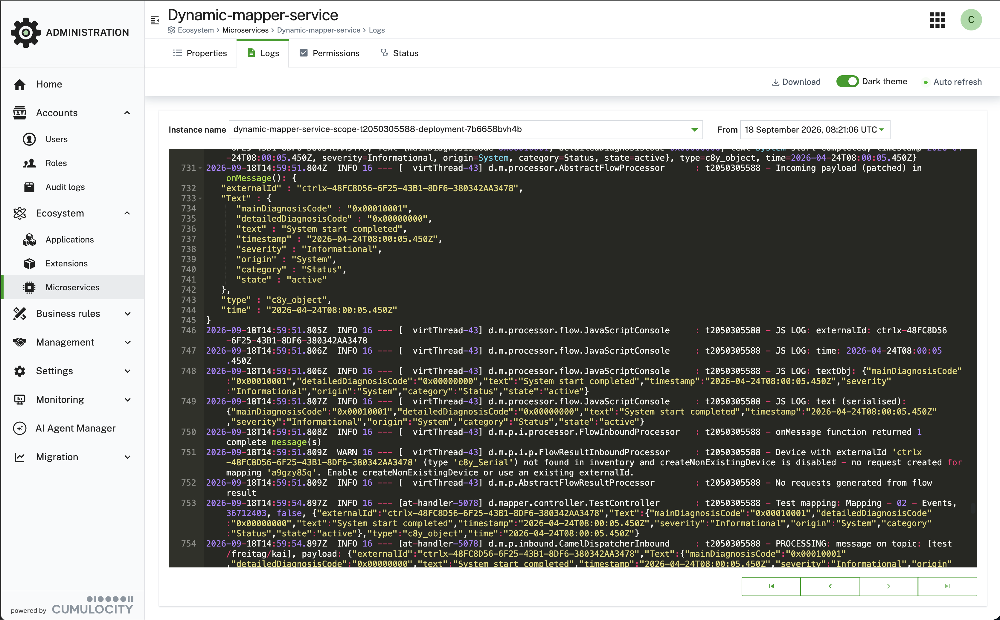

### Troubleshooting {#troubleshooting}

The following lists common problems and how to resolve them.

#### Messages arrive but no Cumulocity objects are created

Work through the following causes in order. Each one stops a mapping without an error on the mapping itself.

- **Connector.** Open [**Configuration → Connectors**](/c8y-pkg-dynamic-mapper/node3/connectorConfiguration). The
  connector must be **Enabled** and its **Status** must be `CONNECTED`. A new or imported connector starts
  disabled. Status `DISCONNECTED`, `FAILED`, or `RETRYING` means the connector does not deliver messages yet. Open
  the connector and its **Details & logs** page. The page records changes only while **Send connector lifecycle**
  is on in the service configuration.
- **Deployment.** A mapping runs only on the connectors it is deployed to. A new mapping is deployed nowhere. Open
  the mapping and check the connector selection (**Add and select connector** step). Importing mappings does not carry
  the deployment either. After **Reset deployment cache** (an Admin action) every mapping is undeployed.
- **Mapping active.** Check that the mapping is activated (**Activate** in the mapping list). A mapping with **Max
  failure count** set deactivates itself after that many failures in a row. See
  [Reliability settings](/c8y-pkg-dynamic-mapper/introduction/reliability-settings). Activation also fails when
  the mapping does not pass validation, for example because of an invalid template, a missing device identifier, or
  an invalid topic. The editor lists the reasons.
- **Topic.** Verify that the **topic pattern** matches the topic your device is publishing to. Wildcards `#` and `+`
  follow MQTT semantics. A topic that contains wildcards needs a connector that supports them. The HTTP Endpoint
  uses the URL path after `/httpConnector/` as the topic.
- **Statistics.** Open [**Monitoring → Statistic processed**](/c8y-pkg-dynamic-mapper/node2/monitoring/statistic/inbound).
  If **Received** of your mapping does not increase but **Unmapped messages** does, the messages arrive and no active,
  deployed mapping claims them. If neither increases, the messages do not reach the connector.
- **Filters.** If **Filtered** increases, a filter rejects the messages. Check the **Execution Filter** (**Filter
  execution mapping** on the *Select templates* step). If set, it must evaluate to `true` for the incoming payload,
  otherwise the message is skipped without an error. For outbound mappings, also check **Filter Inventory**.
- **Errors.** If **Errors** increases, read **Last error** in the same view, and the
  [Service logs](/c8y-pkg-dynamic-mapper/introduction/monitoring#service-logs) for the mapping.
- **Missing role.** Saving, activating, and deploying mappings needs `ROLE_DYNAMIC_MAPPER_CREATE`, and connector
  changes need `ROLE_DYNAMIC_MAPPER_ADMIN`. Controls appear disabled without the role, and the service refuses the
  call with `403`. See [Managing permissions](/c8y-pkg-dynamic-mapper/introduction/access-control).
- **Default HTTP Connector.** The sender needs the `ROLE_DYNAMIC_MAPPER_HTTP_CONNECTOR_CREATE` role. Without it, the
  endpoint answers `403`. If the pipeline fails or times out, the endpoint answers `500`, and the sender should
  retry.

#### Transformation errors

Per-message transformation errors do not appear under **Monitoring → Service events**. Read the **Last error**
column of **Monitoring → Statistic processed**, or the
[Service logs](/c8y-pkg-dynamic-mapper/introduction/monitoring#service-logs) filtered by the mapping. Service events
record connector, subscription, and mapping state changes, for example a mapping that was deactivated.

- **Device not found in inventory and `createNonExistingDevice` is disabled** (log warning): the external ID
  returned by your mapping does not match any registered device, and no request is created. Enable **Create device**
  on the mapping or pre-register the device in Cumulocity.
- **JSONata expression errors**: the expression references a field that is missing or null in the source payload.
  Add a null-guard, for example `payload.value ? payload.value : 0`.
- **Smart Function throws a JavaScript exception**: the stack trace is in the microservice log and in the **Service
  logs** of the mapping. Use `console.log()` in your function to emit diagnostic output, which appears in the log
  and in the editor's console panel.
- **A Smart Function exceeds a time limit**: the service stops it, counts the message as a failure, and does not
  acknowledge the message. Raise the limits under **Configuration → Service configuration → Processing** or simplify
  the function. See [Reliability settings](/c8y-pkg-dynamic-mapper/introduction/reliability-settings).
- **A Java extension returns an empty result**: the service ignores the message. This is not a failure and does
  not count toward **Max failure count**.
- **`Device not found in inventory cache` warning from `context.getManagedObject()`**: the managed object or its
  fragment is not in the cache. Add the exact fragment name or a matching glob pattern (for example
  `sparkPlugB_DBIRTH_*`) under
  [**Configuration → Service configuration → Caching → Fragments from inventory to cache**](/c8y-pkg-dynamic-mapper/node3/serviceConfiguration/caching),
  and clear the inventory cache or wait for it to refresh.
- **A message disappears after repeated failures**: when a message fails the number of times set in **Maximum
  processing attempts per message** (**Configuration → Service configuration → Processing**, default 3), the connector
  acknowledges and drops it, so it does not block the subscription. The error stays in **Last error** of the mapping
  statistics. Fix the cause, or raise the setting if the cause is temporary, such as a short Cumulocity outage.
- **Mapping deactivated after repeated failures**: the mapping reached **Max failure count**. Fix the cause, then
  activate the mapping again, which resets the count. A `d11r_mappingFailureEvent` in **Service events** shows when
  it happened.

#### Outbound mapping does not trigger

- Check that **Outbound mappings** is on under **Configuration → Service configuration → General** (Expert settings).
  When it is off, the outbound pages are hidden and no outbound message is processed.
- Check that the mapping is active and deployed to the connector, as described for inbound mappings above.
- Check the mapping's **Source API**. It selects which mappings apply when a notification arrives. If it does
  not match the API of the incoming notification (for example **Measurement** vs. **Event**), the mapping is
  silently ignored for that notification.
- Verify that a **subscription** exists for the device (**Mapping → Subscription outbound**). Without a
  subscription, no outbound messages are processed regardless of mapping state.
- Notifications can be partial updates. The **Execution Filter** runs against the changed fields of a notification, not
  the full object. Put checks that need the complete managed object into **Filter Inventory**.
- Check the **Filter Inventory**. If set, it must evaluate to `true` for the device's managed object.
- Check the **Execution Filter**. If set, it must evaluate to `true` for the triggering payload.
- Confirm the mapping's **connector** is enabled and `CONNECTED` under
  [**Configuration → Connectors**](/c8y-pkg-dynamic-mapper/node3/connectorConfiguration).
- If the mapping has **useExternalId** enabled and reads `context.getConfig().externalId` in its
  Smart Function/Flow code, a stale entry in the **Outbound ID Cache** (e.g. after re-enrolling the device under
  a different external ID) can route the message using the old external ID. Clear it under
  [**Monitoring → Cache statistic**](/c8y-pkg-dynamic-mapper/node2/monitoring/cache) using
  **Clear outbound external ID cache**.

#### Smart Function returns stale device inventory data

- The mapper caches inventory fragments for performance. Navigate to
  [**Service Configuration → Caching**](/c8y-pkg-dynamic-mapper/node3/serviceConfiguration/caching) and click
  **Clear inventory cache** to force a refresh.
- Ensure the required fragment is listed in
  [**Service Configuration → Caching → Fragments from inventory to cache**](/c8y-pkg-dynamic-mapper/node3/serviceConfiguration/caching).
  Only listed fragments (or fragments matching a configured glob pattern, e.g. `sparkPlugB_DBIRTH_*`) are loaded
  into the cache.

#### Outbound messages do not reach the expected MQTT client (device isolation)

- With **Device Isolation Cumulocity MQTT Service** on, only the MQTT client that owns the device receives its
  outbound messages. A client owns a device after the mapper has resolved an inbound message from that client to
  the device. A device that never published through the mapper has no owner.
- Open **Mapping → Client relation outbound** to see and edit the relations. A new or changed relation can take up to
  an hour to take effect, because the mapper writes the relations to Cumulocity MQTT Service about once an hour.
- The setting needs an unsubscribe and subscribe of the microservice to take effect. See
  [Service configuration](/c8y-pkg-dynamic-mapper/introduction/service-configuration).

#### Connector disconnects repeatedly

- Check the broker's access logs for authentication or authorization errors.
- Verify the connector credentials, host, and port in the connector configuration. After an import, enter the
  secrets again, because exports contain `****` instead of passwords and tokens.
- For TLS connections, ensure the broker's certificate is trusted and the CA certificate is correctly configured
  in the connector.
- For MQTT connectors, use a unique client ID for each connector that connects to the same broker.
- Check the **Details & logs** page of the connector and **Monitoring → Service events** for TLS handshake or
  connection timeout errors. Both record entries only while **Send connector lifecycle** is on in the service
  configuration.
- A connector with status `RETRYING` is connected and retries a delayed subscription start automatically.

#### Reading the microservice log {#microservice-log}

When the **Last error** column, Service events, and the monitoring counters do not explain a failure, the microservice log is the last and most
detailed source: it records every message the mapper processed, the decisions it took, and the stack trace of
anything that threw.

Open it in the **Administration** application under **Ecosystem → Microservices → dynamic-mapper-service → Logs**.

**Your tenant only subscribes to the Dynamic Mapper?** Then the microservice belongs to another tenant and you cannot
open its log in Administration. Open **Monitoring → Service logs** in the Dynamic Mapper instead (it needs
`ROLE_DYNAMIC_MAPPER_ADMIN`). It shows the lines that were logged for your tenant, provided the operator and the
tenant switched the collection on under **Service configuration → Monitoring**. See
[Service logs](/c8y-pkg-dynamic-mapper/introduction/monitoring#service-logs).



Useful controls on that page:

- **From**: jump to the time the message arrived, rather than scrolling back through the buffer.
- **Auto refresh**: follow the log live while you publish a test message.
- **Download**: save the log for a bug report, or to search it with your own tools.

Every line is tagged with the tenant ID, so on a shared instance you can filter the log down to your own tenant.
The lines most worth looking for:

| Log line | What it tells you |
|---|---|
| `PROCESSING: message on topic: [...]` | The message reached the mapper and a mapping matched that topic. If this is missing, the problem is the connector or the topic, not the transformation. |
| `Incoming payload (patched) in onMessage()` | The payload as your Smart Function actually received it, after the mapper added its metadata. |
| `JS LOG: …` | Output from `console.log()` in your Smart Function, the same lines shown in the Console output panel of the mapping editor. See [Testing a Smart Function](/c8y-pkg-dynamic-mapper/introduction/define-mapping#testing-smart-function). |
| `onMessage function returned N complete message(s)` | How many Cumulocity objects your transformation produced. `0` means the transformation ran but built nothing. |
| `No requests generated from flow result` | Nothing was sent to Cumulocity, usually paired with a `WARN` above it giving the reason. |

The `WARN` lines are normally the answer. For example, a mapping that produces nothing because the device does not
exist yet logs exactly that, and names the mapping it applies to:

```text
WARN  d.m.p.i.p.FlowResultInboundProcessor - Device with externalId 'ctrlx-48FC8D56…' (type 'c8y_Serial')
      not found in inventory and createNonExistingDevice is disabled — no request created for mapping
      'a9gzy85q'. Enable createNonExistingDevice or use an existing externalId.
```

**Raising the log level.** By default the log records the processing steps above but not the full detail of each
one. Rather than turning up logging globally, which on a busy tenant buries the messages you care about, enable
**debug** for the one mapping you are investigating. Its entries then include the full payload at each stage, the
individual substitutions applied, and `JS DEBUG:` output from `console.debug()` in Smart Functions, which is
otherwise suppressed. The **debug** label in the mapping list opens the Service logs filtered to that mapping. See the
next section.

#### Enabling debug mode for a mapping {#debug-mode}

Debug mode logs detailed processing information for a specific mapping without enabling verbose logging globally.
In the mapping list, use the context menu (three-dot icon) to select **Enable debug** for a mapping. Debug output
appears in the
[microservice log](/c8y-pkg-dynamic-mapper/introduction/troubleshooting#microservice-log), including the
`JS DEBUG:` lines that are otherwise suppressed. Disable debug mode after troubleshooting to avoid excessive log
volume.

:::caution
Debug mode logs full payload content. Do not leave it enabled in production if payloads contain personally
identifiable information (PII) or secrets.
:::
